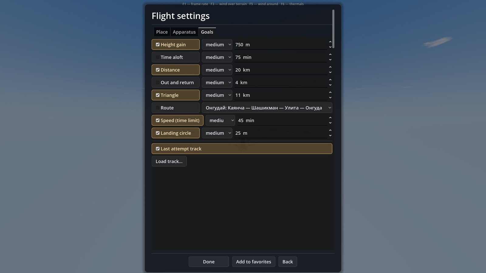
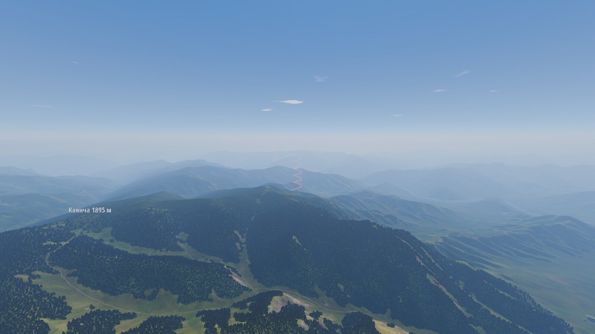

# Цели полёта и треки

Цели — необязательная надстройка над свободным полётом: перед стартом отмечаешь, что хочешь сделать, игра в полёте следит и в конце показывает итог. Очков и подсказок нет. Работает только в одиночной игре; в сети цели и треки не создаются.

## Какие бывают цели

| Цель | Что засчитывается |
|---|---|
| Набор высоты | набор над точкой взлёта держится 10 с подряд (разовый заброс в болтанке не считается) |
| Время в воздухе | время с отрыва |
| Расстояние | наибольшее расстояние от взлёта по прямой |
| Туда и обратно | точка поворота на заданном расстоянии и возврат в цилиндр у взлёта |
| Треугольник | равносторонний треугольник от взлёта с заданным периметром и возврат |
| Маршрут | готовое задание этого места: встроенное или своё, загруженное из файла `.xctsk` |
| Предел времени | пройти ведущий маршрут от старта до ESS (если нет — до гоула) не дольше заданного |
| Посадка | сесть в круг заданного радиуса и не разбиться |

Предел времени работает только вместе с маршрутом, треугольником или возвратом. Возврат и треугольник строятся от точки взлёта: первое плечо идёт против ветра (если ветер у земли от 2 м/с), иначе по курсу старта; цилиндры — радиусом 400 м. Фигура поворачивается вокруг взлёта шагом 15°, пока не поместится в зону рельефа; если не поместилась — цель недоступна. Круг посадки есть не везде: нужна посадочная площадка в локации или мишень тренировки «точность приземления»; для места, выбранного на карте, его нет.

## Уровни и числа

У каждой цели четыре уровня: лёгкая, средняя, трудная и «своя» (число правлено руками). Числа предлагает формула по погоде на час старта: сила термиков, высота облаков, ветер, часы до заката. Это порядок величины, а не прогноз: рельеф и модель воздуха в оценке не участвуют, высота старта над средним рельефом принята грубо (400 м). Уровни не подгоняются под плохую погоду: в хороший день все достижимы без облака, а в слабый или пасмурный трудные не достижимы по построению. Недоступные строки серые, без объяснений.

## Своё задание из XCTrack {#xctsk}

Рядом с выбором маршрута на вкладке «Цели» есть кнопка «Загрузить задание…»: она берёт файл `.xctsk` — задание, как его делают в XCTrack и публикуют организаторы соревнований. Файл проверяется:

1. он читается как `.xctsk` версии 1 (JSON) и в нём есть пункты;
2. все пункты лежат внутри детальной зоны выбранного места — той же, по которой проверяются чужие треки.

Годный файл копируется в папку заданий игры и сразу выбирается в списке маршрутов; негодный не принимается, под кнопкой сообщение: «не из этого места» или «не удалось прочитать». В самом файле места нет, поэтому игра показывает задание в списке тех мест, где в зону попадают все его пункты.

; загрузка задания открывается так же, но принимает `.xctsk`.")

Время в `.xctsk` — часы UTC; в игре полёт начинается за 20 минут до открытия первого старта (время взлететь и набрать высоту). Если окон старта в файле нет, создаётся одно. Границы: сжатый формат версии 2 (QR-коды `XCTSK:`) не поддерживается; редактора заданий в игре нет; очков по правилам соревнований нет — итог показывает время скоростного участка или пройденную дистанцию.

## В полёте

- **Список целей** в углу экрана: ○ ждёт, ✓ выполнено, ✗ не выполнено, — недоступно; у цели в работе показано текущее значение.
- **Планшет**: маршрут целей попадает на страницы «Карта» и «Задание», а на странице «Ветер» в углу розы — стрелка на активную точку относительно путевого курса.
- **Столбы** над пунктами маршрута (настройка «Цилиндры целей», по умолчанию выключены): полупрозрачные, от земли вверх на 2 км; активный пункт заметнее, вдали — плотнее.

 и столбы над пунктами: красный и синий — соседние точки маршрута.")
- **Итог**: «выполнено n из m», по цели строка и, если не вышло, причина («сел раньше», «мимо круга», «позже предела»…), новые рекорды: время в воздухе, дальность, высота; для маршрута — время и дальность по нему. Рекорды ведутся, только если взлёт был.

, ниже новые рекорды. Падение не отменяет записанные рекорды: взлёт был.")

## Треки

Пока ты в воздухе, игра пишет трек раз в секунду. В конце полёта, если взлёт был, он сохраняется в IGC — одна запись на место, новая заменяет прошлую.

В окне «Полёт…» можно включить **след прошлой попытки** (включается, если на этом месте есть запись) и **загрузить свои треки** `.igc` или `.gpx`. Файл принимается, если не меньше половины его точек попадает в зону этого места; иначе окно говорит, что трек чужой.

Трек рисуется лентой во всю длину: ширина на экране постоянна (4 пикселя) на любом расстоянии, лента полупрозрачная. Цвет — по вертикальной скорости за 5 с: подъём красный, снижение синее, около нуля лента почти не видна. Длинный трек прореживается до 2000 точек без потери формы.

## Где симулятор упрощает

- Оценка уровней по погоде — грубая формула, не прогноз; реальный день на конкретном рельефе может дать и больше, и меньше.
- «Расстояние» — по прямой от взлёта, а не соревновательная дистанция с поворотными пунктами.
- В файле IGC дата — системная дата записи, время суток условное (12:00 от начала записи), давление равно GPS-высоте, подписи `G` нет: для сравнения линии и высоты годится, для архива полётов — нет.
- След прошлой попытки — один на место, не история.

Подробный технический разбор — `docs/guide/goals.md` и контракты `docs/contracts/goals.md` в репозитории; формат `.xctsk` и правила соревнований — `docs/research/competition_rules.md`, задания — `docs/guide/tasks.md`; загрузка задания появилась в сборке 1.5.20 (`CHANGELOG.md`).
