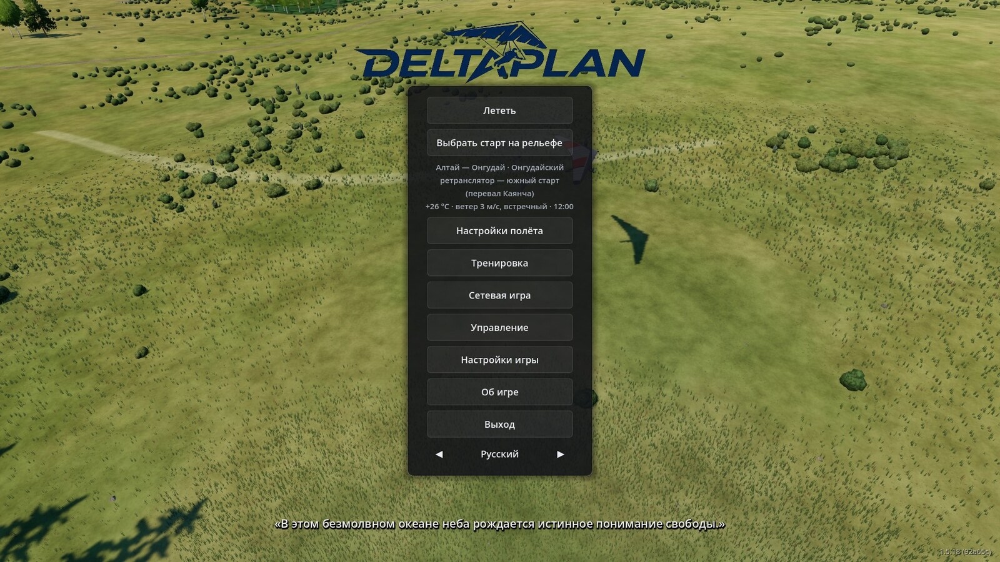
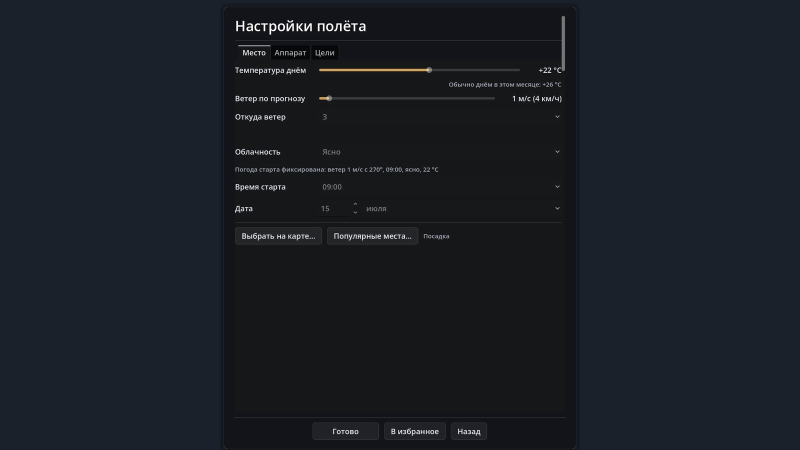

# Menu and game settings {#player-guide}

This page covers what surrounds the flight itself: the main menu, the "Flight settings" window, choosing the aircraft, mouse and keyboard controls, the pause menu and the settings tabs. Buttons and items are named as they are labelled in the game.

## Main menu {#player-guide-menu}

The buttons, top to bottom:

- **Fly** — a flight with the current choice; the "Start" window opens first ([below](#player-guide-start)). The "Flight settings" window does not lead into a flight: it only remembers the choice.
- **Pick launch on terrain** — look over the terrain with a free camera and choose the exact launch spot.
- Under it is the line with the current choice: place, temperature, wind and hour, for example "+26 °C · wind 3 m/s, headwind · 12:00". If the sky is not clear, its state is added at the end.
- **Flight settings** — a window with the tabs "Place", "Apparatus" and "Goals" (below).
- **Training** — cards with ready-made starts and a goal, see [the Training window](/docs/training/#training-window).
- **Multiplayer**, **Controls** (the list of keys), **Game settings** (below), **About**, **Quit**.
- At the bottom — the language switch (Russian and English); in the corner — the build version.

A **"Favorites"** list appears to the left of the column when it has anything in it. Behind the menu a slideshow of game frames runs; in the background a quiet mountain wind blows, and now and then there is the distant cry of a bird of prey. When a flight starts, the sound fades out smoothly. This is atmosphere only and does not affect the flight.

On a small window (for example 1024×600) the column of buttons scrolls with the mouse wheel, so "Quit" does not fall off the screen.

In the bottom left corner of the menu a line "Crash report sent" or "Safe graphics: the last run crashed" with a "Restore settings" button may appear — see [the crash report](#player-guide-crash-report).

## The "Flight settings" window {#player-guide-flight-settings}

"Flight settings" is only a choice of conditions. "Done" saves it and returns to the menu, "Back" closes the window without changes; you then fly with the "Fly" button. The window scrolls and the bottom buttons are always visible. There are three tabs (in a network zone there is no "Goals" tab):

- **Place.** "Daytime high" (the typical one for the month and place beside it), "Forecast wind" (in m/s and km/h), "Wind from" (including "Headwind" — against the launch direction), "Cloud cover" ("Clear", "Partly", "Overcast"), "Start time" and "Date". The place is set with "Pick on map…", "Popular places…" or the "Recent places" list at the bottom — its entries can be renamed, pinned and removed.
- **Apparatus.** "Wing class" (the class name shows the range of glide ratio and wind limit), "Model", a line of wing data (glide ratio, wind, area, pilot weight, era, kingpost or topless), "Pilot weight" within the limits of this wing, and four sliders for the hang and the sail: "Hang point along keel", "Hang strap length", "Sail flexibility", "Effective dihedral". The slider values are stored separately for each wing.
- **Goals.** The set of flight goals, a route, loading a task and a track — on the page [Flight goals and tracks](/docs/goals/).

Some starts have fixed weather (this is how the "Training" cards work): the weather and time fields are then unavailable, and the line under them says what the weather is.

### Popular places {#player-guide-popular}

The "Popular places…" window is a catalogue of hang-gliding launches: countries first (with the number of places), then the country's places with height and wind, with a search by name on top. The catalogue has 702 entries: 698 in 24 countries and four more that are the Training Island starts (they show "Country not specified"). The data of the outside entries is OpenStreetMap. Choosing a place sets the launch point by coordinates, like picking on the map. Sixteen entries are the game's built-in places (Altai, Bashkiria, Wilotree Park and the Training Island): for them a prepared start with the exact run direction is loaded. If the catalogue file is missing, the button is not in the game.

The honest limits: the catalogue is coordinates and OSM data, not verified descriptions of sites. Where you can actually fly is for a local club to say, not the game.

### Favorites {#player-guide-favorites}

The **"Add to favorites"** button at the bottom of the window remembers the whole set of conditions: place, hour, wind, cloudiness, wing. In the main menu they appear on the left as a list with a name such as "Ongudai, 13:00, 3 m/s NW, Sport". A click on a row starts a flight with those conditions at once (the "Start" window is not shown), × removes it. The list holds at most 8 rows: the ninth pushes out the oldest; identical conditions are not duplicated.

## Start: hang glider, towing, trike {#player-guide-start}

"Fly" opens the "Start" window. In it:

- **Tow (hang glider)** — "None", "Winch" or "Aerotow (trike)". The kinds depend on the site: a built-in site with towing offers its own kinds, a point picked on the map offers all of them. The default is the site's first kind, and "None" where there is no towing.
- The buttons **"Hang glider"** (start with the chosen kind of towing), **"Trike"** and "Cancel".

The window is not shown in multiplayer (there it is always a hang glider without towing), when starting from "Favorites" and in "Training". On a winch tow the **B** key releases the cable.

### The player's trike {#player-guide-trike}

How it works, the numbers and the model limits are on the page [Trike and towing](/mechanics/trike/).

The trike is a powered cart with an Air Creation iXess 15 wing; the wing cannot be chosen. It is put on its wheels at the launch point of the chosen place with the engine off and a full tank (53 l). The game does not check the terrain under the wheels: on a steep slope the cart simply rolls away. Single player only.

| Action | Key |
|---|---|
| Throttle up / down | W / S (both together — zero) |
| Start or stop the engine | Space |
| Nose-wheel steering | A / D (on the ground only) |
| Wheel brake | Shift (on the ground only; in the air Shift is "pull in" to the hips) |
| Wing pitch and roll | mouse or stick, as on the hang glider |
| Look around | mouse with the right button (W/S are taken by the throttle) |

The other keys (X, C, V, Q, Tab, 1–5, R, Esc, M, F12) are as on the hang glider; there is no walking or running, the pilot sits. The panel has two gauges: a tachometer (green arc 2000–6500 engine rpm, red line 6800) and a fuel gauge 0–53 l. The engine starts in 3 s and stops in 4 s; an empty tank stops the engine and then you glide. Consumption runs from 2 l/h at idle to 26.5 l/h at full power (an estimate from the Rotax 582 manual, not a measurement).

In the air the cart is drawn in exactly the position the physics computes: no lag in a turn and no twisting under the wing. The front strut stops the bar on push-out (about 55 km/h at zero throttle), and pull-in travel is 0.178 m, to the pilot's chest. Pitch on pull-in stays rather heavy, roll is quick. Grass up to 25 m behind the propeller lies down in its wash while thrust is at least 100 N and the propeller is below 5 m above the ground. Numbers and sources are on the page [Trike and towing](/mechanics/trike/).

Model limits: propeller thrust and consumption are calculated, not measured; fuel burn does not change the mass in flight; a hard landing on the wheels is not counted as a crash (the wing or keel touching the ground is a crash, as on a hang glider); "Fly again" (R) puts you back on the wheels.

## Mouse and keys {#player-guide-controls}

The full list of keys is on the "Controls" screen (main menu and pause); it reads the bindings from `configs/controls.json`, so it shows what is actually in effect. The main ones for the hang glider:

| Action | How |
|---|---|
| Wing pitch and roll | the mouse is the control bar: forward-back — pitch, sideways — roll; the mouse is captured from the start of the flight, **M** releases and re-captures it (a released mouse does not move the wing) |
| Stand in the centre of the bar | **X**: the accumulated mouse position is zeroed, the wing levels and flies straight |
| Pull in to the hips | hold **Shift** in flight; release — the bar eases back to the chest; beyond the normal limit the hang indicator turns red |
| Run | hold **Shift** on the ground (W is not needed) |
| Step forward / back, turn on the spot | **W** / **S**, **A** / **D** on the ground; while running W/S/A/D do nothing |
| Look around | in flight W/A/S/D (up/left/down/right) or the right mouse button — the bar stays where it is; **V** or the middle button — look forward |
| Glance at the instruments | hold **Q** (cockpit view only) |
| Camera | **C**: cockpit → behind → free |
| Instrument pages | **Tab** — next, **1**–**5** — straight to the one you want |
| Pause and menu | **Esc** |
| Start over | **R** |
| Screenshot | **F12** |
| Multiplayer | **=** — the "Catch up" menu |

A gamepad (stick) replaces the mouse; it is set up in "Game settings → Controls → Control bar / joystick" ([below](#player-guide-settings)).

**Mouse travel.** The bar position is the accumulated mouse movement. The full travel to the stop is 4000 mouse counts at a "Bar sensitivity" multiplier of 1.00×; that is about 12.7 cm at 800 DPI (4000 / 315 counts per cm). The multiplier slider runs from 0.1× to 4×. The "≈ N cm (800 DPI)" label beside it is shown only where the mouse gives raw counts (Windows, X11); on Wayland and macOS the system's mouse acceleration makes the travel indefinite, and the game asks you to turn it off in the OS settings.

**Roll by mouse.** In "Game settings → Controls → Roll by mouse" there are two options: "Like the body (right — roll right)" (the default) and "Like the bar (right — roll left)".

## During a flight {#player-guide-in-flight}

- **Start hint.** While the pilot stands on the launch, a translucent list of keys is visible: the keyboard on the left, the mouse on the right. The first step forward (W) removes it.
- **The camera** (cockpit or "behind") is remembered: the next flight starts with it.
- **F12** — a screenshot into the "Pictures/Deltaplan" folder (if the system has no such folder, into the game's screenshots folder); the path is shown on screen for 2 s. The free camera's keys are on the "Controls" screen.
- **After a landing or a crash** any key opens the result at once, R starts a new flight. The wing control keys (W/S/A/D, arrows, Shift) do not skip the result. In the air R works after being held for about a second, with a visible hold progress.

### Pause: "Wait an hour" and "Look around" {#player-guide-pause}

Esc opens the pause menu: "Continue", "Wait an hour" (not always), "Look around", "Restart", "Controls", "Game settings", "Main menu", "Quit". In a network zone the zone code, the list of pilots and "Leave zone" are added.

- **Look around** — a free camera with the world stopped. Esc returns to the pause menu with the camera mode as before; "Continue" returns to the flight from the same spot.
- **Wait an hour** — the item exists only in single player, while the pilot stands on the launch and is not on a tow. World time runs 60 times faster (an hour passes in a minute of real time), the pilot and the controls stand still; any key, mouse button or gamepad button interrupts the wait. The wait also ends at the end of the game day. It is for when you are waiting on the launch for the thermals to get going or the weather to change.

The honest part: "Wait an hour" does not speed up the game as a whole, it only skips time on the ground; in multiplayer and in flight the item is not there.

## Game settings {#player-guide-settings}

They open from the main menu and from the pause menu. There are five tabs; "Save" and "Cancel" are at the bottom. Settings are kept in the user profile, and only changed values are written.

| Tab | What is in it |
|---|---|
| **Game** | language, pilot name (empty — the Steam nickname), "Wind cache on disk" (0–2000 MB, 200 by default), "Time speed" (×1, ×10, ×60, "frozen"; no such row in a network zone), "Other pilots in the sky" (0–20, from the next flight), "Pilot names", "Peak labels", "Pilot shift", "Clock", "Goal cylinders", "Compass" |
| **Graphics and view** | "Graphics" (preset), "Render scale", "Grass density", "Haze toward the sun", "Field of view", "Cockpit camera", "Helmet"; vertical sync, frame rate limit, window mode and resolution, "Graphics driver"; effect switches |
| **Controls** | "Mouse look", "Bar sensitivity", "Invert pitch", "Roll by mouse", the "Control bar / joystick" section |
| **Sound** | "Vario volume", "Vario sound" ("Classic, 1990s" or "XC Tracer (modern)") |
| **Motion platform** | "Motion output" to a motion platform over UDP: address, rate, format (SRS or Generic), ease-in, sign inversion |

Some settings are machine settings (graphics, window): they are tied to the computer and do not go to the Steam cloud.

Notes on the rows. "Pilot shift" is a circle at the bottom of the screen; the dot in it shows where the pilot is shifted relative to the bar (forward — up, back — down, sideways — horizontal; the edge of the circle is the travel limit). "Cockpit camera" is "Seated pose" or "Prone pose". "Helmet" is "No helmet", "Open face", "With visor" or "With dark visor". "Mouse look" is degrees per pixel (0.02–0.5; 0.12 by default) for looking around with the right button. "Control bar / joystick": device, roll and pitch axes, inversions, deadzone, expo, "Set neutral", "Record range" (calibration), "Reset".

### Graphics: presets, VSync, frame rate limit {#player-guide-graphics}

The three presets change many parameters at once: the range of tree models, the number of clouds, shadows, anti-aliasing, grass density.

| | Low (light) | Medium | High (full) |
|---|---|---|---|
| Clouds, at most | 90 | 160 | 220 |
| 3D tree models up to | 250 m | 400 m | 500 m |
| Sun shadows up to | 1200 m | 2000 m | 3000 m |
| Grass density | 0 % (off) | 100 % | 150 % |
| 3D resolution | 75 % (FSR 1) | 100 % | 100 % |
| Anti-aliasing (MSAA) | none | 2× | 2× |

The "Render scale" (50–100 %; the "From preset" box removes the override) and "Grass density" sliders override the preset.

- **First launch.** If no preset has been chosen yet and the graphics card is integrated or software (or its name contains Intel, UHD, Iris, Vega, Radeon Graphics, Mali, Adreno, Apple, llvmpipe, SwiftShader), the game switches on "Low" itself. On the rest nothing is chosen; the preset can be changed at any time. The automatic choice relies on the card's name and type, not on a speed measurement, so on strong integrated graphics "Low" may be unnecessary — then raise the preset yourself.
- **VSync** is on by default (frames follow the monitor's refresh rate).
- **Frame rate limit** — 30, 60, 120, 144 or "Unlimited"; 144 by default. Without VSync and without a limit the graphics card runs at 100 %, which is what the limit is for.
- **Window mode** — windowed or fullscreen; **window resolution** — whatever fits the monitor from the list 1280×720 … 3840×2160, or "As is". It applies at once on saving.
- **Graphics driver** — the choice exists only on Windows ("Auto", Vulkan, DirectX 12) and macOS ("Auto", Metal, Vulkan); on Linux there is no such item. A change takes effect after a restart, and a "Restart game" button appears next to it.
- **Effect switches** — "Sun shadows", "Cloud shadows on the ground", "Glow of bright areas" and the box "Simple clouds (no compute shaders)". If the game crashes or the graphics card hangs, switch them off one at a time; changes take effect from the next place load.

## Crash report {#player-guide-crash-report}

If the game broke off, at the next launch it sends a report to the developer by itself; in the menu an unobtrusive line "Crash report sent" points to it. The report holds: the game version, the operating system, the graphics card and driver, the processor, memory, the settings and the tail of the previous run's log. The user's paths in it are replaced with `~`; the length is limited to 60,000 characters.

Limits: the report goes only from a built game with a window and only when there is a network (up to 3 attempts across all launches); on a normal exit ("Quit", closing the window) the session mark is erased and nothing is sent. If the game was open in two windows, that is not counted as a crash. In a build without a sending key the feature is off.

After a break-off the game may show the "Graphics card not responding" window with the options "Switch to … and restart" (Windows and macOS only), "Safe graphics (no heavy effects)" and "Try again". "Safe graphics" turns the effect switches off and turns simple clouds on; the menu keeps the note "Safe graphics: the last run crashed" and a "Restore settings" button.

## More {#player-guide-more}

A description of the screens and settings layers — `docs/guide/game/menus-settings.md`, reports — `docs/guide/crash-report.md`, the trike — `docs/guide/flight/trike-pilot.md`; changes by build — `CHANGELOG.md`. The catalogue of popular places — `docs/contracts/popular-places.md`. Training — [the Training window](/docs/training/), goals — [Flight goals and tracks](/docs/goals/).
