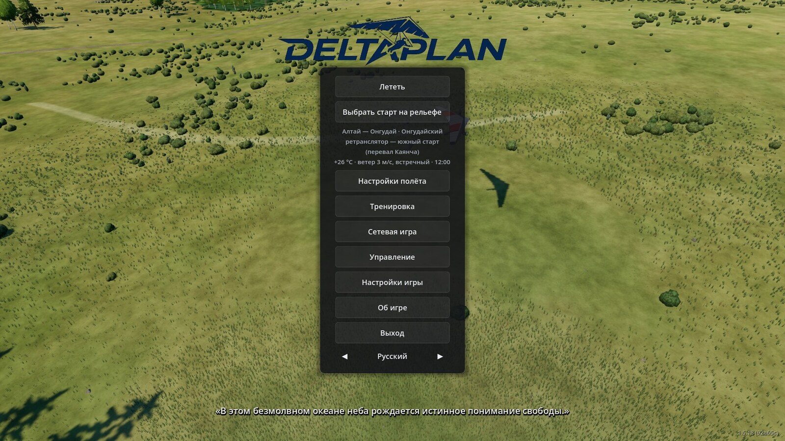
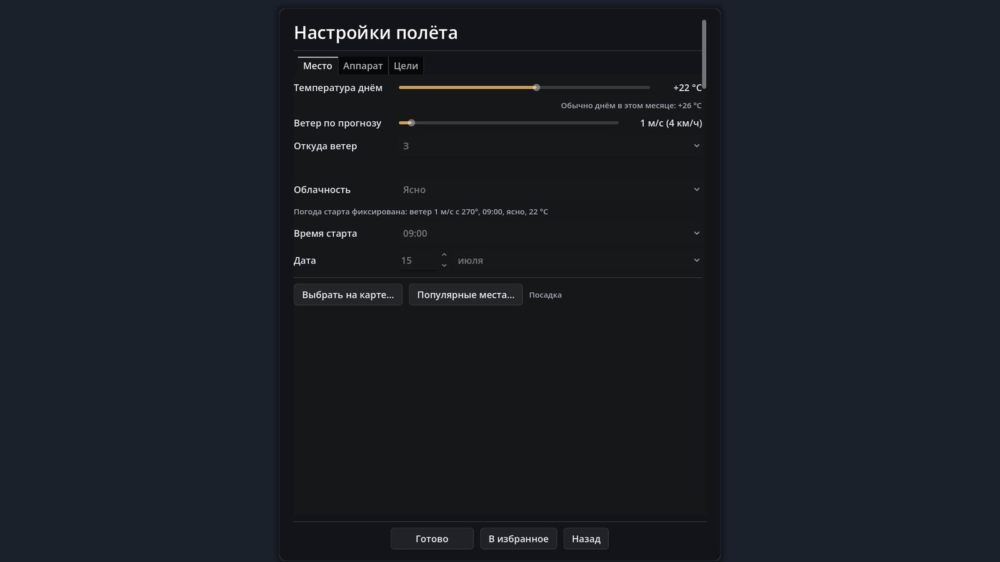

# Menu and game settings {#player-guide}

This page covers what surrounds the flight itself: the main menu, the "Flight settings" window, favorites, the pause menu, the settings tabs and graphics. Buttons are named as they are labelled in the game.

## Main menu {#player-guide-menu}

The buttons, top to bottom:

- **Fly** — a flight with the current choice. It is the only way into a flight from the "Flight settings" window: that window only remembers the choice.
- **Pick launch on terrain** — look over the terrain and choose the exact launch spot.
- Under it is the line with the current choice: place, temperature, wind and hour, for example "+26 °C · wind 3 m/s, headwind · 12:00". If the sky is not clear, its state is added at the end.
- **Flight settings** — a window with the tabs "Place", "Apparatus" and "Goals" (below).
- **Training** — cards with ready-made starts and a goal, see [the Training window](/docs/training/#training-window).
- **Multiplayer**, **Controls**, **Game settings** (below), **About**, **Quit**.
- At the bottom — the language switch (Russian and English).

A **"Favorites"** list appears to the left of the column when it has anything in it. Behind the menu a slideshow of game frames runs; in the background a quiet mountain wind blows, and every 20–60 s there is the distant cry of an eagle, kite or buzzard. When a flight starts, the sound fades out smoothly. This is atmosphere only and does not affect the flight.

On a small window (for example 1024×600) the column of buttons scrolls with the mouse wheel, so "Quit" does not fall off the screen.

## The "Flight settings" window {#player-guide-flight-settings}

"Flight settings" is only a choice of conditions. "Done" saves it and returns to the menu, "Back" closes the window without changes; you then fly with the "Fly" button. The window scrolls and the bottom buttons are always visible. There are three tabs:

- **Place.** Daytime temperature (the typical one for the month beside it), forecast wind and where it comes from (including "headwind"), cloudiness, start time and date. The place is set with "Pick on map…" (then "Pick this point"), "Popular places…" or the "Recent places" list at the bottom — its entries can be renamed, pinned and removed.
- **Apparatus.** Wing class, model, wing data (area, glide ratio, wind limit), pilot weight and apparatus parameters. These parameters act on "Pendulum", the player's only physics.
- **Goals.** The set of flight goals, a route, loading a task and a track — on the page [Flight goals and tracks](/docs/goals/).

Some starts have fixed weather (this is how the "Training" cards work): then the line under the fields says what it is, and the weather fields do not change it.

### Popular places {#player-guide-popular}

The "Popular places…" window is a catalogue of 696 hang-gliding launches from OpenStreetMap in 24 countries: countries first, then the country's places with launch height and wind, with a search by name on top. Choosing a place sets the launch point by coordinates, like picking on the map. Ten places in the catalogue are the game's built-in places: for them a prepared start with the exact run direction is loaded. If the catalogue file is missing, the button is not in the game.

The honest limits: the catalogue is coordinates and OSM data, not verified descriptions of sites. Where you can actually fly is for a local club to say, not the game.

### Favorites {#player-guide-favorites}

The **"Add to favorites"** button at the bottom of the window remembers the whole set of conditions: place, hour, wind, cloudiness, wing. In the main menu they appear on the left as a list with a name such as "Ongudai, 13:00, 3 m/s NW, Sport". A click on a row starts a flight with those conditions at once, × removes it. The list holds at most 8 rows: the ninth pushes out the oldest; identical conditions are not duplicated.

## During the flight {#player-guide-in-flight}

- **Start hint.** While the pilot stands at the launch, a semi-transparent list of keys is shown: the keyboard on the left, the mouse on the right, the centre free. The first step forward (W) removes it.
- **The camera** (cockpit or "from behind") is remembered: the next flight starts with it.
- **F12** — a screenshot to the "Pictures/Deltaplan" folder (if the system has no such folder, to the game's screenshot folder); the path is shown on screen for 2 s. The free-camera keys are on the "Controls" screen.
- **After a landing or a crash** any key opens the result at once, R starts a new flight. The wing-control keys (W/S/A/D, arrows, Shift) do not skip the result. In the air R works after a hold of about a second, with a visible progress of the hold.

### Pause: "Wait an hour" and "Look around" {#player-guide-pause}

Esc opens the pause menu: "Continue", "Wait an hour" (not always), "Look around", "Restart", "Controls", "Game settings", "Main menu", "Quit". In a network zone the zone code and the list of pilots are added.

- **Look around** — a free camera with the world stopped. Esc returns to the pause menu, the camera mode stays as it was; "Continue" returns to the flight from the same place.
- **Wait an hour** — the item exists only in single-player, while the pilot stands at the launch. World time runs 60 times faster (an hour passes in a minute of real time), the pilot and controls stand still; any key, mouse button or gamepad button interrupts the wait. The wait also ends at the end of the game day. It is for when you wait at the launch for the thermals to get going or the wind to change: the sun, thermals, clouds and the wind field follow their usual schedule. During wind recalculations the picture freezes for a few seconds.

The honest limit: "Wait an hour" does not speed up the game as a whole, it only skips time on the ground; in network play and in flight the item is not there.

## Game settings {#player-guide-settings}

Opened from the main menu and from the pause menu. There are five tabs; "Save" and "Cancel" are at the bottom. Settings are stored in the user profile, and only the changed values are written.

| Tab | What is inside |
|---|---|
| **Game** | language, pilot name (empty — Steam nickname), wind model ("GPU solver (terrain flow)" or "Heuristic (wind profile without terrain)"), wind cache on disk (0–2000 MB, 200 by default), time speed, number of other pilots in the sky (0–20, from the next flight), pilot names, peak labels, pilot shift indicator, clock, goal cylinders, compass |
| **Graphics and view** | graphics preset, render scale, grass density, haze toward the sun, field of view, cockpit camera, helmet; VSync, frame rate limit, window mode and resolution |
| **Controls** | mouse sensitivity, invert pitch, roll by mouse ("like the bar" or "like the body"), the "Control bar / joystick" section |
| **Sound** | vario volume and vario sound (preset) |
| **Motion platform** | motion output to a motion platform |

Some settings are machine-specific (graphics, window): they are tied to the computer and do not go to Steam Cloud.

### Graphics: presets, VSync, frame rate limit {#player-guide-graphics}

The three presets change many parameters at once: tree model distance, number of clouds, shadows, anti-aliasing, grass density.

| | Low (light) | Medium | High (full) |
|---|---|---|---|
| Clouds, at most | 90 | 160 | 220 |
| 3D tree models up to | 250 m | 400 m | 500 m |
| Sun shadows up to | 1200 m | 2000 m | 3000 m |
| Grass density | 0 % (off) | 100 % | 150 % |
| 3D resolution | 75 % (FSR 1) | 100 % | 100 % |
| Anti-aliasing (MSAA) | none | 2× | 2× |

The "Render scale" and "Grass density" sliders override the preset.

- **First launch.** If no preset has been chosen yet and the graphics card is integrated or software (or its name contains Intel, UHD, Iris, Vega, Radeon Graphics, Mali, Adreno, Apple, llvmpipe or SwiftShader), the game turns on "Low" by itself. On anything else nothing is chosen; the preset can be changed at any time. The automatic choice relies on the card's name and type, not on a speed measurement, so on a strong integrated GPU "Low" may be more than needed — then raise the preset yourself.
- **VSync** is on by default (frames follow the monitor refresh).
- **Frame rate limit** — 30, 60, 120, 144 or "Unlimited"; 144 by default. Without VSync and without a limit the video card runs at 100 %; that is what the limit is for.
- **Window mode** — windowed or fullscreen; **window resolution** — from what fits the monitor, or "As is". It is applied right when saving.

### Game size {#player-guide-size}

Textures are stored compressed, and the built-in places (Altai, Ongudai, Askarovo, Aushkul) are downloaded on first choice rather than shipped in the build. In build 1.5.1 the archive became ~90 MB instead of 168 MB (textures in WebP); in 1.5.13 the game data shrank from 212 to 86 MB (Basis Universal), and the Linux build from ~285 to ~155 MB. These are numbers from the release notes; check the download page for the size of the current build.

## Crash report {#player-guide-crash-report}

If the game was cut off, at the next launch it sends a report to the developer by itself; in the menu this is shown by an inconspicuous line "Crash report sent". The report contains: the game version, the operating system, the video card and driver, the processor, memory, settings and the tail of the previous run's log. User paths in it are replaced with `~`; its length is limited to 60,000 characters.

Limits: the report is sent only from a built game with a window and only when there is a network (up to 3 attempts across all launches); on a normal exit ("Quit", closing the window) the session mark is deleted and nothing is sent. If the game was open in two windows, that does not count as a crash. In a build without a sending key the function is off.

## More {#player-guide-more}

Descriptions of the screens and settings layers — `docs/guide/game/menus-settings.md`, reports — `docs/guide/crash-report.md`; builds 1.3.3, 1.5.1, 1.5.10, 1.5.12, 1.5.13 and 1.5.15 — `CHANGELOG.md`. The places catalogue — `docs/contracts/popular-places.md`. Training — [the Training window](/docs/training/), goals — [Flight goals and tracks](/docs/goals/).
