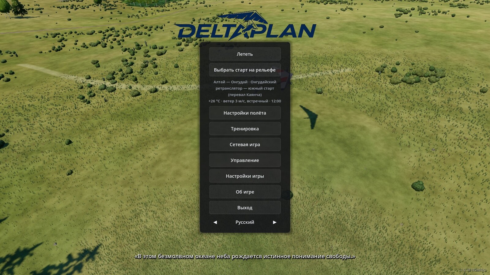
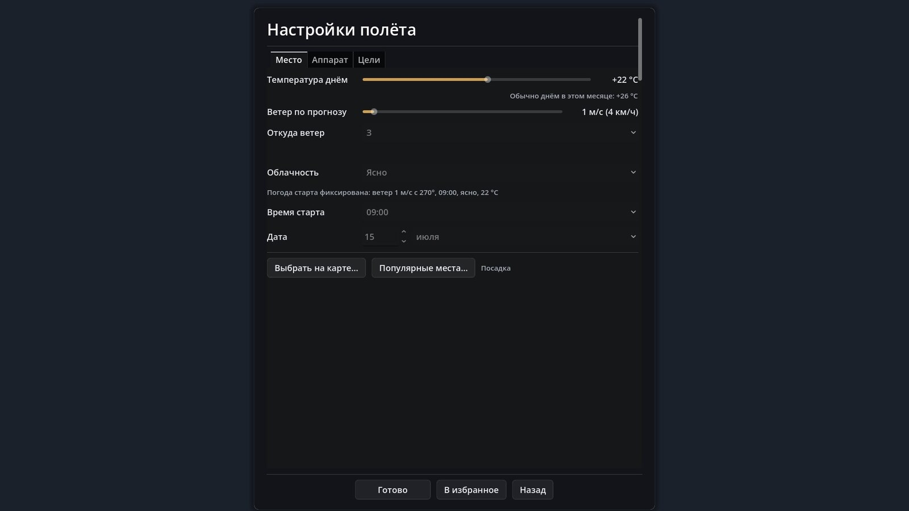

# Меню и настройки игры {#player-guide}

Страница про то, что находится вокруг самого полёта: главное меню, окно «Настройки полёта», выбор аппарата, управление мышью и клавишами, пауза и вкладки настроек. Кнопки и пункты названы так, как они подписаны в игре.

## Главное меню {#player-guide-menu}

Кнопки сверху вниз:

- **Лететь** — полёт с текущим выбором; сначала открывается окно «Старт» ([ниже](#player-guide-start)). Само окно «Настройки полёта» в полёт не ведёт: оно только запоминает выбор.
- **Выбрать старт на рельефе** — осмотр рельефа со свободной камерой и выбор точного места старта.
- Под ней — строка текущего выбора: место, температура, ветер и час, например «+26 °C · ветер 3 м/с, встречный · 12:00». Если небо не ясное, в конец добавляется его состояние.
- **Настройки полёта** — окно с вкладками «Место», «Аппарат», «Цели» (ниже).
- **Тренировка** — карточки готовых стартов с целью, см. [окно «Тренировка»](/docs/training/#training-window).
- **Сетевая игра**, **Управление** (список клавиш), **Настройки игры** (ниже), **Об игре**, **Выход**.
- Внизу — переключатель языка (русский и английский); в углу — версия сборки.

Слева от колонки появляется список **«Избранное»**, когда в нём что-то есть. Сзади меню идёт показ кадров игры; на заднем плане тихо шумит горный ветер, изредка слышен далёкий крик хищной птицы. Когда начинается полёт, звук плавно затихает. Это только атмосфера, на полёт она не влияет.

Если окно маленькое (например 1024×600), колонка кнопок прокручивается колесом мыши, и «Выход» не уходит за экран.

В левом нижнем углу меню может появиться строка «Отчёт о вылете отправлен» или «Безопасная графика: прошлый запуск оборвался» с кнопкой «Вернуть настройки» — о них в разделе [«Отчёт о вылете»](#player-guide-crash-report).

## Окно «Настройки полёта» {#player-guide-flight-settings}

«Настройки полёта» — только выбор условий. «Готово» сохраняет его и возвращает в меню, «Назад» закрывает окно без изменений; лететь потом нужно кнопкой «Лететь». Окно прокручивается, кнопки внизу всегда видны. Вкладок три (в сетевой зоне вкладки «Цели» нет):

- **Место.** «Температура днём» (рядом — типичная для месяца и места), «Ветер по прогнозу» (в м/с и км/ч), «Откуда ветер» (в том числе «Встречный» — против направления старта), «Облачность» («Ясно», «Переменная», «Облачно»), «Время старта» и «Дата». Место задают так: «Выбрать на карте…», «Популярные места…» или список «Недавние места» внизу — их можно переименовать, закрепить и убрать.
- **Аппарат.** «Класс крыла» (в названии класса — диапазон качества и допустимого ветра), «Модель», строка сведений о крыле (качество, ветер, площадь, масса пилота, год, мачтовое или безмачтовое), «Масса пилота» в пределах, допустимых для этого крыла, и четыре ползунка параметров подвески и паруса: «Подвеска вдоль киля», «Длина подвески», «Гибкость паруса», «Поперечное V». Значения ползунков хранятся отдельно для каждого крыла.
- **Цели.** Набор целей полёта, маршрут, загрузка задания и трека — на странице [«Цели полёта и треки»](/docs/goals/).

У некоторых стартов погода фиксирована (так устроены карточки «Тренировки»): поля погоды и времени тогда недоступны, а строка под ними пишет, какая именно погода задана.

### Популярные места {#player-guide-popular}

Окно «Популярные места…» — каталог стартов дельтаплана: сначала страны (с числом мест), потом места страны с высотой и ветром, сверху поиск по названию. В каталоге 702 записи: 698 — в 24 странах, ещё четыре — старты учебного острова (у них «Страна не указана»). Данные внешних записей — OpenStreetMap. Выбор места задаёт точку старта по координатам, как с карты. Шестнадцать записей — встроенные места игры (Алтай, Башкирия, Wilotree Park и учебный остров): для них загружается заготовленный старт с точным направлением разбега. Если файла каталога нет, кнопки в игре нет.

Честно о границах: каталог — это координаты и данные OSM, а не проверенные описания площадок. Куда на самом деле можно лететь, решает местный клуб, а не игра.

### Избранное {#player-guide-favorites}

Кнопка **«В избранное»** внизу окна запоминает условия целиком: место, час, ветер, облачность, крыло. В главном меню слева они появляются списком с названием вроде «Онгудай, 13:00, 3 м/с СЗ, Sport». Щелчок по строке — сразу полёт с этими условиями (окно «Старт» при этом не показывается), × — удалить. В списке не больше 8 строк: девятое вытесняет самое старое; одинаковые условия не дублируются.

## Старт: дельтаплан, буксировка, дельталёт {#player-guide-start}

«Лететь» открывает окно «Старт». В нём:

- **Буксировка (дельтаплан)** — «Нет», «Лебёдка» или «Аэробуксировка (дельталёт)». Виды зависят от площадки: у встроенной площадки с буксировкой предлагаются её виды, у точки с карты — все. По умолчанию — первый вид площадки, а там, где буксировки нет, — «Нет».
- Кнопки **«Дельтаплан»** (старт с выбранным видом буксировки), **«Дельталёт»** и «Отмена».

Окна нет в сетевой игре (там всегда дельтаплан без буксировки), при старте из «Избранного» и в «Тренировке». При буксировке на лебёдке клавиша **B** снимает трос.

### Дельталёт игрока {#player-guide-trike}

Дельталёт — моторная тележка с крылом Air Creation iXess 15; крыло выбрать нельзя. Он ставится на колёса в точке старта выбранного места, двигатель заглушен, бак полный (53 л). Рельеф под колёсами игра не проверяет: на крутом склоне тележка просто покатится. Только одиночная игра.

| Действие | Клавиша |
|---|---|
| Газ: прибавить / убавить | W / S (обе вместе — ноль) |
| Завести или заглушить двигатель | Пробел |
| Руление носовым колесом | A / D (только на земле) |
| Тормоз колёс | Shift (только на земле; в воздухе Shift — «на себя» до бёдер) |
| Нос и крен крыла | мышь или стик, как у дельтаплана |
| Осмотреться | мышь с правой кнопкой (W/S заняты газом) |

Остальные клавиши (X, C, V, Q, Tab, 1–5, R, Esc, M, F12) — как у дельтаплана; шага и бега нет, пилот сидит. На приборной панели два прибора: тахометр (зелёная дуга 2000–6500 об/мин двигателя, красная черта 6800) и топливомер 0–53 л. Двигатель запускается за 3 с, останавливается за 4 с; пустой бак глушит двигатель, и дальше идёт планирование. Расход — от 2 л/ч на холостых до 26,5 л/ч на полной мощности (оценка по руководству Rotax 582, не замер).

Границы модели: тяга винта и расход рассчитаны, а не измерены; расход топлива не меняет массу в полёте; удар шасси при жёсткой посадке на колёса не считается аварией (крыло или киль о землю — авария, как у дельтаплана); «Ещё раз» (R) возвращает на колёса.

## Мышь и клавиши {#player-guide-controls}

Полный список клавиш — на экране «Управление» (главное меню и пауза); он читает привязки из `configs/controls.json`, так что показывает то, что действует в игре. Основное для дельтаплана:

| Действие | Как |
|---|---|
| Нос и крен крыла | мышь — это трапеция: вперёд-назад — нос, вбок — крен; мышь захвачена с начала полёта, **M** отпускает и снова захватывает её (отпущенная мышь крыло не двигает) |
| Встать в центр трапеции | **X**: накопленное положение мыши обнуляется, крыло выравнивается и летит прямо |
| Добор «на себя» до бёдер | держать **Shift** в полёте; отпустил — штанга плавно к груди; за обычным пределом индикатор подвески красный |
| Разбег | держать **Shift** на земле (W не нужен) |
| Шаг вперёд / назад, поворот на месте | **W** / **S**, **A** / **D** на земле; на бегу W/S/A/D не действуют |
| Осмотреться | в полёте W/A/S/D (вверх/влево/вниз/вправо) или правая кнопка мыши — трапеция при этом стоит на месте; **V** или средняя кнопка — взгляд вперёд |
| Посмотреть на приборы | держать **Q** (только из кабины) |
| Камера | **C**: кабина → сзади → свободная |
| Страницы прибора | **Tab** — следующая, **1**–**5** — сразу нужная |
| Пауза и меню | **Esc** |
| Начать заново | **R** |
| Снимок экрана | **F12** |
| Сетевая игра | **=** — меню «Догнать» |

Геймпад (стик) заменяет мышь; настраивается в «Настройки игры → Управление → Трапеция / джойстик» ([ниже](#player-guide-settings)).

**Ход мыши.** Положение трапеции — накопленное движение мыши. Полный ход до упора равен 4000 отсчётов мыши при множителе «Чувствительность штанги» 1,00×; это примерно 12,7 см при 800 DPI (4000 / 315 отсчётов на см). Слайдер множителя — от 0,1× до 4×. Подпись «≈ N см (800 DPI)» рядом показывается только там, где мышь даёт сырые отсчёты (Windows, X11); на Wayland и macOS ускорение мыши в системе делает ход неопределённым, и игра просит выключить его в настройках ОС.

**Крен мышью.** В «Настройки игры → Управление → Крен мышью» два варианта: «Как тело (вправо — крен вправо)» (по умолчанию) и «Как штанга (вправо — крен влево)».

## Во время полёта {#player-guide-in-flight}

- **Подсказка на старте.** Пока пилот стоит на старте, виден полупрозрачный список клавиш: слева клавиатура, справа мышь. Первый шаг вперёд (W) её убирает.
- **Камера** (кабина или «сзади») запоминается: следующий полёт начинается с неё.
- **F12** — снимок экрана в папку «Изображения/Deltaplan» (если у системы нет такой папки — в папку снимков игры); путь на 2 с показывается на экране. Клавиши свободной камеры — на экране «Управление».
- **После посадки или падения** любая клавиша открывает итог сразу, R — новый полёт. Клавиши управления крылом (W/S/A/D, стрелки, Shift) итог не пропускают. В воздухе R срабатывает после удержания, около секунды, с видимым ходом удержания.

### Пауза: «Подождать час» и «Осмотреться» {#player-guide-pause}

Esc открывает паузу: «Продолжить», «Подождать час» (не всегда), «Осмотреться», «Заново», «Управление», «Настройки игры», «В меню», «Выход». В сетевой зоне добавляются код зоны, список пилотов и «Выйти из зоны».

- **Осмотреться** — свободная камера при остановленном мире. Esc возвращает в меню паузы, режим камеры прежний; «Продолжить» возвращает в полёт с того же места.
- **Подождать час** — пункт есть только в одиночной игре, пока пилот стоит на старте и не на буксире. Время мира идёт в 60 раз быстрее (час проходит за минуту реального времени), пилот и управление стоят; любая клавиша, кнопка мыши или геймпада прерывает ожидание. Ожидание заканчивается и в конце игрового дня. Нужно, если на старте ждёшь, пока разгуляются термики или переменится погода.

Честно: «Подождать час» не ускоряет игру в целом, а только пропускает время на земле; в сетевой игре и в полёте пункта нет.

## Настройки игры {#player-guide-settings}

Открываются из главного меню и из паузы. Вкладок пять; кнопки «Сохранить» и «Отмена» внизу. Настройки хранятся в профиле пользователя, и записываются только изменённые значения.

| Вкладка | Что внутри |
|---|---|
| **Игра** | язык, имя пилота (пусто — ник Steam), «Кеш ветра на диске» (0–2000 МБ, по умолчанию 200), «Скорость времени» (×1, ×10, ×60, «стоп»; в сетевой зоне строки нет), «Другие пилоты в небе» (0–20, со следующего полёта), «Имена пилотов», «Подписи вершин», «Смещение пилота», «Часы», «Цилиндры целей», «Компас» |
| **Графика и вид** | «Графика» (пресет), «Масштаб рендера», «Густота травы», «Дымка к солнцу», «Поле зрения», «Камера в кабине», «Каска»; вертикальная синхронизация, предел кадров, режим и разрешение окна, «Драйвер графики»; рубильники эффектов |
| **Управление** | «Обзор мышью», «Чувствительность штанги», «Инверсия тангажа», «Крен мышью», раздел «Трапеция / джойстик» |
| **Звук** | «Громкость вариометра», «Звук вариометра» («Классический, 1990-е» или «XC Tracer (современный)») |
| **Платформа** | «Вывод движения» на платформу подвижности по UDP: адрес, частота, формат (SRS или Generic), плавный вход, инверсия знаков |

Часть настроек — машинные (графика, окно): они привязаны к компьютеру и не уходят в облако Steam.

Пояснения к строкам. «Смещение пилота» — круг внизу экрана, точка в нём показывает, куда относительно трапеции сдвинут пилот (вперёд — вверх, назад — вниз, вбок — по горизонтали; край круга — предел хода). «Камера в кабине» — «Сидячая поза» или «Горизонтальная поза». «Каска» — «Без каски», «Открытая», «С визором», «С тёмным визором». «Обзор мышью» — градусов на пиксель (0,02–0,5; по умолчанию 0,12) для осмотра правой кнопкой. «Трапеция / джойстик»: устройство, оси крена и тангажа, инверсии, мёртвая зона, экспонента, «Нейтраль», «Края» (калибровка), «Сброс».

### Графика: пресеты, VSync, предел кадров {#player-guide-graphics}

Три пресета меняют сразу много параметров: дальность моделей деревьев, число облаков, тени, сглаживание, густоту травы.

| | Низкое (лёгкое) | Среднее | Высокое (полное) |
|---|---|---|---|
| Облаков не больше | 90 | 160 | 220 |
| 3D-модели деревьев до | 250 м | 400 м | 500 м |
| Тени от солнца до | 1200 м | 2000 м | 3000 м |
| Густота травы | 0 % (выкл.) | 100 % | 150 % |
| Разрешение 3D | 75 % (FSR 1) | 100 % | 100 % |
| Сглаживание (MSAA) | нет | 2× | 2× |

Слайдеры «Масштаб рендера» (50–100 %; галочка «Как в пресете» снимает перекрытие) и «Густота травы» перекрывают пресет.

- **Первый запуск.** Если пресет ещё не выбран и видеокарта встроенная или программная (или в названии есть Intel, UHD, Iris, Vega, Radeon Graphics, Mali, Adreno, Apple, llvmpipe, SwiftShader), игра сама включает «Низкое». На остальных ничего не выбирается; пресет можно сменить в любой момент. Автовыбор опирается на название и тип карты, а не на замер скорости, так что на сильной встроенной графике «Низкое» может оказаться лишним — тогда поднимите пресет сами.
- **VSync** — по умолчанию включён (кадры по частоте монитора).
- **Предел кадров** — 30, 60, 120, 144 или «Без предела»; по умолчанию 144. Без VSync и без предела видеокарта грузится на 100 %, для этого предел и нужен.
- **Режим окна** — оконный или полноэкранный; **разрешение окна** — из списка 1280×720 … 3840×2160 то, что помещается в монитор, или «Как есть». Применяется сразу при сохранении.
- **Драйвер графики** — выбор есть только на Windows («Авто», Vulkan, DirectX 12) и macOS («Авто», Metal, Vulkan); на Linux пункта нет. Смена действует после перезапуска, рядом появляется кнопка «Перезапустить игру».
- **Рубильники эффектов** — «Тени солнца», «Тени облаков на земле», «Свечение ярких мест» и галочка «Простые облака (без вычислительных шейдеров)». Если игра вылетает или видеокарта зависает, выключайте их по одному; изменения действуют со следующей загрузки места.

## Отчёт о вылете {#player-guide-crash-report}

Если игра оборвалась, при следующем запуске она сама отправляет отчёт разработчику; в меню на это указывает неприметная строка «Отчёт о вылете отправлен». В отчёте: версия игры, операционная система, видеокарта и драйвер, процессор, память, настройки и хвост журнала прошлого запуска. Пути пользователя в нём заменены на `~`; длина ограничена 60 000 знаков.

Границы: отчёт уходит только из собранной игры с окном и только когда есть сеть (до 3 попыток за все запуски); при штатном выходе («Выход», закрытие окна) метка сеанса стирается и ничего не отправляется. Если игра была открыта в двух окнах, это не считается вылетом. В сборке без ключа отправки функция выключена.

После обрыва игра может показать окно «Видеокарта не отвечает» с вариантами «Перейти на … и перезапустить» (только Windows и macOS), «Безопасная графика (без тяжёлых эффектов)» и «Попробовать снова». «Безопасная графика» выключает рубильники эффектов и включает простые облака; в меню остаётся пометка «Безопасная графика: прошлый запуск оборвался» и кнопка «Вернуть настройки».

## Подробнее {#player-guide-more}

Описание экранов и слоёв настроек — `docs/guide/game/menus-settings.md`, отчёты — `docs/guide/crash-report.md`, дельталёт — `docs/guide/flight/trike-pilot.md`; изменения по сборкам — `CHANGELOG.md`. Каталог популярных мест — `docs/contracts/popular-places.md`. Тренировка — [окно «Тренировка»](/docs/training/), цели — [«Цели полёта и треки»](/docs/goals/).
