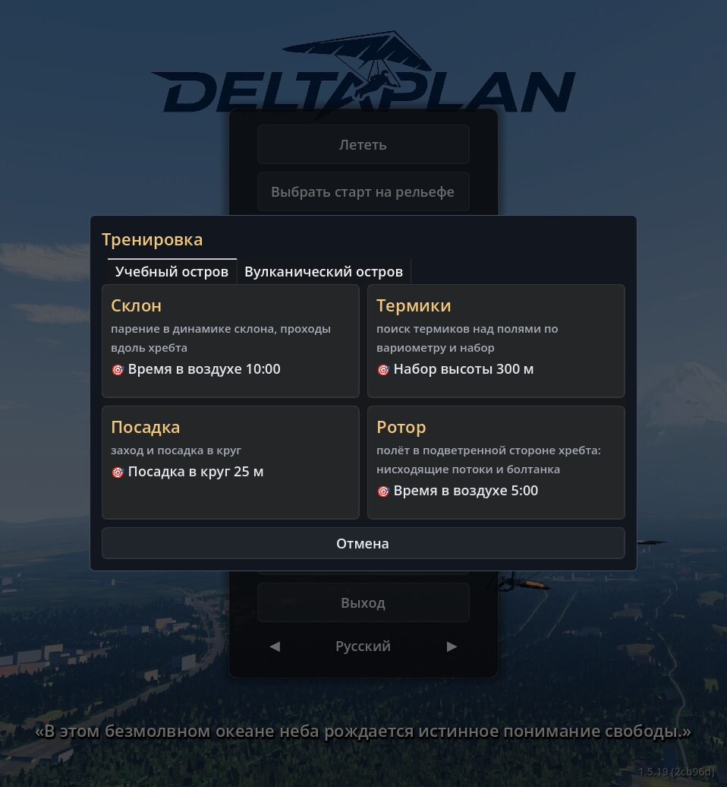
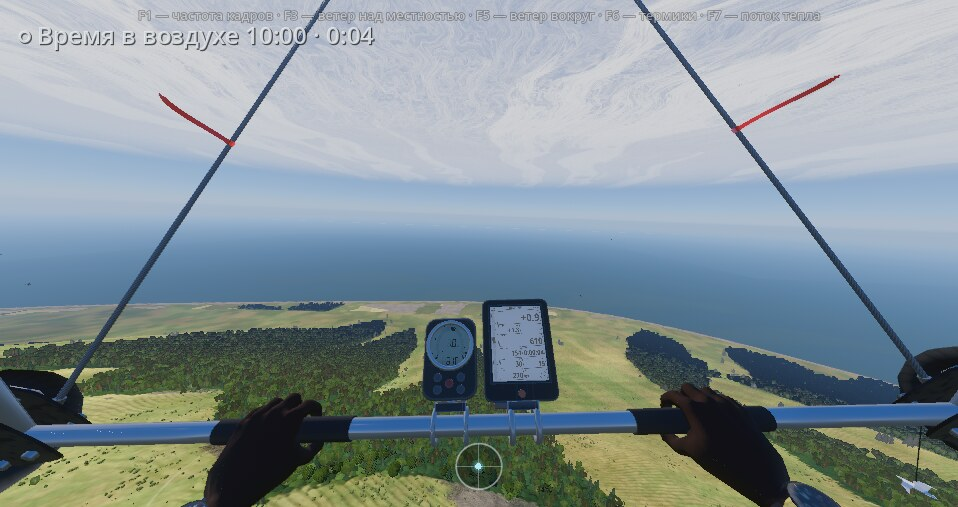
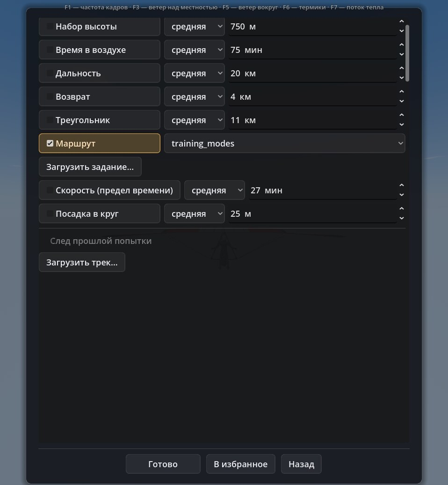

# The Training window {#training-window}

"Training" is a button in the main menu. It opens a window of cards: each one is a ready-made start on one of two islands with fixed weather and one flight goal. Press a card and you fly at once: no picking of place, weather or goals by hand.

This is not a course or an exam. There are no lessons, hints or a "training score" screen: a card sets a start and one [flight goal](/docs/goals/), and the outcome is the usual "done n of m".

## How to start {#training-start}

1. In the main menu press "Training".
2. Pick a place tab: "Training Island" or "Volcanic Island".
3. Press a card. The window closes, loading begins, then you fly from the card's start.
4. "Cancel" closes the window without starting.

The wing, mass and vehicle come from the last choice in the "Flight…" window; the place, start, weather and goal come from the card. A point picked on the map and an exact start are reset. The track of the previous attempt is not shown, and the pilot's "last flight" (what "Fly" repeats) is not overwritten. While a flight is loading, the button is unavailable.

Both islands are reachable only from here: they are not in "Popular places" or in the "Flight…" menu.

## Cards {#training-cards}

A card shows a name, what you practise and the goal (a target icon).

### Training Island

A fictional place of 15 × 10 km with generated terrain; there is no real place behind it. Each card has its own start and its own weather set.

| Card | What you practise | Goal | Start weather |
|---|---|---|---|
| Ridge | ridge soaring: passes along the ridge in slope lift | Time aloft 10:00 | wind 6 m/s, 270° |
| Thermals | finding thermals over the fields by the variometer and climbing | Height gain 300 m | wind 2 m/s, 180°, 25 °C |
| Landing | approach and landing in the circle | Landing in a 25 m circle | wind 1 m/s, morning |
| Rotor | flying on the lee side of the ridge: sink and turbulence | Time aloft 5:00 | incoming flow 8.5 m/s |

### Volcanic Island

The island's real terrain (open data, unedited).

| Card | What you practise | Goal |
|---|---|---|
| Cliffs | dynamic lift at the east plateau cliffs: passes along the edge and wind handling | Time aloft 10:00 |
| Crater | crater ridge: soaring along the crest; the lee side and turbulence | Time aloft 10:00 |
| Thermals | finding and centering thermals over the island slopes at hot midday | Height gain 300 m |
| Plateau landing | short approach and landing in the circle on the plateau | Landing in a 25 m circle |

The volcanic island has a 110° trade wind, about 6 m/s at the slopes. More about the islands is in the [system descriptions](/docs/) and the [CHANGELOG](../../CHANGELOG.md) (builds 1.5.19 and 1.5.20).

## In flight {#training-flight}

The card's goal is the only one in the goal list in the screen corner: "Time aloft 10:00 · 0:04", with the current value beside it. At the end you get "done n of m" and, if the glider took off, new records. The rules of goals are on the page [Flight goals and tracks](/docs/goals/).

## What counts, and what does not {#training-caveats}

Card names promise more than the goal checks. The goal is an ordinary flight goal; the game does not look at how it was achieved.

- **Ridge** and **Cliffs** count time aloft, not time at the slope. A flight far from the ridge counts as well.
- **Rotor** and **Crater** are also time aloft. The lee side's turbulence and sink are in the air, but completing the goal does not depend on them.
- **Thermals** is a gain above the take-off point held for 10 s in a row, not centering in a thermal as such: a climb in ridge lift counts the same.
- **Landing** is a 25 m circle on the place's landing site. There is no circle everywhere: with no site or target the goal is unavailable. A landing with a crash does not count.
- The volcanic island is a simplification. The model has no trade-wind inversion, and the cumulus base is about 3.8–3.9 km (in real life usually 1.5–2.5 km), so climbs in thermals up to 3 km are higher than real ones. Lift comes from the cliff facing the sea; on gentle 5–10° slopes there is almost none. There are no level landing fields, only ledges sloping 4–8°.
- The same goal can be done in an ordinary flight; the cards are only a convenient way to reach the right start with the right weather.

## If you need your own goal {#training-own-goal}

Cards do not change their goals. To set another goal or several, use the "Goals" tab of the "Flight…" window: levels, a route, loading a task and a track.

