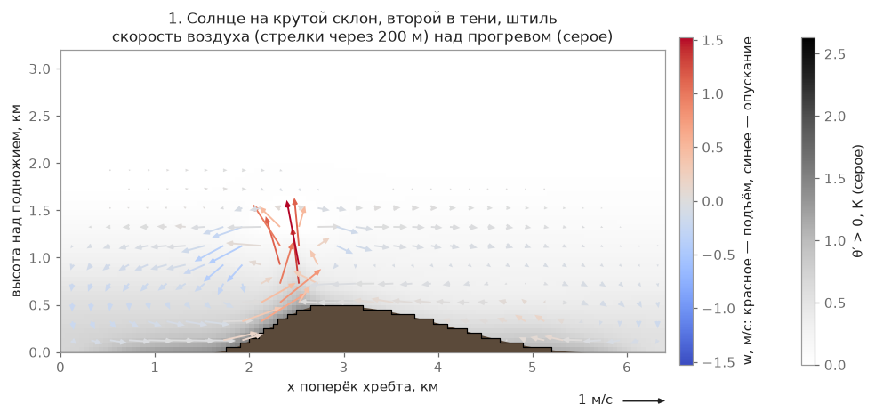

# Thermals, dust devils, thunderstorms

A thermal is a column of warm air rising from ground heated by the sun. A hang glider pilot circles
inside it to gain altitude; around the thermal the air, on the contrary, sinks weakly. Below is how this works
in the game, where the formulas come from and what the model cannot do. This is level 2 of the [air model](/mechanics/air-model/): the place, strength, ceiling and drift of a thermal come from the [level 1 wind field](/mechanics/air-model/wind-phases/), and the shape and life of the bubble from the formulas below; turbulence is [level 3](/mechanics/air-model/turbulence/).

## What is computed at level 2

For each field (a flight hour; the field is recomputed every 15 game minutes) the calculation builds a **list of thermal sources** (`AirThermals`, [rust/dp-air/src/terms/thermal_air/](/rust/dp-air/src/terms/thermal_air/mod.rs); computed by the Rust crate on the CPU). The data for it come from the level 1 wind field — from its coarsest level, the 400 m area for the whole place (the 100 and 50 m windows around the pilot are not used to choose sources):

- **Where.** A source appears where there is more heat flux at the ground and the air converges near the ground: over heated slopes dense, over weakly heated ones sparse, in shade, where there is no heat flux, none at all. This ties sources to the sunny side of a slope rather than to grid nodes.
- **Strength.** The Deardorff scale w\* from the heat flux at the point and the mixing-layer height; the core gains a fraction of w\*. In the morning the layer is thin — cores are small and frequent, weaker; toward noon wider and stronger.
- **Ceiling.** By the inversion, not by the cloud base: a parcel rises until it equals the temperature of the air above. The top of the layer is not the same over the whole place: it follows the terrain and drops over the plain by a range (see "Layer ceiling and subsidence").
- **Drift.** The axis is tilted by the wind from the same field: the cloud ends up kilometers downwind of the source.
- **How many.** The number, radius and strength of cores follow Allen's updraft model from layer thickness and w\*; the field only decides **where** there are more. The field's updraft beyond what the cores carry is a broad weak lift "in between".

Where the field covers the ground (the field's edge weight is at least ½), grid cells do not spawn thermals — the sources come from the field; beyond the edge of the area thermals spawn on a regular grid of cells. A thermal that received its place, strength, radius, ceiling and drift from the field lives like an ordinary cell: its own period, phase, growth — maturity — decay (see "Shape and life of a bubble" below).

**Multiplayer.** Air is not sent over the network: neither thermal sources nor cloudiness. Each client has its own air from the shared weather and seed (`scripts/net/net_zone.gd`), so two pilots in the same zone do not see thermals in the same places.

The strength, ceiling and drift of a thermal are not made up separately but agree with levels 1 and 3: the w\* of turbulence at a source point equals the w\* of the source itself (ratio 1.001 ± 0.038 at Kayancha, 12:00).

An example result — Ongudai, 12:00 (wind 3 m/s, clear, a typical July): on heated slopes 4.9 sources per km², on weakly heated ones 0.7, in shade 0. On real terrain the thermal column is 575 m in the morning, 1440 m at 12:00, 1640 m at 15:00.

")

**What it cannot do.** The core strength is a single fraction of w\* without spread between neighbors; in life the spread is wider. "Strong thermals every 1–1.5 layer thicknesses" the model does not reproduce: the density of all cores matches the literature, the spacing of strong ones does not. There are no "streets" along the wind. The source list is updated when the field is recomputed (every 15 game minutes); live thermals live out their life, and the course of the day within a period is not accounted for. Small morning thermals with a column shorter than 300 m are not born. The position of particular thermals is statistics, not a computation.

, middle the mean layer lift W̄ (red — lift at slopes, blue — sinking over the neighboring valley), right the flux carried by bubbles. Conclusion: sources cluster where there is much heat and the air converges; over valleys with blue W̄ there are few")

## Where the heating comes from: cover, moisture, water

The source strength and the solver input are computed from one heat flux H (W/m²), and it depends on what lies on the ground: forest, meadow, cropland, shrub, rock, built-up area, water, snow.

- **Albedo.** Light surfaces reflect more sun (meadow 0.20, rock 0.25, snow 0.55), dark ones less (forest 0.12, water 0.07). The rest heats the ground.
- **Part of the heat goes into the ground.** 4 % for forest, 15 % for meadow, 25 % for rock and built-up areas. What is left is split between heating the air and evaporation.
- **Wet heats less.** The wetter the soil, the more energy goes into evaporation and the less is left for the air. Wetness comes from the terrain: damp hollows heat the air less, dry ridges and rock more. There is no rain or irrigation in the game, so this is drainage geometry, not weather.
- **Lag.** The sun for a class is taken with a delay: meadow, field and snow 0.3 h, shrub 0.4 h, forest 0.6 h, rock 0.9 h, built-up 1.2 h (water has no lag; `configs/weather_model.json → heating.lag_h`). Rock and villages start heating later and keep giving heat longer than open fields.

At noon on level ground, clear sky, midsummer (50° N): meadow ≈ 210 W/m², forest ≈ 290, rock ≈ 300, built-up ≈ 320, snow ≈ 20. The spread across a place is large: southern rocky slopes heat more, northern slopes and damp hollows less. The number of sources is set by the field (flux and layer depth), not by the heat flux directly.

**Forest heats the air no less than meadow.** By the literature values forest is dark and hides almost no heat in the ground, so the air over it warms more than over meadow. Thermal sources can also form over forest. The field–forest boundary is a place where thermals break off: at a class boundary the source strength gets an extra boost (up to +30 % in a 50–150 m band).

**Water.** On a summer day water is colder than the air, and the air above it is cooled — "the lake sinks you": at Lake Aushkul over open water the flux is about −30 W/m² (3 m/s wind, water 6 K colder than air), and there are no thermals. A thermal source is not placed over water at all — neither over a lake nor over the sea: the source point is chosen on land only, and the column's heat flux goes to sources only from its land part (a coastal column by its land fraction). Measured when the rule was introduced, volcanic island: sources over water 957 → 0, the thermal strength over land is the same (90th percentile of the core 4.21 → 4.23 m/s). In the evening warm water heats the air. Water temperature follows the climate a month earlier: the daily mean air temperature 30 days before the date (at the site's altitude). Below zero the water is ice and behaves like snow.

**Roughness.** The wind near the ground accounts for the cover: over forest and a village it is weaker, over meadow and water stronger. At launches this is a few percent: at 30 m over forest the wind is about ×0.95, over meadow ×1.03–1.05 (see ["Forest"](/mechanics/air-model/turbulence/#forest)).

**What the model cannot do.** Soil moisture comes from terrain only (no rain, irrigation or moisture forecast). Cold mountain rivers (snowmelt) are treated as warm as lakes. There is no daily cycle of water temperature (0.5–2 K for small lakes), and ice has no thickness or melting. There is no terrain shadowing in the heating. Water or land smaller than a 400 m cell that touches neither a corner nor the center of the column is not seen in the land fraction; open sea without a water map is recognized by height ≤ 0.5 m, and a place without a surface map counts as land.

## Layer ceiling and subsidence {#thermal-ceiling}

The thermal ceiling is the top of the mixing layer zi (above sea level) at the source point. It is computed per air column and depends on the terrain:

- **Over ridges the layer is higher.** The layer top follows the terrain "in a muted form" (De Wekker and Kossmann, 2015): zi(x) = day zi + ⅓·(h̃(x) − valley height), where h̃ is the terrain smoothed to a scale of about 5 km but not lower than the terrain itself + 300 m. Over mountains this adds to the ceiling; over the lowland zi stays at the day value. The layer top over ridges compared with the valley (median / 90th percentile, m): Ongudai weak day +105 / +102, strong +101 / +135; Askarovo weak +5 / +21, strong +39 / +65; Almaty weak +41 / +169, strong +147 / +414. One and the same zi sets the thermal ceiling, w\*, the number of sources and the cloud base, so the thermal ceiling and the clouds agree.
- **Over the plain by a ridge the layer sinks.** By day air flows from the plain to the slopes; aloft it returns over the plain and sinks weakly there (Whiteman, 2000; Zardi and Whiteman, 2013). The game smooths the mean lift of the columns to a 10 km scale and where it is negative lowers the layer top by |W̄m|·3 h. Example, Almaty, strong day: over the ridge W̄m is +1.2…1.5 cm/s — no subsidence; over the lowland about −1.2 cm/s, and the layer top is lower by 130 m (median) and 379 m (90th percentile). For a pilot: over a valley by a big ridge the thermal ceiling is lower than the "average" computation of the day suggests, and nearer the crest higher.

, layer top by column (colour, 4256…4904 m). Bottom: a section along the line on the map — the earlier layer top is flat at 4271 m, the new one rises toward the ridge to about 4980 m; right: source ceilings — median 4950 m before and 5097 m after. Conclusion: by the ridge the thermal ceiling is higher, over the lowland it stays near the day value")

 and its part smoothed to 10 km, W̄m: negative over the lowland, positive over the ridge. Bottom right: source ceilings before subsidence p10 / median / p90 — 4787 / 5096 / 5506 m, after — 4185 / 5030 / 5500 m. Conclusion: subsidence cuts mainly the lower edge of the ceilings — over the lowland; by the ridge the ceiling barely changes")

**What it cannot do.** The factor ⅓ and the 5 and 10 km scales are order-of-magnitude numbers from literature reviews, not a fit to records. The subsidence of about 1 cm/s is the lower edge of the literature's 1–5 cm/s: the game builds the return branch from the inflow to the slopes, not from the heat balance of ridge and plain. The 3 h time is constant, with no course of the day. The field grid (38 km) is narrower than the circulation in big mountains, so at the grid edge the subsidence is mirrored. The "clear over the city" effect is not reproduced: over the lowland zi is almost the day value (4283 vs 4271 m at Almaty), and lowland thermals still reach the cloud base. About the cloud field itself — [clouds](/mechanics/clouds/).

## Shape and life of the bubble

Every thermal in the game is a bubble (`AtmoThermal`) with a source on the ground, a life cycle of growth → maturity →
decay and a lift profile over the radius. A source from the field is a "cell" with its own cycle; beyond the edge of the field the world is divided into cells (`thermal_spacing_m`), and each cell has
its own cycle with a deterministic phase, strength and source point (chosen by the solar illumination
of the slope). A thermal is a pure function of the cell and the cycle, so the same day is reproducible regardless of where the pilot flew.

**Profile over the radius** is Gedeon's "Mexican hat": a core with lift in the center, around it a ring of weak
sink, then zero. The mass flux through a horizontal section is exactly zero: as much air as rose,
the same amount sank next to it:

$$ w(r) = w_c \cdot e^{-(r/R)^2} \cdot \left(1 - (r/R)^2\right) $$

**The radius grows with height** according to Allen's model (NASA, autonomous soaring gliders): the thermal widens from the
ground to the cloud base, the lift grows from the ground as `z^(1/3)` and dies out near the top:

$$ R(\xi) \propto \xi^{1/3}(1 - 0.25\,\xi), \qquad \xi = \frac{y - h_s}{z_{top} - h_s} $$

**The thermal axis is tilted by the wind**: the air rises at the core speed and is drifted at the same time:
`Δx(z) ≈ z · U(z_mid) / w_c`. With wind of 5 m/s, a core of 3 m/s and a layer of 1500 m the cloud ends up ~2.5 km
downwind of the source; the tilt angle is capped from above, otherwise the thermal would simply have to be torn apart
by the wind, as it happens in real life.

**Life cycle** (`configs/atmosphere.json → thermal`): growth 2–4 min, maturity 5–12 min, decay 2.5–5 min, a pause between a cell's cycles of 1–5 min; a thermal lives about 10–21 min, and the cloud lingers 240 s after it (`clouds.linger_s`). In the decay stage
the bottom of the column detaches from the source earlier than the top: a pilot low under a decaying cloud no longer finds
lift, a familiar situation.

**Cloud suction.** Under a large growing cloud, in the last hundreds of meters below the base the climb noticeably
speeds up (inside the cloud condensation adds buoyancy: the air there cools more slowly than the dry
adiabat), and for a Cb up to a dangerous "pull-in". Under small, young and decaying clouds there is no suction:
the thermal weakens toward the top, as without a cloud.

**Wind and turbulence.** The wind profile in the mixing layer is almost constant; fluctuations (gusts, jolts, rotor) are computed by [level 3](/mechanics/air-model/turbulence/) — at the thermal edge turbulence is added as an independent component.

**Background sink** between thermals is −0.3…−0.8 m/s depending on layer depth (`background_sink_ms` in `configs/weather_model.json → anchors_by_top_agl`), from mass conservation: what
rose in the thermals must sink somewhere. This is a weather-of-the-day value: inside the field's area it is replaced by the field's share (the mask grows by the field's share) — there the field itself gives the lift and sink "between" (wconv minus the bubble flux), so mass is conserved on average.

## Physics: laws and approximations

The scale of the lift is the Deardorff convective velocity: the stronger the ground heating and the higher the mixing layer,
the stronger the thermals.

$$ w_* = \left(\frac{g}{T} \cdot H_0 \cdot z_i\right)^{1/3} $$

For a good summer day `w*` ≈ 1.5–3 m/s, on a weak day ≈ 1 m/s; the thermal core climbs ≈ 1…1.5·`w*`,
that is 0.5–5 m/s, consistent with hang glider pilots' logs ("a good thermal is 1–2 m/s cruise
climb, 2–3.5 on a strong day", [docs/research/xc_reference.md](/docs/research/xc_reference.md)). By
the annual statistics of the Desert Rock station (Allen 2006) the median `w*` over the year is 2.56 m/s at `z_i` ≈ 1400 m,
in July on average 2.69 m/s (`z_i` ≈ 1975 m), the maximum over the year is 6.3 m/s.

The thermal profile over height (Lenschow and Stevens 1980, from aircraft measurements over the sea; Allen 2006 —
the same formula, fitted to autonomous vehicles):

$$ \hat w / w_* = (z/z_i)^{1/3} (1 - 1.1\, z/z_i) $$

— the maximum is ≈ 0.45·`w*` at `z` ≈ 0.25·`z_i`, and it goes to zero at 0.91·`z_i`. By paraglider logs in France
(2017–2024, 1.47 million climbs) over mountains the climb is 30–40 % stronger than over flat terrain: at summer noon
over flat terrain ≈ 1.03 m/s, in high mountains ≈ 1.41 m/s, which is accounted for indirectly through the source strength
tied to terrain classes.

**Dust devils** are a visible sign of a young thermal over a dry surface (in `configs/atmosphere.json → dust`: cropland and bare ground, a thermal stronger than 2 m/s): they live 10–60 s, are 20–200 m high depending on the thermal strength, and drift with the surface wind; no more than three are shown.

## Model limits

- **Not CFD.** A thermal is an analytical formula (Gedeon + Allen), not a flow computation: the shape of the core and
  the sink ring is fitted to the feel of an experienced pilot rather than derived from the equations from scratch.
- **The life of a thermal is a deterministic generator by cell, cycle and seed** (beyond the edge of the field — on a regular grid of cells; inside the field's area — a cell sits on a source from the field), unlike in the real boundary layer, where the number
  and positions of thermals are a random but statistically structured process.
- **The upper fall-off of lift at the top** is made adjustable (`top_taper_m`), rather than strictly 10 % of the layer
  height, as follows from Allen's formula — otherwise under a growing cloud the lift would die out unrealistically early.
- **The heat flux is a model, not a measurement**: it is computed from the sun, slope, weather and land-cover class (see above), but without soil physics, groundwater depth and terrain shadows.
- Clouds in detail (shape, shadows, stages) are a separate mechanic: [/mechanics/clouds/](/mechanics/clouds/).

## What was considered and why this way

- **A bubble (column) model instead of a rising ring (Scorer).** In real life both regimes occur: a long-
  working "column" over a sunny slope and a short-lived "bubble" that detaches and rises.
  A column with a life cycle was chosen, whose bottom detaches in the decay stage; this gives the same
  feeling of a "bubble that went up" without computing a separate vortex ring.
- **Gedeon's profile was chosen for its smoothness**: the difference in lift between the wing halves (≈10 m) grows smoothly
  toward the edge of the core, so the wing banks "out of the thermal", as in real life, rather than abruptly at a sharp boundary.
- **Extreme thermals (7–9 m/s) are made rare and only on a strong day**: in a pilot's words
  "+8 — time to get out of here": a test verified that on a weak and a medium day such thermals do not occur at all,
  and on a strong day they are rare and always under a large cloud.
- **Dry thermals without a cloud** are kept as a separate share (on a weak day at least 40 %): the pilot
  looks for them "by the variometer", without the visual cue of a cumulus cloud.

**Thunderstorms are a rare phenomenon**, not a typical element of weather. The share of strong thermals that actually
become cumulonimbus (Cb) is separated from the overall "thunderstorminess of the day" (commit ):
with a daytime maximum of +26 °C a thunderstorm at the start in every flight would not match
real life; the share is set by the `cb_thermal_chance` column in `configs/weather_model.json → clouds_by_margin` (0 up to a 600 m margin, 0.0001 at 700 m ≈ +26 °C at Ongudai, 0.0025 at 900, 0.005 from 1100). Measured when the rule was introduced, 100 random days at Ongudai (September 2026; the game test for the measurement predates the move of wind to Rust and is not in this version):

| Daytime temperature | Cb within 15 km in the first hour | Thunderstorm at the start at the beginning of the flight |
|---|---|---|
| +26 °C | 0–1 % of flights | 0 % |
| +30 °C | 20–40 % | 0–4 % |
| +34 °C | 50–70 % | 3–6 % |

Inside a storm cell ([rust/dp-air/src/terms/storm/field.rs](/rust/dp-air/src/terms/storm/field.rs)) there are a downdraft under the downpour, spreading near the ground and a gust
front; the outflows of neighboring cells **are not added up** (in the code they merge, the flow is no stronger than one cell's): the summed speeds of several
cells would give 30–60 m/s, which is physically wrong (a real squall of such
strength is a rare natural disaster, not an ordinary thunderstorm).

## Details

- [Wind field: phases and Picard](/mechanics/air-model/wind-phases/), [turbulence and rotor](/mechanics/air-model/turbulence/), [air model](/mechanics/air-model/).
- [docs/research/thermals.md](/docs/research/thermals.md): formulas and sources: Gedeon, Allen,
  Lenschow and Stevens, Deardorff.
- [docs/research/calibration_data.md](/docs/research/calibration_data.md): the table of observables with
  uncertainties (§1 "Thermals").
- [docs/research/xc_reference.md](/docs/research/xc_reference.md): references for cross-country flights
  (climb, share of time spent circling, number of thermals per 10 km).
- [rust/dp-air/src/terms/thermal/](/rust/dp-air/src/terms/thermal/mod.rs),
  [rust/dp-air/src/terms/thermal_air/](/rust/dp-air/src/terms/thermal_air/mod.rs),
  [rust/dp-air/src/field/surface_heat.rs](/rust/dp-air/src/field/surface_heat.rs),
  [scripts/atmosphere/atmo_thermal.gd](/scripts/atmosphere/atmo_thermal.gd),
  [rust/dp-air/src/terms/storm/field.rs](/rust/dp-air/src/terms/storm/field.rs),
  [scripts/atmosphere/dust_devils.gd](/scripts/atmosphere/dust_devils.gd): code.
- [configs/atmosphere.json](/configs/atmosphere.json), [configs/weather_model.json](/configs/weather_model.json): parameters.
