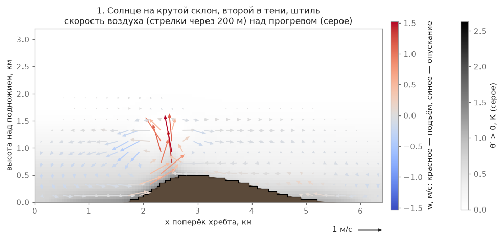

# Термики, пыльные вихри, грозы

Термик — это столб тёплого воздуха, поднимающийся от прогретой солнцем земли. Дельтапланерист кружит
внутри него, набирая высоту; вокруг термика воздух, наоборот, слабо опускается. Ниже — как это устроено
в игре, откуда взяты формулы и что модель не умеет.

## Что считается на уровне 2

Для каждого поля (час полёта; поле пересчитывается каждые 15 игровых минут) расчёт строит **список источников термиков** (`AirThermals`, [rust/dp-air/src/terms/thermal_air/](/rust/dp-air/src/terms/thermal_air/mod.rs); считает Rust-крейт на процессоре). Данные для него берутся из поля ветра уровня 1 — из самого грубого уровня, области 400 м на всё место (окна 100 и 50 м вокруг пилота для выбора источников не используются):

- **Где.** Источник появляется там, где у земли больше потока тепла и где воздух сходится у земли: над прогретыми склонами — густо, над слабо прогретыми — редко, в тени, где потока тепла нет, — никак. Это даёт привязку к солнечной стороне склона, а не к узлам сетки.
- **Сила.** Масштаб Дирдорфа w\* по потоку тепла в точке и высоте слоя перемешивания; ядро набирает долю w\*. Утром слой тонкий — ядра мелкие и частые, слабее; к полудню — шире, сильнее.
- **Потолок.** По инверсии, а не по кромке облаков: частица поднимается, пока не сравняется по температуре с воздухом сверху. Верх слоя при этом не одинаков по всему месту — он следует рельефу и опускается над равниной у хребта (см. «Потолок слоя и опускание»).
- **Снос.** Ось наклоняется ветром из того же поля: облако оказывается по ветру от источника на километры.
- **Сколько.** Число, радиус и сила ядер — по модели восходящих потоков Аллена от толщины слоя и w\*; поле решает только **где** их больше. Восходящий поток поля сверх несомого ядрами — широкий слабый подъём «между».

Там, где поле покрывает землю (вес края поля не меньше ½), клетки сетки термиков не рождают — источники берутся из поля; за краем области термики рождаются по регулярной сетке клеток. Сам термик, получив место, силу, радиус, потолок и снос из поля, живёт как обычная клетка: свой период, фаза, рост — зрелость — распад (см. «Форму и жизнь пузыря» ниже).

**Сетевая игра.** Воздух по сети не передаётся: ни источников термиков, ни облачности. У каждого клиента свой воздух от общей погоды и сида (`scripts/net/net_zone.gd`), поэтому у двух пилотов в одной зоне термики стоят не в одних и тех же местах.

Сила термика, потолок и снос не придуманы отдельно, а согласованы с уровнями 1 и 3: w\* болтанки в точке источника совпадает с w\* самого источника (отношение 1,001 ± 0,038 на Каянче в 12:00).

Пример результата — Онгудай, 12:00 (ветер 3 м/с, ясно, типичный июль): на прогретых склонах 4,9 источника на км², на слабо прогретых — 0,7, в тени — 0. На реальном рельефе столб термика утром 575 м, в 12:00 — 1440 м, в 15:00 — 1640 м.

")

**Чего не умеет.** Сила ядра — одна доля w\* без разброса между соседними, в жизни разброс шире. «Сильные термики через 1–1,5 толщины слоя» модель не воспроизводит: густота всех ядер с литературой совпадает, шаг сильных — нет. «Улиц» вдоль ветра нет. Список источников обновляется при пересчёте поля (раз в 15 игровых минут); живые термики доживают, ход дня внутри срока не учитывается. Мелкие утренние термики со столбом короче 300 м не рождаются. Положение конкретных термиков — статистика, а не расчёт.

, в середине средний подъём слоя W̄ (красное — подъём у склонов, синее — опускание над соседней долиной), справа поток, который несут пузыри. Вывод: источники группируются там, где много тепла и сходится воздух; над долинами с синим W̄ их мало")

## Откуда берётся нагрев: покров, влага, вода

Сила источника и вход решателя считаются из одного потока тепла H (Вт/м²), и он зависит от того, что лежит на земле — лес, луг, пашня, кустарник, скалы, застройка, вода, снег:

- **Альбедо.** Светлое отражает больше солнца (луг 0,20, скала 0,25, снег 0,55), тёмное — меньше (лес 0,12, вода 0,07). Остальное нагревает землю.
- **Часть тепла уходит в землю.** У леса — 4 %, у луга — 15 %, у скал и застройки — 25 %. Остаток делится между нагревом воздуха и испарением.
- **Сырое греет слабее.** Чем влажнее почва, тем больше энергии уходит на испарение и тем меньше остаётся воздуху. Влажность берётся из рельефа: сырые ложбины греют слабее, сухие гребни и скалы — сильнее. Дождей и полива в игре нет, так что это геометрия стока, а не погода.
- **Запаздывание.** Солнце для класса берётся с задержкой: луг, поле и снег — 0,3 ч, кустарник — 0,4 ч, лес — 0,6 ч, скалы — 0,9 ч, застройка — 1,2 ч (у воды запаздывания нет; `configs/weather_model.json → heating.lag_h`). Скалы и деревни начинают греть позже и дают тепло дольше, чем открытое поле.

В полдень на ровном месте, ясно, середина лета (50° с. ш.): луг ≈ 210 Вт/м², лес ≈ 290, скала ≈ 300, застройка ≈ 320, снег ≈ 20. Разброс по месту большой: южные скалистые склоны греют сильнее, северные и сырые ложбины слабее. Число источников задаёт поле (поток и толщина слоя), а не поток тепла напрямую.

**Лес греет не слабее луга.** По литературным параметрам лес тёмный и почти не прячет тепло в землю, поэтому воздух над ним греется сильнее, чем над лугом. Источники термиков бывают и над лесом. Граница поле–лес — место отрыва: на границе классов сила источника дополнительно усиливается (до +30 % в полосе 50–150 м).

**Вода.** Днём летом вода холоднее воздуха и воздух над ней охлаждается — «над озером садит»: на оз. Аушкуль над чистой водой нагрев около −30 Вт/м² (при ветре 3 м/с и воде холоднее воздуха на 6 К), термиков нет. Источник термика не ставится над водой вообще — ни над озером, ни над морем: точка источника выбирается только на суше, а поток тепла столбца отдаётся источникам только с его сухопутной части (береговой столбец — по доле суши). Замер при введении правила, вулканический остров: источников над водой 957 → 0, сила термиков над сушей та же (90-й процентиль ядра 4,21 → 4,23 м/с). Вечером тёплая вода греет воздух. Температура воды — по климату месяц назад: среднесуточная воздуха за 30 суток до даты (на высоте места). Ниже нуля вода — лёд, и ведёт себя как снег.

**Шероховатость.** Ветер у земли учитывает покров: над лесом и посёлком он слабее, над лугом и водой сильнее. На стартах это даёт несколько процентов: на 30 м над лесом ветер примерно ×0,95, над лугом ×1,03–1,05 (см. [«Лес»](/mechanics/air-model/turbulence/#forest)).

**Чего модель не умеет.** Влажность почвы — только от рельефа (дождей, полива, прогноза влажности нет). Холодные горные реки (таяние) считаются такими же тёплыми, как озёра. Суточного хода температуры воды нет (у мелких озёр он 0,5–2 К), лёд без толщины и таяния. Тени рельефа в нагреве нет. Вода или суша мельче клетки 400 м, не задевшая ни угла, ни центра столбца, в доле суши не видна; открытое море без карты воды определяется по высоте ≤ 0,5 м, а место без карты поверхности считается сушей.

## Потолок слоя и опускание {#thermal-ceiling}

Потолок термика — верх слоя перемешивания zi (над уровнем моря) в точке источника. Он считается по столбцу воздуха и зависит от рельефа:

- **Над хребтами слой выше.** Верх слоя следует рельефу «в приглушённом виде» (De Wekker и Kossmann, 2015): zi(x) = zi дня + ⅓·(h̃(x) − h долины), где h̃ — рельеф, сглаженный до масштаба около 5 км, но не ниже самого рельефа + 300 м. Над горами это даёт прибавку к потолку, над низиной zi остаётся равным дневному. Верх слоя над хребтами выше, чем в долине (медиана / 90-й процентиль, м): Онгудай, слабый день +105 / +102, сильный +101 / +135; Аскарово слабый +5 / +21, сильный +39 / +65; Алматы слабый +41 / +169, сильный +147 / +414. Один и тот же zi определяет потолок термиков, w\*, число источников и основание облаков, поэтому потолок термиков и облака согласованы.
- **Над равниной у хребта слой опускается.** Днём воздух течёт от равнины к склонам; наверху он уходит обратно над равниной и там слабо опускается (Whiteman, 2000; Zardi и Whiteman, 2013). Игра сглаживает средний подъём столбцов до масштаба 10 км и там, где он отрицателен, опускает верх слоя на |W̄м|·3 ч. Пример, Алматы, сильный день: над хребтом W̄м +1,2…1,5 см/с — опускания нет, над низиной около −1,2 см/с, и верх слоя ниже на 130 м (медиана) и 379 м (90-й процентиль). Для пилота это значит: над долиной у большого хребта потолок термиков ниже, чем показывает «средний» расчёт дня, а ближе к гребню — выше.

, верх слоя по столбцам (цветом, 4256…4904 м). Снизу: разрез вдоль линии на карте — прежний верх слоя горизонтален на 4271 м, новый поднимается к хребту примерно до 4980 м; справа потолки источников — медиана 4950 м до и 5097 м после. Вывод: у хребта потолок термиков выше, над низиной остаётся около дневного")

 и его сглаженная до 10 км часть W̄м: отрицательна над низиной, положительна над хребтом. Справа внизу потолки источников: до опускания p10 / медиана / p90 — 4787 / 5096 / 5506 м, после — 4185 / 5030 / 5500 м. Вывод: опускание срезает в основном нижний край потолков — над низиной; у хребта потолок почти не меняется")

**Чего не умеет.** Коэффициент ⅓ и масштабы 5 и 10 км — порядковые числа из обзоров литературы, а не подгонка под записи. Опускание около 1 см/с — нижний край литературных 1–5 см/с: игра строит возвратную ветвь из притока к склонам, а не из теплового баланса хребта и равнины. Время 3 ч — постоянное, хода дня нет. Сетка поля (38 км) уже, чем циркуляция в больших горах, поэтому у края сетки опускание отражённое. Эффект «над городом ясно» модель не воспроизводит: над низиной zi почти равен дневному (4283 против 4271 м в Алматы), и термики равнины по-прежнему доходят до основания облаков. Про само поле облачности — [облака](/mechanics/clouds/).

## Форма и жизнь пузыря

Каждый термик в игре — пузырь (`AtmoThermal`) с источником на земле, жизненным циклом рост → зрелость →
распад и профилем подъёма по радиусу. Источник из поля — «клетка» со своим циклом; за краем поля мир разбит на клетки (`thermal_spacing_m`), у каждой — свой цикл с детерминированной фазой, силой и точкой источника (выбранной по солнечной освещённости
склона). Термик — чистая функция клетки и цикла, поэтому один и тот же день воспроизводим независимо от того, где летал пилот.

**Профиль по радиусу** — «мексиканская шляпа» Гедеона: ядро с подъёмом в центре, вокруг — кольцо слабого
опускания, дальше — нуль. Поток массы через горизонтальное сечение ровно нулевой — сколько воздуха
поднялось, столько рядом опустилось:

$$ w(r) = w_c \cdot e^{-(r/R)^2} \cdot \left(1 - (r/R)^2\right) $$

**Радиус растёт с высотой** по модели Аллена (NASA, автономные планеры-парители): термик расширяется от
земли к кромке облаков, подъём нарастает от земли как `z^(1/3)` и гаснет у верха:

$$ R(\xi) \propto \xi^{1/3}(1 - 0{,}25\,\xi), \qquad \xi = \frac{y - h_s}{z_{top} - h_s} $$

**Ось термика наклонена ветром** — воздух поднимается со скоростью ядра и одновременно сносится:
`Δx(z) ≈ z · U(z_mid) / w_c`. При ветре 5 м/с, ядре 3 м/с и слое 1500 м облако оказывается на ~2,5 км
по ветру от источника; угол наклона ограничен сверху — иначе термик должен был бы просто разорваться
ветром, как это и происходит в жизни.

**Жизненный цикл** (`configs/atmosphere.json → thermal`): рост 2–4 мин, зрелость 5–12 мин, распад 2,5–5 мин, пауза между циклами клетки 1–5 мин; термик живёт около 10–21 мин, облако доживает после него ещё 240 с (`clouds.linger_s`). На стадии распада
низ столба отрывается от источника раньше верха — пилот низко под распадающимся облаком уже не находит
подъём, знакомая ситуация.

**Облачный подсос.** Под крупным растущим облаком последние сотни метров под основанием набор заметно
ускоряется (внутри облака конденсация добавляет плавучести — воздух там остывает медленнее сухой
адиабаты), у Cb — до опасного «затягивания». Под мелкими, молодыми и распадающимися облаками подсоса
нет — термик слабеет к кромке, как без облака.

**Ветер и турбулентность.** Профиль ветра в слое перемешивания почти постоянный; пульсации (порывы, рывки, ротор) считает [уровень 3](/mechanics/air-model/turbulence/) — на краю термика болтанка добавляется как независимая составляющая.

**Фоновое опускание** между термиками — −0,3…−0,8 м/с в зависимости от толщины слоя (`background_sink_ms` в `configs/weather_model.json → anchors_by_top_agl`), из сохранения массы: то, что
поднялось в термиках, должно где-то опуститься. Это значение погоды дня: в области поля оно заменяется долей поля (маска растёт на долю поля) — там подъём и опускание «между» даёт само поле (wconv за вычетом потока пузырей), так что в среднем сохраняется масса.

## Физика: законы и приближения

Масштаб подъёма — конвективная скорость Дирдорфа: чем сильнее прогрев земли и выше слой перемешивания,
тем сильнее термики.

$$ w_* = \left(\frac{g}{T} \cdot H_0 \cdot z_i\right)^{1/3} $$

Для хорошего летнего дня `w*` ≈ 1,5–3 м/с, в слабый день ≈ 1 м/с; ядро термика набирает ≈ 1…1,5·`w*`,
то есть 0,5–5 м/с — согласуется с записями дельтапланеристов («хороший термик — 1–2 м/с крейсерский
набор, 2–3,5 в сильный день», [docs/research/xc_reference.md](/docs/research/xc_reference.md)). По
годовой статистике станции Desert Rock (Allen 2006) медианный `w*` за год — 2,56 м/с при `z_i` ≈ 1400 м,
в июле в среднем 2,69 м/с (`z_i` ≈ 1975 м), максимум за год — 6,3 м/с.

Профиль термика по высоте (Леншоу и Стивенс 1980, по самолётным измерениям над морем; Аллен 2006 —
та же формула, подогнана под автономные аппараты):

$$ \hat w / w_* = (z/z_i)^{1/3} (1 - 1{,}1\, z/z_i) $$

— максимум ≈ 0,45·`w*` на `z` ≈ 0,25·`z_i`, обнуляется у 0,91·`z_i`. По записям парапланов во Франции
(2017–2024, 1,47 млн наборов высоты) над горами набор на 30–40 % сильнее, чем над равниной: в полдень
летом на равнине ≈ 1,03 м/с, в высоких горах ≈ 1,41 м/с — что учтено косвенно через силу источника,
завязанную на классы рельефа.

**Пыльные вихри** — видимый признак молодого термика над сухой поверхностью (в `configs/atmosphere.json → dust`: пашня и голый грунт, термик сильнее 2 м/с): живут 10–60 с, высота 20–200 м от силы термика, дрейфуют с приземным ветром; на экране не больше трёх.

## Границы модели

- **Не CFD.** Термик — аналитическая формула (Гедеон + Аллен), а не расчёт течения: форма ядра и
  кольца опускания подогнаны под ощущения опытного пилота, а не выведена из уравнений с нуля.
- **Жизнь термика — детерминированный генератор по клетке, циклу и зерну** (за краем поля — на регулярной сетке клеток; в области поля — клетка стоит на источнике из поля), а не как в реальном пограничном слое, где число
  и положение термиков — случайный, но статистически структурированный процесс.
- **Верхний спад подъёма у кромки** сделан настраиваемым (`top_taper_m`), а не строго по 10 % высоты
  слоя, как получается у формулы Аллена — иначе под растущим облаком подъём гас бы нереалистично рано.
- **Поток тепла — модель, не измерение**: он считается из солнца, уклона, погоды и класса покрова (см. выше), но без физики почвы, глубины грунтовых вод и тени рельефа.
- Подробно про облака (форма, тени, стадии) — отдельная механика: [/mechanics/clouds/](/mechanics/clouds/).

## Что рассматривали и почему так

- **Модель пузыря (столб) вместо всплывающего кольца (Scorer).** В жизни встречаются оба режима — долго
  работающая «колонна» над солнечным склоном и короткоживущий «пузырь», отрывающийся и всплывающий.
  Выбрана колонна с жизненным циклом, у которой на стадии распада отрывается низ — это даёт то же
  ощущение «пузыря, ушедшего вверх», не считая отдельно вихревое кольцо.
- **Профиль Гедеона выбран за гладкость**: разница подъёма между консолями крыла (≈10 м) плавно растёт
  к краю ядра, поэтому крыло кренит «из термика», как в жизни, а не рывком на резкой границе.
- **Экстремальные термики (7–9 м/с) сделаны редкими и только в сильный день** — по словам пилота
  «+8 — уже надо валить»: проверено тестом, что в слабый и средний день таких термиков не бывает вовсе,
  а в сильный они редки и всегда под крупным облаком.
- **Сухие термики без облака** оставлены отдельной долей (в слабый день — не меньше 40 %) — пилот их
  ищет «по вариометру», без визуальной подсказки в виде кучевого облака.

**Грозы — редкое явление**, не типичный элемент погоды. Доля сильных термиков, которые действительно
становятся кучево-дождевыми (Cb), отделена от общей «грозовости дня» (коммит ):
при дневном максимуме +26 °C гроза у старта в каждом полёте не соответствовала бы жизни; доля задаётся столбцом `cb_thermal_chance` в `configs/weather_model.json → clouds_by_margin` (0 до запаса 600 м, 0,0001 при 700 м ≈ +26 °C в Онгудае, 0,0025 при 900, 0,005 от 1100). Замер при введении правила, 100 случайных дней на Онгудае (сентябрь 2026; игровой тест замера — до переноса ветра в Rust, в этой версии его нет):

| Температура днём | Cb ближе 15 км за первый час | Гроза у старта в начале полёта |
|---|---|---|
| +26 °C | 0–1 % полётов | 0 % |
| +30 °C | 20–40 % | 0–4 % |
| +34 °C | 50–70 % | 3–6 % |

Внутри грозовой ячейки ([rust/dp-air/src/terms/storm/field.rs](/rust/dp-air/src/terms/storm/field.rs)) — нисходящий поток под ливнем, растекание у земли и фронт
порывов; растекание соседних ячеек **не складывается** (в коде — слияние, поток не сильнее одной ячейки): сумма скоростей нескольких ячеек давала бы 30–60 м/с, что физически неверно (реальный шквал такой силы — редкое стихийное явление, а не рядовая гроза).

## Подробнее

- [Поле ветра: фазы и Пикар](/mechanics/air-model/wind-phases/), [болтанка и ротор](/mechanics/air-model/turbulence/), [модель воздуха](/mechanics/air-model/).
- [docs/research/thermals.md](/docs/research/thermals.md) — формулы и источники: Гедеон, Аллен,
  Леншоу и Стивенс, Деардорф.
- [docs/research/calibration_data.md](/docs/research/calibration_data.md) — таблица наблюдаемых с
  погрешностями (§1 «Термики»).
- [docs/research/xc_reference.md](/docs/research/xc_reference.md) — эталоны маршрутных полётов
  (набор, доля времени в кружении, число термиков на 10 км).
- [rust/dp-air/src/terms/thermal/](/rust/dp-air/src/terms/thermal/mod.rs),
  [rust/dp-air/src/terms/thermal_air/](/rust/dp-air/src/terms/thermal_air/mod.rs),
  [rust/dp-air/src/field/surface_heat.rs](/rust/dp-air/src/field/surface_heat.rs),
  [scripts/atmosphere/atmo_thermal.gd](/scripts/atmosphere/atmo_thermal.gd),
  [rust/dp-air/src/terms/storm/field.rs](/rust/dp-air/src/terms/storm/field.rs),
  [scripts/atmosphere/dust_devils.gd](/scripts/atmosphere/dust_devils.gd) — код.
- [configs/atmosphere.json](/configs/atmosphere.json), [configs/weather_model.json](/configs/weather_model.json) — параметры.
