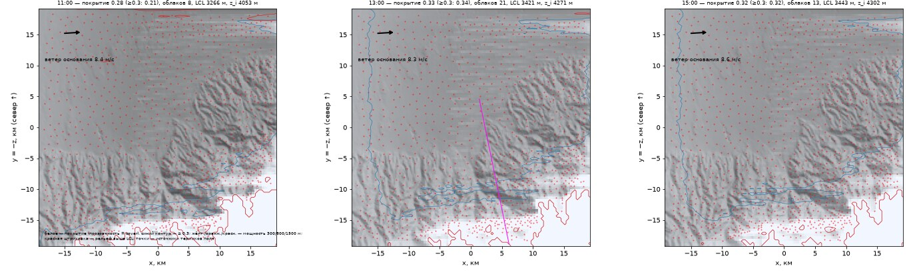
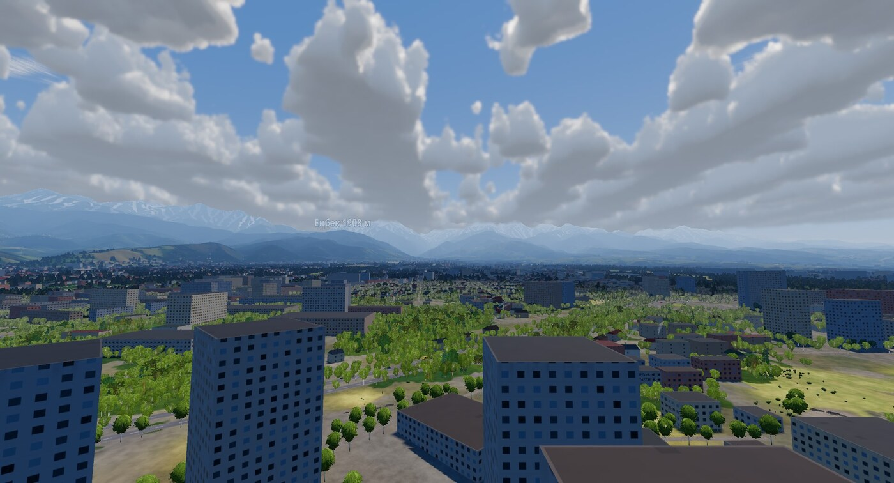
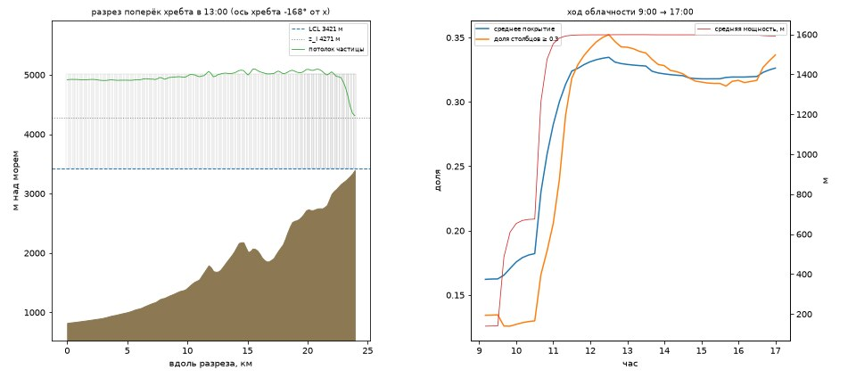
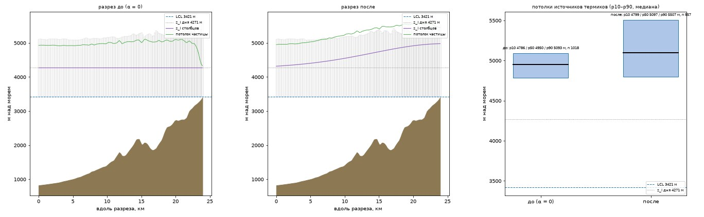
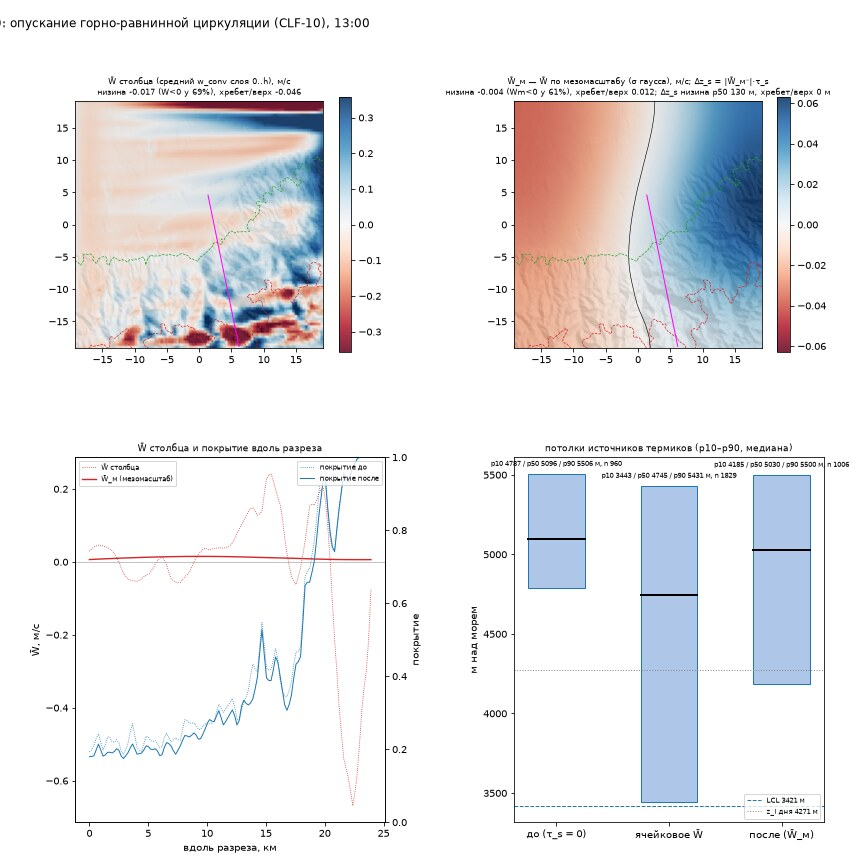

# Облака и тени

Кучевые облака в игре — не «по одному на термик», а **поле облачности** над всем местом: оно растёт там, куда подъём
воздуха дошёл до уровня конденсации, держится, пока подъём работает, тает с задержкой и сносится ветром. Тень облака
на земле — не декоративное пятно, а честная тень именно этой формы, и там, где она лежит, новые термики слабее.

## Как рождается поле облачности

Облако видно только там, где воздух поднялся достаточно высоко, чтобы остыть до насыщения. Высота, на которой это
случается, — **уровень конденсации**; он один для всего места и дня, поэтому у всех облаков дня одно плоское
основание. Его высота зависит от температуры воздуха и точки росы — точку росы игра берёт из климата места
(отдельной влажности воздуха по высоте и по участкам нет, см. «Границы»).

Дальше модель считает по ячейкам сетки 96 × 96 клеток по 400 м (38 × 38 км вокруг места, шаг расчёта — 20 игровых
секунд, считается в отдельном потоке). В каждой клетке хранится:

- какая доля площади закрыта **активным** облаком — над работающим подъёмом;
- какая доля — **пассивным**: подъём ушёл, облако ещё стоит и тает;
- мощность облака — высота над основанием;
- накопленное «переразвитие» — признак того, что здесь вырастает высокая башня.

**Откуда берётся облако.** Источников три: конвекция поля воздуха (то, что игра считает термиками, — потолок и
поток у основания из [Термиков](/mechanics/air-model/thermals/)), подъём воздуха на наветренном склоне, а если поля
воздуха нет — живые термики старой аналитической модели. Облако появляется там, куда подъём дошёл до уровня
конденсации: чем выше потолок термиков над основанием, тем больше потока до него доходит. Если потолок едва достаёт —
остаётся редкая россыпь; если ниже основания — безоблачный («голубой») день.

**Жизнь облака во времени** (числа взяты из литературы по кучевым облакам, не подогнаны под картинки):

| этап | время |
|---|---|
| облако заполняется после прихода подъёма к основанию | 4 мин |
| подъём под облаком работает | 15 мин |
| пассивное облако тает | 20 мин × (мощность / 1 км), множитель от ½ до 2 |

Поэтому тонкие кучевые тают за 5–10 минут после ухода подъёма, мощные держатся 20–40. Через 5 минут после ухода
подъёма остаётся больше половины покрытия, через 90 минут — меньше десятой. Облако не появляется и не пропадает за кадр.
Из-за долгого таяния облаков больше, чем подъёмов: при мощности 1 км покрытие — около 2,3 площади активных
облаков. Поэтому сильный день не обязательно «облачнее» слабого по покрытию, но его облака мощнее и живут дольше.

**Мощность** — высота, до которой частица воздуха доходит выше основания (с поправкой на влажную адиабату: в облаке
она теряет плавучесть медленнее, до трёх раз), но не больше предела дня из модели погоды. У части клеток сильного дня при устойчивом подъёме
облако 30 минут копит переразвитие и вырастает до 2,5 км — высокие башни. Грозовые облака в это поле не входят (см. ниже).

**Снос.** Облака уносит ветер на высоте основания; при ветре они вытягиваются по нему и могут выстраиваться в гряды
вдоль ветра. Шум внутри облака тоже «течёт» с ветром, а форма стоит над своим подъёмом.

Три кадра одного дня — Алматы, +31 °C, ветер 18 км/ч, 11, 13 и 15 часов: белое — покрытие, синий контур — где оно
выше 0,3, красные точки — источники термиков. Покрытие
сосредоточено над горами и предгорьями внизу кадра, ветер (стрелка) сносит облака вправо; на равнине облаков меньше,
но они есть — об этом ниже.

**Что видно по самому облаку** (форма и стадия — без подписей):
- **растущее** — клочья собираются в плотное облако с чёткими «кочанными» краями, заметен рост за 1–3 минуты наблюдения;
- **зрелое** — высокое, плотное, с плоским тёмным основанием; пока подъём жив, основание темнее и плотнее (виден подсос);
- **распадающееся** — рваное, прозрачное, с приподнятой рваной кромкой, оседает и уплывает по ветру.

Форма строится из восьми полуэллипсоидов-«башен» с широким центральным куполом и заполняется 3D-шумом (Perlin-Worley
и Уорли) — края клубящиеся, а не гладкие. Отношение высоты к ширине больше у переразвитых дней: кучевые хорошей
погоды шире, чем выше. Новое облако проявляется за ~40 с, тающее исчезает примерно за минуту.

### Разные дни, разные места

Тот же расчёт, дни 15 июля, 13:00 (покрытие — среднее по сетке 38 × 38 км):

| место, погода | основание, м | потолок слоя z_i, м | покрытие | облака (покрытие ≥ 0,3) |
|---|---|---|---|---|
| Онгудай, слабый | 2117 | 2462 | 0,19 | 58 мелких, до 18 × 11 км |
| Онгудай, сильный | 3459 | 4359 | 0,23 | 50, до 27 × 8 км вдоль ветра |
| Алматы, слабый | 2079 | 2374 | 0,33 | 10, до 41 × 19 км вдоль хребта |
| Алматы, сильный | 3421 | 4271 | 0,33 | 21, до 50 × 37 км |
| учебный остров, слабый | 1259 | 1004 | 0,001 | — (голубой день) |

В слабый день над Онгудаем это россыпь над гребнями: покрытие над верхней пятой частью рельефа втрое выше, чем над
низинами. В сильный — полосы по ветру, гребни и долины почти поровну. Над островом слабый день голубой: потолок термиков
ниже основания.

Слева — разрез поперёк хребта в 13 часов: рельеф, основание облаков (синяя пунктирная линия) и потолок частиц воздуха
(зелёная); облака — между ними. Справа — ход дня: до 10:30 почти чисто, затем покрытие растёт вместе с прогревом,
с 12 до 17 часов держится около 0,32–0,34, мощность выходит на 1,6 км.

## Рельеф: слой воздуха следует за горами

Потолок термиков (верх слоя перемешивания, z_i) не одинаков над горами и долиной. В модели он **частично следует
рельефу**: z_i(x) = z_i дня + ⅓ · (сглаженный рельеф − уровень долины), сглаживание — 5 км. Доля ⅓ — порядок из обзора
наблюдений над Альпами, Скалистыми горами и Шварцвальдом (De Wekker & Kossmann, 2015): слой над хребтами выше, чем над
долинами, в приглушённом виде. Узкие гребни и ущелья он не повторяет.

Что это даёт: потолок термиков над горами выше — в Онгудае на ~100 м по медиане, в Алматы в сильный день на 150 м по
медиане и до +414 м у верхних 10 % (хребет 3–4 км). Основание облаков то же, поэтому облака над хребтами получают
больше запаса над основанием и держатся дольше: площадь облаков ≥ 0,3 выросла на треть–половину (Онгудай 0,10 → 0,18,
Алматы 0,40 → 0,47). Над ровной местностью (Аскарово, перепад рельефа мал) поправка почти не заметна — так и должно быть.

Слева и в середине — разрез поперёк хребта без поправки и с ней: фиолетовая линия — z_i столбцов (была ровной, стала
поднимающейся к горам), зелёная — потолок частицы. Справа — потолки источников термиков до и после: медиана
4950 → 5097 м, верхний край 5093 → 5507 м.

## Опускание над равниной

Днём над хребтом воздух поднимается, а над равниной ему положено слабо опускаться — это возвратная ветвь
горно-равнинной циркуляции. Модель учитывает её **только мезомасштабную часть**: вертикальный ток поля воздуха,
сглаженный до ~10 км. Над равниной у Алматы он около −1 см/с, над хребтом +1 см/с; оседающий воздух опускает потолок
слоя над столбцом: в среднем на 130 м, у верхних 10 % — на 380 м. Мелкие ячейки организованной конвекции
(соседние клетки отличаются на ±0,1 м/с) в это не входят — они часть самого слоя.

Результат скромный: над равниной покрытие уменьшается лишь на десятую часть (0,25 → 0,23). Ожидание «над городом
заметно ясно, покрытие ≤ 0,1» **не выполняется**, и из этой физики не получится: чтобы город был чист, нужен более сухой
воздух над равниной (выше основание) — а точка росы в модели одна на место.

## Особые облака

Кучевые из поля — не все облака игры. Остальные — отдельные записи, они строятся тем же шейдером из той же физической
модели (подробности — в [docs/guide/atmosphere/clouds.md](/docs/guide/atmosphere/clouds.md)):
- кучево-дождевое (`storm_field.gd`): сильные зрелые термики переразвиваются в башню до тропопаузы с
  наковальней, под основанием — ливень из мягких полупрозрачных полос; под ним нисходящий поток, растекание
  у земли и фронт порывов. Грозы в модели редкие: от сотых долей процента на термик при малом запасе по
  температуре до 0,5 % при большом;
- лентикулярные линзы, шапка на высшей точке рельефа и роторные клочья в гребнях подветренной волны (`wave_field.gd`);
- перистая пелена верхнего яруса (`cirrus_layer.gd`): ленты волокон по ветру, гасит термики (меньше
  инсоляция) и делает тени кучевых бледнее.

Подробно про сам термик — его силу, форму потока, восходящую скорость и то, как рождается и умирает
поток воздуха под облаком, — на странице [Термики](/mechanics/air-model/thermals/); здесь описана только
надземная, видимая часть.

## Тени облаков

Облако **гасит только прямой свет солнца** — рассеянный свет неба под ним остаётся, поэтому тень не
превращается в чёрное пятно. Тень рисуется отдельным проходом (`CloudShadowMap`): карта вокруг камеры
(сторона 32 км) перерисовывается раз в 3 кадра, и в каждой её точке считается пропускание прямого света
по формуле поглощения Бера через ту же самую плотность облака, что рисуется у него над головой. Тень
поэтому **в точности повторяет форму облака**, включая клубы и истончённые края распадающегося, плывёт
вместе с ним и тает с ним же.

Тень ложится на рельеф, траву, лес (и модели, и импостеры, и процедурные кроны), кусты и камни — все
они используют одну и ту же формулу освещения, ослабленную прозрачностью облака в этой точке. Часть
неба, закрытая облаком, тоже чуть темнее (рассеянный свет), но слабее, чем прямой. К краю карты тени
плавно тают в дымку; под перистой пеленой верхнего яруса (если она есть) тени всех кучевых облаков
бледнее — как в реальности, когда солнце уже частично рассеяно высокой облачностью.

## Полутень

Тень не обрывается резкой линией: у края карты тени и на грани облака есть плавный переход (мягкое
затухание), а не «ступенька» видимость/невидимость. Собственная тень солнца в игре (рельеф, деревья,
крыло) тоже мягкая, с угловым размером солнечного диска — так что у объектов на границе тени облака
получается настоящая полутень, а не два чётких состояния «светло» и «темно».

## Термики слабее в тени

Это не только картинка: модель термиков знает о тех же зрелых облаках, что рисуются на небе, и **новый
термик, рождающийся в тени такого облака, слабее**, чем на солнце: его сила и нагрев уменьшаются на 0,6 × тень.
Тень для этого расчёта считается от поля облачности — покрытие, помноженное на (1 − exp(−мощность / 60 м)), по лучу
от земли к солнцу до основания, — так что 100-метровое облако уже закрывает солнце. Пилот,
читающий тени под собой, видит то же самое разделение земли на «греется» и «не греется», что использует модель.

## Границы модели

- **Влажность — одна точка росы на место** (из климата), без сухого и влажного воздуха на высоте и без разницы между
  горой и равниной. Отсюда основание облаков плоское и общее на весь день, нет вечернего роста основания, а над
  равниной облака не такие редкие, как в жизни (см. «Опускание над равниной»).
- **Сверки с наблюдениями нет**: ни спутниковых снимков, ни записей пилотов по этим местам. Эталоном были
  ожидания по Алматы (гряда вдоль главного хребта, основание 3–3,5 км, вершины в облаке): основание и облака на
  хребте — совпало; гряда — только в слабый день (в сильный выходит сплошная пелена 50 × 37 км); ясно над городом — нет.
- **Пассивное облако тает по экспоненте** с одним временем на все погоды, без учёта влажности окружения; переразвитие —
  это только рост мощности, не физика грозы (ливня, нисходящего потока и наковальни у такого облака нет — это Cb).
- **Нет облачных улиц от конвективных валов**: поле их не даёт, гряды вдоль ветра получаются только сносом.
- **Поле воздуха меняется ступенями** раз в 15 игровых минут (новые входы подмешиваются за минуту), настоящего
  суточного хода между полями нет.
- **Снос размазывает край облака** примерно на одну клетку (400 м) за час — следствие численного переноса.
- **Кучевые из поля есть только в основном режиме отрисовки** (Forward+/Mobile). В режиме для встроенной графики
  (Compatibility) рисуются лишь линзы, шапка и грозовые облака — по решению автора целевой рендер Forward+.
- **Тень — не глобальная карта**, а окно вокруг камеры фиксированного размера (32 км): облака за его пределами
  тени на видимую сцену не бросают (это и не нужно — их и так не видно).
- **Грозовые ячейки, волна и перистая пелена — упрощённые образы**: наковальня без маммаусов, Cb издалека похож на «гриб» (у настоящих тело массивнее и шире), линзы гладкие, «стопка тарелок» видна слабо.
- **Плотность облака приближённая**: раймарч по нескольким геометрически растущим шагам к солнцу, а не
  честная многократная рассеивающая симуляция — этого достаточно, чтобы основание было темнее краёв и
  темнее над живым термиком, но точной фотометрии не будет.
- **Разные рендер-пути дают разную цену и немного разную картинку**: основной путь (Forward+/Mobile) —
  один общий раймарч-проход по кадру в буфере пониженного разрешения (0,33/0,5/0,75 по пресету качества) с апскейлом по
  глубине; путь для встроенной графики (Compatibility) — бокс на каждое облако отдельно. В Compatibility известна
  визуальная проблема: часть облаков делится вертикальной границей на две половины разной яркости со «ступенчатым»
  краем — сознательно не исправляется.
- **Цена слоя поля — оценка, не замер против прежней версии**: в сильный день Онгудая (покрытие около 0,19) кадр
  1080p стоит на 1,2–1,7 мс GPU больше, чем без слоя (4,5–6,1 против 3,3–4,3 мс).
- **Тень не учитывает переотражение** от соседних облаков или рельефа — только прямое затенение по
  толщине облака над точкой.
- Модель термика и его облако **не считаются заново на каждый шаг физики** — облако и его тень
  пересчитываются заметно реже, чем кадр, поэтому при резкой смене освещения (например, после быстрого
  разворота) тень может на долю секунды отстать от актуальной формы облака.

## Что рассматривали и почему так

- **Поле облачности vs одно облако на термик.** Раньше каждое облако привязывалось к одному термику и жило вместе с ним.
  Поле, наоборот, считает долю неба под облаком в каждой клетке: подъём наполняет облако за минуты, а таять оно
  продолжает после его ухода. Цена — чуть более тяжёлый расчёт (шаг сетки 96 × 96 занимает 6–7 мс на машине
  разработки, раз в 20 игровых секунд, в отдельном потоке) и честные ограничения, перечисленные выше. У прежнего
  пути остался запасной режим: без поля воздуха облака строятся по живым термикам.
- **Верх слоя по рельефу: ⅓, а не «целиком» и не «совсем нет».** Без поправки потолок и облака над хребтами не
  отличаются от долинных; целиком слой рельеф не повторяет (в наблюдениях — приглушённо, порядка ⅓ перепада высот).
  Взяли ⅓ и сглаживание 5 км из обзора наблюдений, не подгоняя под карты.
- **Декали vs аналитическая тень по карте.** Раньше тени облаков рисовались декалями — плоскими пятнами
  под каждым облаком без честной формы и без полутени. От декалей отказались в пользу
  `CloudShadowMap`: карта считает настоящее пропускание света через ту же плотность, что и видимое
  облако, поэтому тень автоматически повторяет стадию жизни облака (рваная тень у распадающегося,
  плотная у зрелого) без отдельной ручной анимации.
- **Компромисс качество/цена.** Полный волюметрический теневой проход для каждого источника света на
  каждый объект сцены был бы дороже, чем позволяет бюджет производительности на встроенной графике.
  Выбран отдельный маленький проход (SubViewport с плоской картой) с настраиваемым разрешением и числом
  шагов луча по пресетам качества — на мощной видеокарте это доли миллисекунды GPU за перерисовку, на
  слабой можно снизить разрешение карты и не терять сам принцип (форма тени всё равно настоящая).
- **Опорная плоскость под камерой**, а не честная проекция на весь рельеф: карта тени строится на земле
  под камерой и работает корректно для рельефа любой высоты в этой области — дешевле честной
  трассировки тени на весь видимый рельеф и для целей полёта (тень нужна там, где пилот, а не за
  горизонтом) этого достаточно.
- **Compatibility-рендер не чинили специально**: визуальный артефакт с разделением облака известен, но
  решение пользователя — считать целевым рендером Forward+, а встроенную графику поддерживать по
  возможности без переписывания облачного шейдера под неё с нуля.

## Подробнее

- [docs/guide/atmosphere.md](/docs/guide/atmosphere.md) — полное устройство модуля атмосферы: термики, облака, тени,
  опасная погода (грозы, волна, перистая пелена, пыльные вихри); облака поля — в
  [docs/guide/atmosphere/clouds.md](/docs/guide/atmosphere/clouds.md).
- Исследование поля облачности (формулы, параметры с источниками, карты по местам):
  [docs/research/cloud_field.md](/docs/research/cloud_field.md) и
  [docs/research/cloud_field/subsidence.md](/docs/research/cloud_field/subsidence.md).
- Код поля: [scripts/atmosphere/cloud_field.gd](/scripts/atmosphere/cloud_field.gd),
  [scripts/atmosphere/cloud_field_sources.gd](/scripts/atmosphere/cloud_field_sources.gd), верх слоя по рельефу —
  [scripts/atmosphere/air_model/air_zi_terrain.gd](/scripts/atmosphere/air_model/air_zi_terrain.gd); параметры —
  `configs/atmosphere.json`, раздел `cloud_field`. В сетевой игре поле считает каждый клиент, ведущий раз в 30 с
  присылает снимок, остальные подтягиваются к нему за 10 с.
- Код облаков и теней: [scripts/atmosphere/cloud_layer.gd](/scripts/atmosphere/cloud_layer.gd),
  [scripts/atmosphere/cloud_shadow_map.gd](/scripts/atmosphere/cloud_shadow_map.gd),
  [scripts/atmosphere/cloud_common.gdshaderinc](/scripts/atmosphere/cloud_common.gdshaderinc),
  [scripts/terrain/cloud_shadow.gdshaderinc](/scripts/terrain/cloud_shadow.gdshaderinc).
- Генератор шума облаков: [tools/atmosphere/gen_cloud_noise.py](/tools/atmosphere/gen_cloud_noise.py).

