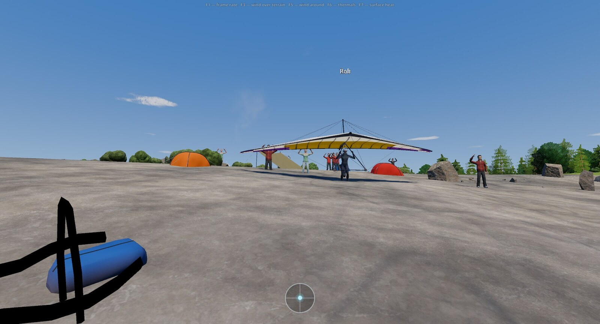
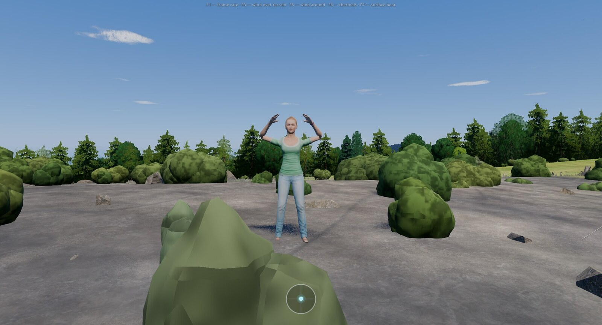
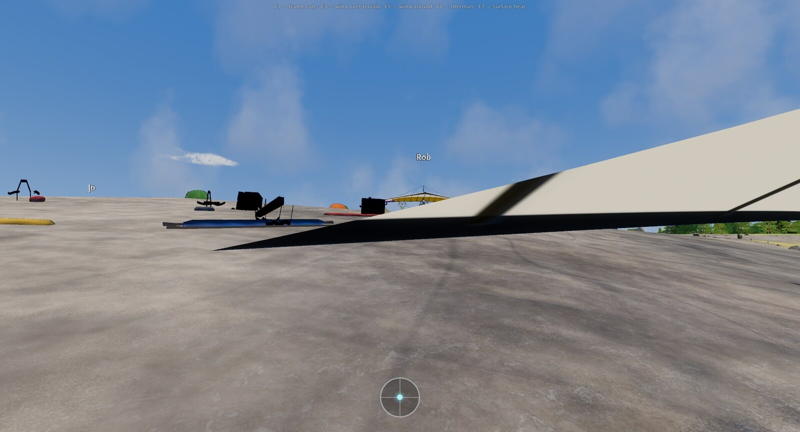
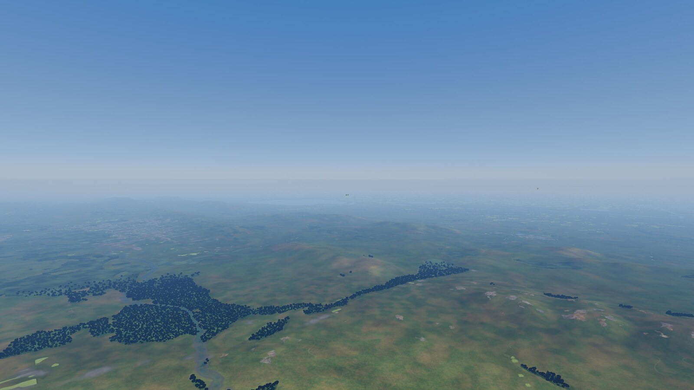

# Лагерь у старта и живой мир

Пустой склон со стартовой площадкой выглядел бы неправдоподобно: на настоящих стартах всегда кто-то есть, лежат крылья и чехлы,
трава вытоптана. Поэтому у каждого старта стоит лагерь пилотов, а вокруг мира время от времени что-то происходит: тянутся гуси,
лежат рулоны сена, высоко проходит самолёт. Всё это — картинка и звук. На полёт, воздух, ботов и счёт оно **не влияет**
(одно исключение — стоящие вещи лагеря, о нём ниже).

## Палатки

Палаток в лагере столько, сколько пилотов: ваша плюс по одной на каждого бота (настройка «Другие пилоты в небе»). В сетевой игре
число берётся из настройки зоны, поэтому у всех игроков лагерь одинаковый.

Где ставятся:
- в 30–50 м от старта, позади или сбоку; не впереди линии старта, не в коридоре разбега и не ниже старта по склону больше чем на 5 м;
- на ровном месте: уклон не больше 8° в радиусе 5 м, не на бровке обрыва;
- не на тропе к старту, не у домов, не на дорогах и реках, не в лесу, воде, на скалах и снегу, не на крупных камнях и кустах.

Если ровного места в этом кольце нет, радиус расширяется ступенями 60, 80, 150 м. На утёсе и крутом склоне палаток нет совсем —
меньше палаток или ни одной. Палатки стоят кучкой, три типа (купольная, туннельная, навес), шесть цветов; вход чаще по ветру;
палатка наклонена по рельефу.

Рядом с лагерем горит костёр; дым сносит местный ветер модели: в штиль тонкая струйка вверх, при 3 м/с наклонён, при 7 м/с
прижат к земле. Другие пилоты ждут своей очереди в стороне от палаток и вещей.

## Снаряжение у старта

У каждой стартовой площадки лежит и стоит снаряжение лётного выезда: 2–4 собранных крыла на базовой штанге носом в ветер,
один полусобранный аппарат (трубы с парусом в рулоне, трапеция на земле), 3–6 чехлов, 2–4 рюкзака с подвесками, 1–3 шлема,
2–5 бутылок. Крылья берутся из тех же моделей, что и в игре. Набор у данного старта всегда один и тот же: он не зависит от
погоды, времени суток, вас и ботов. Нос и концы штанги ставятся на землю по геометрии модели, поэтому на склоне крыло стоит на земле, а не висит над ней.

Палатки, крылья, аппарат и чехлы — препятствия: если врезаться, это авария, как с любым препятствием. Шлемы и бутылки
препятствиями не считаются.

## Примятая трава

Вокруг палаток, у вещей, на круге разбега и вдоль тропы к старту трава ниже, наклонена набок и чуть желтее. Это сделано не
для красоты: на склоне высокая трава закрывала палатки и тропу. При полном приминании высота травы — 12 % от обычной.
Значение подобрано без измерений и проверяется глазами, так что это «похоже», а не «как в жизни».

## Люди

Рядом с лагерем стоят, ходят и машут руками люди: 3–8 человек, когда пилот пролетает невысоко рядом (в пределах 150 м по
дальности и 60 м по высоте), они реагируют. Вблизи (до 100 м) — четыре разных человека с лицами и повседневной одеждой
(двое мужчин, две женщины); пятый и следующие повторяют первых четырёх. Вдали — упрощённые фигурки в цветах одежды; за границей видимости людей не рисуют. Одновременно с полной анимацией — не больше 8 человек, ближайшие первыми.

Где симулятор врёт: походка рассчитана примерно на 1,1 м/с, а люди движутся 0,05–0,2 м/с, поэтому шаг на месте скользит
заметнее, чем в жизни. Ладонь при взмахе смотрит туда, куда её привела дуга руки. Волосы вдали одного цвета.

## Звук шагов и шорох травы

На земле, при беге и ходьбе, слышны шаги по траве или гравию, дыхание нарастает за 4 секунды бега, после остановки или
посадки — одышка. Отдельно звучит шорох ног о траву: громче, чем быстрее ноги идут по земле и чем глубже они погружены
в траву. Это честный сигнал близости земли на взлёте и посадке, без индикаторов. Звук считается из высоты травы и скорости ног;
с картой примятой травы он не связан: на вытоптанном месте шорох такой же, как на целине.

## Лицензия моделей людей

Люди — модели [Microsoft Rocketbox](https://github.com/microsoft/Microsoft-Rocketbox) (Male_Adult_06, Male_Adult_10, Female_Adult_12,
Female_Adult_17), лицензия MIT, (c) 2020 Microsoft. Мы их переработали: прореженные уровни детализации, облегчённый скелет,
текстуры 512 пикселей, перенесённые анимации. Текст лицензии лежит в игре рядом с моделями, список ресурсов — в `ASSETS.md`
репозитория.

## Живой мир

Сцены вокруг появляются по месту, дате и погоде полёта; расписание не зависит от шага кадра, а у одного ключа мира (место и
даты) повторяется одно и то же. Многие бывают почти в каждом полёте, если подходят место, погода и время суток; гуси и самолёты — реже.

| Сцена | Что это | Когда видно |
|---|---|---|
| Рулоны сена | Круглые рулоны на лугах и полях: рядами по полю и горками у края | Ряды — июнь–сентябрь, горки — июнь–ноябрь, по дате полёта |
| Клинья гусей | Стая 20–40 птиц клином, меняется ведущий, слышен гогот | Весной (март–май) на север, осенью (сентябрь–ноябрь) на юг; в южном полушарии наоборот; вне сезона гусей нет |
| Брелок на трапеции | Фигурка чайки с раскинутыми крыльями на шнурке в правом углу трапеции; качается от кренов и болтанки | Всегда |
| Стада | Овцы, коровы или лошади; при приближении пилота ближе 80 м разбегаются | Апрель–октябрь, ветер не сильнее 10 м/с |
| УАЗ на бездорожье | Одна-две машины с шлейфом пыли | Когда рядом нашлась бездорожная долина; пыль только при температуре выше 5 °C |
| Ан-2 | Самолёт проходит низко над местностью, слышен звук | Апрель–октябрь, ветер не сильнее 8 м/с, солнце выше 5° над горизонтом |
| Лайнер | Высоко (9–11 км) идёт самолёт со следом, след держится дольше во влажном воздухе | Солнце не глубже 4° под горизонтом |
| Воздушные шары | Один шар или праздничная группа 15–40 | Утро (до 10:30) и вечер, апрель–октябрь, ветер не сильнее 3,5 м/с |
| Орёл | Обгоняет вас на несколько метров в термике или у скал | Солнце выше 5° над горизонтом |
| Группа дельтапланов | Другие пилоты на соседнем склоне, 1–3 бота | Солнце выше 10°, ветер не сильнее 9 м/с, не ближе 2 км до другого старта |

Условия в таблице — сокращённо; точные пороги лежат в конфигурации игры.

### Что это не меняет

Все эти сцены только рисуются и звучат: у них нет физических тел, столкновений, записи в карту препятствий и в данные ботов,
нет подсказок и текстов. Тест игры проверяет, что полёт со сценами и без них идёт побитно одинаково: физика, воздух, боты,
столкновения, счёт и итог. Пролететь сквозь Ан-2 можно, и ничего не случится. Каждая сцена отключается флагом в конфигурации игры.

### Границы

- Гуси, самолёты и шары — декорации, а не данные: они не показывают ветер на высоте и не отмечают термики, хотя шары идут по ветру.
- Орёл появляется возле скал и термиков модели (подъём не слабее 1 м/с), но это подсказка «похоже на подъём», а не измерение.
- Сено, стада и УАЗ ставятся на участки полей, лугов и бездорожья по данным о покрове; на неточных данных могут оказаться не там,
  где настоящее поле.
