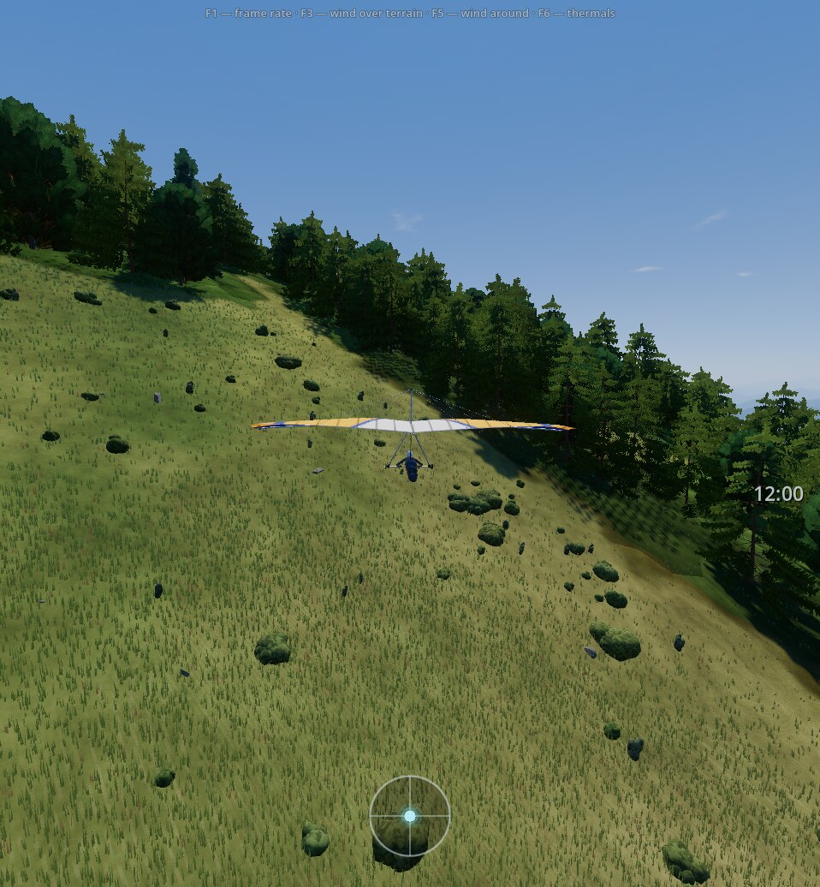

# Terrain and places

The terrain is not just a "mountain made of noise": underneath it are the real elevations of a specific place on Earth and a
real land cover map (forest, meadow, field, water, built-up area). You can take off from one of the built-in places or
pick a point on the map and fly wherever the data reaches. Houses, roads, power lines and other objects come from
OpenStreetMap (the project's own tiles, worldwide); if the tiles are unavailable, the place is built without them.

## Built-in places

| Place | What it is | Launches |
|---|---|---|
| `ongudai` | Altai, the Ursul valley near Ongudai, a ridge with the Kayancha pass (flights since the 1980s) | south slope at the Ongudai relay tower, 1870 m, heading 151° |
| `askarovo` | Bashkiria, the Biyagoda ridge near Idyash-Kuskarovo (hang gliding site, Russian Championship 2025) | west at the upper camp 294°, east 94°, south summit 285° |
| `aushkul` | Bashkiria, Lake Aushkul: Mount Austau ("pupyr") and the ridge near Starobayramgulovo | Austau east 119°, Austau south 170°, ridge west 273° |
| `altai` | Altai near Manzherok: Malaya Sinyukha and Tugaya | Sinyukha west 276°, Sinyukha summit east 115°, Tugaya south 150° |

Sources and assumptions for each place are in the `_sources_doc` of the place config, for example
[configs/locations/ongudai.json](/configs/locations/ongudai.json). In addition, the "Popular places" window offers a
catalog of ≈ 700 hang gliding launches in 24 countries (`data/places/hg_takeoffs.json`, from OpenStreetMap data:
name, height, the wind the launch works in); choosing one sets the launch point, like a point from the map.

## Building a place and flight by coordinates

A built-in place and any point on the map get the same set of layers: the code is one, the place builder
(`scripts/terrain/build/`), and five stages run in order: terrain (Copernicus GLO-30 + Terrarium), rivers from the
terrain, ESA WorldCover 10 m land cover, smoothing under forest and buildings, OpenStreetMap tiles. The game package holds no place data: the four built-in places are **downloaded
on first selection** and cached in `user://locations/<key>`. A cache with a different format version (`FORMAT_VERSION`) is
deleted and rebuilt. Example: the first build of `aushkul` with an empty cache takes 55.8 s and 166 requests.
Place data is stored as lossless WebP; elevations are 24 bit with a 1/32 m step (error against float32 is 0).

The loading screen shows a request counter ("Terrain: N/M", "Cover: N/M", "OSM: N/9", "Total: N/M"); there are no time
estimates. If the cover or the OSM tiles could not be fetched, the flight goes on without that layer (procedural cover,
no 10 m water and no cover-based houses; without OSM no roads or other objects), and the next run fetches only what is missing. Without terrain there is no place: a message and a return to the menu.
Details: [docs/guide/location-data.md](/docs/guide/location-data.md).

OSM tiles are cached separately (`user://osm_tiles/v1`); a place cache can be filled in advance without flying:
`deltaplan --headless -- --prefetch=lat,lon` (`--offline` forbids the network).

The place selection map is a raster basemap from tiles (`scripts/terrain/map_picker.gd`): OpenTopoMap by default or the
standard OpenStreetMap tiles, with a disk cache and attribution on the map. It is a menu basemap and provides no place data.

### Wind cache on disk {#wind-cache}

The wind field of a place is computed at load time (≈ 15 s), so the finished computation is saved to disk: if the
place, the start and the conditions are the same, the field is taken from the file. Reloading Ongudai takes 12.5 s
instead of 29.2, a map point 18 s instead of 40; the loading screen freezes for at most ~1-1.5 s (it was 6-12 s). The
first load of a place or of new conditions is hardly faster. The cache size is set in "Settings → Game → Wind cache on
disk": 0-2000 MB, 200 by default (an Ongudai entry is ≈ 17 MB, so about 11 places); long-unused entries are deleted,
0 turns the cache off. The cache lives only on this computer. Limit: on a processor with 4 cores or fewer loading is
slower - Ongudai 18 s on 4 threads and 24 s on 2, and the screen freezes for 3-6 s.

### Exact start on the terrain {#exact-start}

The main menu item "Pick launch on terrain" shows the place in 3D: a click on the ground puts the start point (nose
down the slope), dragging the mouse or the ±5° buttons set the run direction, "Downhill" returns it; "Fly from
here" starts the flight at once from this point without reloading the place. A start cannot be placed on water, in
built-up areas, on a slope steeper than 40° or near the edge of the loaded place - the marker turns red and the reason
is written beside it. The heading chosen by the pilot is not changed by the auto-turn into the wind; "wind at the
start" blows along the chosen heading. No rocks or bushes lie on the run (40 m) at any start. In a network game the
zone host's point and heading are the same for everyone. The point is saved with the flight settings; in "Flight
settings", the "Place" tab, shows the line "Launch set on terrain" and a "Reset" button; choosing another place
resets the point.

## Elevation sources

The detail layer (40 km, 25 m step) is **Copernicus DEM GLO-30** (1″ resolution, ≈30 m, cloud-hosted GeoTIFF, free,
no key): the best open quality, newer and cleaner than SRTM. Only the needed internal tiles are read (HTTP range
requests); smoothing σ = 0.8 cell, only under forest and buildings (see below). The background layer (160 km, 100 m step) is **Terrarium** (AWS Terrain Tiles,
Mapzen/Tilezen, z10): on land the base is the same SRTM, more accurate in some regions (Europe: EU-DEM, USA: 3DEP 10 m,
above 60° N: ArcticDEM). The detail layer is pasted into the background one, the nodes are aligned, and there is no step at the seam.

**Both Copernicus and SRTM are a surface model (DSM), not a ground model (DTM):** in a forest the "elevation" is the
top of the crowns (+15…25 m), and at forest edges and clearings there are steps the height of a tree. So the detail
layer is smoothed (Gauss σ = 0.8 cell) **only under forest and buildings**: `h = r + w·(G_σ(r) − r)`, where `w` is the
forest and built-up fraction from the 10 m mask, blurred over 50 m (the `smooth` stage, after the cover). Above the
forest and away from buildings, ridges and cliffs stay as in the Copernicus data; before, smoothing was applied
everywhere and cut about 40 % of the ridge curvature and ~5 m of height (build 1.5.14). The 3D trees are
additionally sunk into the surface. Without cover (no network) smoothing stays everywhere, as before.

Distant peaks are not lost between LOD grid nodes: a grid vertex is raised to the maximum of the heights in a window
around its node (a maximum pyramid), so Everest seen from Namche, which was 128 m lower than the real one, is now
~20 m lower; Ama Dablam from Gokyo went from 268 to 2 m. Sharpened ridges and gullies on high mountains are only a
picture: near the camera (200–350 m) it fades out and matches `height_at`, which the physics stands on. There are no open forest-free models for Altai:
FABDEM is licensed CC-BY-NC (unsuitable for a freely distributed game), and national lidar DTMs cover only individual countries.

## Land cover map

The surface class (forest, meadow, arable, shrub, rock, water, built-up, snow) comes from **ESA WorldCover 2021**
(10 m, CC-BY 4.0). The same map gives the ground color, where trees stand, and the strength of thermal
sources: three things from one file. The cover stage reads only the needed COG tiles (HTTP range requests, no GDAL) and
writes the node class as the mode of 3×3 subsamples.

For the detail layer a "10 m detail" mask is built (R is the forest fraction, G is the water fraction in a 10 m cell):
it makes forest edges and banks look smooth rather than a "staircase" of 25 m cells. Water in the mask is `max(WorldCover
"water" class fraction, river mask from the terrain)`. Rivers are computed from the terrain itself (drainage over the
background layer, width from the catchment area) and resampled bilinearly onto the 10 m grid; WorldCover sees lakes of
≥ 10 ha by itself. The trade-off: small and narrow water bodies are seen worse by WorldCover, and reservoir outlines
follow the 2021 state. The cover is a single snapshot: new buildings, a changed shoreline and clear-cuts are not visible.

If there is no cover (no network), a fallback procedural map by height, slope, aspect and noise (`SurfaceClassifier`)
is used, of the same form as the real one.

## Objects: OpenStreetMap, villages and the trail to the launch

**OSM tiles.** Objects come from the project's own tiles rather than Overpass queries: the world is cut into tiles
of ≈ 20 × 20 km (latitude bands of 0.18°, `max(1, floor(360·kx / 20000))` tiles per band), and the game takes 3×3 tiles
around the place center (`OsmTilesStage`, counter "OSM: N/9"; waiting at most 5 s, then the layer is skipped).
A tile (zstd + protobuf, `docs/guide/osm-tiles.md`) holds roads by class, houses (from 50 m²), power lines and pylons,
cable cars, aerodromes, vertical objects (masts, chimneys, wind turbines), railways, rivers and canals, and named
peaks and passes. Tunnels are not drawn. The data is © OpenStreetMap contributors (ODbL); the game prints the credit.

The tiles are packed by a Rust packer rather than a Python script: Kazakhstan (source `.pbf` 224 MB, 6119 tiles) takes
5.4 s on 16 cores, an order of magnitude faster than Python; object counts match Python (houses +0.002 % on Slovenia
and +0.008 % on Almaty, roads -0.03 %). The seam between neighbouring regions was checked on the Kazakhstan/Kyrgyzstan
border (74 tiles): the object counts before and after joining are equal, no duplicates. For the player this is
back-office; what matters is that the border of two regions is not visible in the game. The whole world has not been
built in one run: 7.2-7.4 GB is an estimate, not a measurement.

**What is in the game** (`scripts/world_objects/osm/`, `configs/world_objects.json`):
- **Houses** have a "city / village / industrial" style (different roofs, windows by floor, flat roofs with a
  parapet in cities). The height comes from tags; with no tags, the number of floors follows the house type and
  footprint area (3 m per floor, `configs/osm_tiles.json → height_rule`), and in big cities it grows toward the
  center (a multiplier up to 2.2 in the core of a million-plus city; glass towers of 15–30 floors). Some village
  houses have chimney smoke, and half of the industrial chimneys have a steam plume that the model wind carries at the chimney height.
- **Roads** are asphalt with patches and markings, with ruts on dirt roads; up to 200 cars drive on them within
  1.5 km of the pilot (`osm_traffic`: own speeds by road class, no overtaking). In the distance the ribbon is never
  thinner than a pixel, gray-beige, and cloud shadows lie on it.
- **Power lines** have lattice pylons and poles with wires on crossarms; **masts, chimneys, TV towers** are models;
  **wind turbines** turn into the model wind and spin with its strength (they stand still in calm and in storm); gondolas run on **cable cars**.
- **Peak and pass labels**: the "Peak labels" checkbox in "Settings → Game".
- **City trees**: birches along streets and in yards (visible within 0.4–1.1 km depending on the graphics preset).
- Clearings are cut in the forest along roads, railways and near houses. A "city ground" basemap between houses
  exists but is off by default (`city_ground.enabled`).
- There are no fences or field outlines in the game: fields are a coloring of the "arable" class (see "Snow, glaciers and seasons").

**Procedural villages** are placed only in built-up patches where OSM has no houses; the source is the WorldCover
"built-up" class. The cover stage writes the built-up basemap `detail_built10` (built-up fraction in a 10 m cell)
and patches, 8-connected components of cells with fraction ≥ 0.5 and area ≥ 3000 m². Inside a patch `VillagePlacer`
lays out a grid of yards (≈ 520 m²) with a random offset; a yard is occupied with probability equal to the built-up
fraction; it holds a procedural house (6×8…8×10 m, gable roof), with probability 0.7 a shed and 0.3 a bathhouse
(banya). There are no houses on slopes steeper than 14°; a house is turned along the contour. The generator is
deterministic by place and patch, so everyone in a network session sees the same houses.

**Trail.** A footpath dirt trail down the slope from each launch is always procedural. More on world objects:
[docs/guide/world-objects.md](/docs/guide/world-objects.md).

## Water

The "water" class sets not only the color but also the behavior: over water there are no thermals (on a summer day water is colder
than the air and cools it; in the evening warm water heats it; see [Thermals](/mechanics/air-model/thermals/)). Visually the water reacts to the wind: in calm it is a mirror, toward a wind speed of
≈ full roughness ("matte ripple"); the roughness and the direction of the ripple normals run across the
wind; in gust patches the ripple is darker ("cat's paws": less reflected sky), and against the sun it sparkles.
On the side the wind blows from, the water is damped by land and stays a smooth strip (4 samples of the water mask
upwind). Along the shore there is a thin strip of wet ground. For more on wind over water and land, see the
page [“Grass, water and landmarks”](/mechanics/visual-cues/).

## Ships at sea {#sea-ships}

Ships of three types stand off a sea coast: a tanker (250 m), a bulk carrier (225 m) and a container ship (300 m), 2-6
ships per place, 3-15 km from the coast and no farther than 30 km from the place center. The set depends on the place,
not on the pilot. This is scenery: the ships are **stationary**, the models are simplified (no bulbous bow, propeller
or underwater part), each with three levels of detail; on the Low preset the ships cast no shadows, on Medium and High
the near ones do.

: deck, superstructure and funnel, without a bulb or propeller")

The sea is determined from the elevation data: water at a level ≤ 0.25 m reaching the edge of the map, not lower than
-1 m at the coast. So the Caspian and the IJsselmeer count as sea, while Ladoga, Baikal, the Dead Sea and reservoirs
do not; skerries and fjords where water does not reach the map edge get no ships. Without a sea the layer creates
nothing. The sea water level in the terrain data is levelled (ocean 0 m); there are no depths under water in the data.

## Forest and vegetation

Four levels of forest seen from altitude (parameters in `configs/world.json → trees`, distances by graphics preset):

1. **Near models** (LOD0/1, up to 250 / 400 / 500 m on Low / Medium / High): 3D models, 8 models
   (birch, larch, cedar, spruce, pine, oak, palm, tropical tree); which of them exist at a place is decided by the
   region ([below](#regional-vegetation)), and within a region the species depends on the altitude belt and slope
   aspect (spruce on north, pine on south dry slopes), and a location can override the species weights. There is one tree per 8 m cell; presence, species
   and offset come from the cell hash (identical on CPU and GPU).
2. **Crosses** (LOD2, up to 900 / 1100 / 1500 m): two perpendicular billboards per tree built by the vertex
   shader; every tree has its own "model → cross" switch distance, so there is no visible ring on the slope.
3. **Impostors** (up to 3.5 km): billboards from an atlas on a 12 m grid; at the seam with the crosses they are
   denser and larger so that the forest area does not drop (the grids are 8 and 12 m, so density changes, not shape).
4. **Terrain canopy** (on the "forest" class itself in the shader): Voronoi crown cells ≈6 m, lighting by the sun,
   shadow from the neighboring crown, gaps; farther out, a smooth transition to the average tone with patches of stands.

Crowns of the models and the distant forest are matched to one brightness per species, so the boundary between
them is not visible; against the sun the crowns glow through (birch 0.55, larch 0.35, pine and cedar 0.2, spruce
0.15). Branches sway in the wind.

Trees stand only where the "10 m detail" mask shows forest (fraction ≥ 0.5) and do not stand in water (water
fraction < 0.35). At the forest edge the trees are denser and less sunk. Clearings (buildings, planted fields,
roads) cut out trees with an explicit mask (`WorldClearings`): neither a model nor an impostor lands there.

**The treeline depends on latitude:** by the table |φ| = 0 / 30 / 47 / 70° gives 3900 / 3500 / 2100 / 300 m, linear
between nodes. 300 m below the line the forest thins with meadow gaps; above it is an ocher-green alpine meadow
that fades out over 700 m above the line. The table is an order-of-magnitude assumption: local climate and
aspect are not taken into account.

**Mid-distance grass** (a ring of ≈ 8-40 m from the camera) is drawn in two ways, chosen by the angle of view to the
slope: looking along the terrain (under 15°) it is clump cards, looking down (over 30°) it is layers near the ground,
with a smooth blend between. Layers look like stripes at a shallow view and a card is squashed from above, so the
"by angle" mode is the default (since version 1.5.16). There is no grass on rock or on water.

The grass blades around the camera, their thinning and swaying in the wind are a separate mechanic; see
[docs/guide/vegetation.md](/docs/guide/vegetation.md) (parameters and graphics presets). Gusts on grass are seen
from altitude as stripes, light silvery-yellow or dark green, depending on the wind direction relative to the sun
and the view.

## Vegetation and houses by region {#regional-vegetation}

Since version 1.5.20 the set of trees and houses depends on the region of the place. The region comes from the
Köppen-Geiger climate map (Beck et al., 2018, CC BY 4.0): a decision tree on latitude and longitude was built from it
in advance (`configs/biomes.json`, 3 KB), and the game makes ~7 comparisons. Checked on 173 thousand land points and
683 catalog starts: a 128-leaf decision tree agrees with the map on **85 %** of the world; on the start catalog,
mostly the Alps, the agreement is 86-89 %, where the temperate, boreal and alpine regions are told apart by altitude.
In the other 15 % of the world the region from the tree differs from the Köppen map, and on islands and coasts this
is likelier.

- **Alps and Caucasus:** spruce, larch, cedar, pine, oak, birch.
- **Near Nice** (Mediterranean): pine, oak, palm; houses with hipped roofs and terracotta, up to 4 floors.
- **Tropics:** tropical forest and palm; the canopy is evergreen (it does not turn yellow in autumn), the tone is
  darker and more saturated. Palms grow up to ≈ 450 m, forest up to ≈ 1700 m, and there are no trees above. Houses
  are tin-roofed and on stilts.
- **Savanna:** rondavel houses; **dry regions:** flat roofs with a parapet.
- **Altai and the Urals** are unchanged.
- **Hanga Roa (Rapa Nui):** one floor, tin roofs.

 from altitude: a solid dark green tropical forest canopy with a few clearings")

, wooded slopes behind it")

**Houses.** Village houses are small 3D models of the region (tin, stilts, rondavel, terracotta), while the city is
still "boxes" with windows by floor. This is deliberate: a model of fixed proportions stretched to a house outline
loses its floors, and for a city of hundreds of thousands of houses (Almaty 3×3 tiles has 280,412) a box is cheaper.

: a corrugated tin roof, windows and a door - unlike a smooth box")

**Limits.** The altitude belts and species weights are a simplification: one altitude curve for the whole world, so in
the tropics there are no trees above ≈ 1700 m, and the species of the Southern Hemisphere and Africa are reduced to the
same models (oak, palm, tropical tree). Houses by region are a few typical models, not local architecture.

## Snow, glaciers and seasons

**Seasons** follow the flight date, latitude and altitude (`SeasonLook`, Hopkins' law): the phenological phase
shifts by ≈ 4 days per degree of latitude and ≈ 122 m of height (in autumn the height shift is half as strong, an
assumption). In spring there is fresh grass, by the end of summer drying, in autumn the gold of birches and larches,
then bare crowns. In the southern hemisphere the date is shifted by half a year; in the tropics (below ~20–26°
latitude) there is no change of seasons. Fields go through phases: plowed land, shoots, green rye, ripe grain,
stubble, plowing; about 45 % of the cells are crops, and neighboring fields differ in tone.

**Snow.** Above the seasonal snow line lies fresh snow, and on gentle (14–26°) concave snowfields below the line
there is a glacier with transverse crevasses. The summer line by latitude 10 / 46 / 60 / 70° is 4900 / 3200 / 1500 /
500 m; in winter it drops (by 2000 m at 46°). Examples: 15 January at 51° is about 970 m, 15 July at 46° about
2890 m. Snow does not hold on slopes steeper than ~45°, and its edge is ragged. The line depends on date and
latitude but not on the forecast temperature, and ignores local climate and precipitation; the glacier is
determined by slope and concavity, with no data on real ice.

## Rocks, scree and light

- **Rocks and scree.** Rock texture without a repeating pattern (noise with periods incommensurate with the 6 m
  tile), cracks, boulders of different tone; under cliffs there are light scree cones on 26–36° slopes. 3D stones
  near the ground (`rock_scatter.gd`) lie in rows along the slope and as scree. Rock is visible up to 6–12 km.
  Above the forest the rock is darker and colder. The scree fan is computed only on nearby steep slopes.
- **Cattle trails.** On meadows of 16–35°, beyond 60–160 m, light ledges and step shadows are visible every 1.2–2.8 m of height.
- **Light and haze.** Sky and ground light slopes differently (from below, light reflected from meadow or forest).
  The shadow of distant mountains removes only direct sun, leaving the blue sky glow in the shade; the shadow of
  ridges also lies around the pilot (before, ground 2–3 km around the pilot stayed lit in a ridge's shadow). Haze
  depends on the direction to the sun: a bright halo toward the sun, darker away; its density is the "Haze toward the sun" slider in the graphics settings.
- **Large tone patches** on meadows (scales 0.5–3 km) and lusher grass along rivers and lakes (a strip of ~60 m).

## Graphics presets

A preset sets (`configs/game.json → graphics_presets`):

| | Low | Medium | High |
|---|---|---|---|
| Terrain shader variant | lightweight (`low`) | full | full |
| Grass density | 0 (off) | 100 % | 150 % |
| 3D trees / crosses | 250 / 900 m | 400 / 1100 m | 500 / 1500 m |
| Sun shadows | up to 1200 m, no tree shadows | up to 2000 m | up to 3000 m |
| City trees | density 0.35, up to 400 m | 0.7, up to 700 m | 1.0, up to 1100 m |
| Clouds (count) | 90 | 160 | 220 |
| 3D scale | 0.75 of the window + FSR 1 | 1.0 | 1.0 |
| Anti-aliasing (MSAA) | none | 2× | 2× |
| SSAO and glow | off | - | - |
| Ship shadows | none | near ones | near ones |

On Low the shader variant turns off rock outcrops on meadows, rock roughness, tone patches, greenery by water, the
treeline, trails, fresh snow, glaciers and the grass wind sheen; beyond ~3.5 km the terrain is drawn with a
lightweight variant on all presets. Bench measurement (Ongudai, 800 m above ground, 1080p, full frame): Low 4.14 ms
versus 5.68 before the new scene look, Medium 5.59 versus 5.89, High 5.74 versus 5.87. These milliseconds are bench
measurements of the scene ("scene look", `scene-look`), not the overall frame profile; other hardware will give other
numbers. The first launch on integrated graphics sets Low straight away.

## How the terrain is built and loaded

**Mesh.** Each elevation layer is cut into chunks; all chunks of a layer share flat grids of several LODs
(step 1, 2, 4… cells), and the vertex shader adds the elevation by sampling the height texture, so
building the mesh is instant. The LOD is switched by the camera distance to the chunk; gaps between levels
are closed by a "skirt". There is no collision as such: flight and landing use the `height_at` function
(bilinear interpolation of the most detailed layer covering the point; ≈1.6 µs per call).

**Place loading** does not hang the main thread: elevation and cover blocks are downloaded via `HTTPRequest` (blocks are
cached in `user://terrain_cache`, and a neighboring place takes them from there), heavy computation runs in the
`WorkerThreadPool`, and the assembly of the mesh, trees and grass proceeds frame by frame while the loading screen shows the request counter. At high latitudes a web Mercator
pixel shrinks as cos(latitude), so the tile level is lowered automatically to keep the grid from
ballooning (for example, near Greenland at 72° N).

**Errors** return to the menu with a clear message: no connection to the terrain server, no data for the point
(tile 403/404), the point is sea (elevation below sea level with no cover map showing land nearby), the terrain server
does not respond (timeout on unchanged progress).

## Model limits

- **Resolution.** Elevations are 25 m for the detail layer (100 m for the background one), the cover map is 10 m for the
  detail mask / 25 m for the general class map. The terrain distinguishes nothing finer: rocks, paths and
  individual bushes on the map are not "real" but a procedural pattern following statistics.
- **DSM, not DTM.** The elevation in a forest is the top of the crowns, not the ground below; landing in a forest is
  a collision with the crowns, not a descent through them to the ground.
- **Objects.** Houses, roads, power lines and the rest come from OSM, so they are as complete and fresh as the
  volunteers made them: where OSM has no houses there are none in the game (except procedural ones in WorldCover
  patches). There are no fences, tunnels are not drawn, and for houses without a height tag the number of floors
  follows a rule rather than the fact. In a tile (an equirectangular projection at the band's central latitude)
  the longitude scale error is up to ±0.27 % at 60°.
- **Launches and landings.** Named launches and landing fields are manual data only for built-in places; for an arbitrary
  point the launch is at the chosen point, heading down the slope (an exact launch can be set on the terrain with a click:
  not on water, not in a built-up area, not steeper than 40°).
- **Seasons and snow depend on date and latitude.** The Hopkins coefficients and the treeline and snow line tables are
  order-of-magnitude assumptions; the model knows nothing about precipitation, snow depth, or the state of real glaciers.
- **The scene look is tuned by numbers.** Widths, strengths and colors of the effects (rock, snow, haze, tone
  patches) were chosen by numbers and tests, not checked against photographs or frames of specific places.
- **Time zone** is by longitude (`round(lon/15)`); the game does not know time zone borders.
- **Thermals are tied to the same map** as the ground color: if WorldCover got a class wrong (a typical
  satellite classification error is to mistake a floodplain for forest), it shows equally in the thermals and in the picture;
  the model does not "peek" at the right answer separately from what the pilot sees.

## What was considered and why it is done this way

- **One path for built-in places and any point.** Built-in places used to have pre-built data and points by
  coordinates poorer data. Now the build code is one, a place is equally rich everywhere, and OSM comes from tiles
  shared by everyone.
- **OSM: Overpass, own tiles, or no OSM.** Overpass is no longer used as a source; for a while the game ran without
  OSM (built-up areas from WorldCover, rivers from the terrain, no roads or power lines). Then the objects came
  back through own tiles of ≈ 20 km covering the planet (size estimate ≈ 7.2–7.4 GB against a 10 GB R2 budget):
  one file request instead of a map server query, a disk cache, and a flight without the layer if the network fails.
  The price: the data is updated only by rebuilding the tiles.
- **Lakes and rivers without OSM outlines.** Water comes from WorldCover and the terrain, not from OSM polygons. WorldCover sees lakes of ≥ 10 ha by itself (coverage of OSM polygons 0.85–0.98 at
  Aushkul, Chebarkul, Atavda, Muldakkul), and rivers are computed from drainage. Details: `docs/research/lakes_worldcover.md`.
- **Map tiles for the place selection screen.** Standard `tile.openstreetmap.org` tiles are, by usage policy, for
  moderate traffic with attribution and no bulk prefetching; so the default basemap is OpenTopoMap with a disk cache.
  Paid services (MapTiler, Thunderforest) would require embedding an API key in open code.
- **DEM.** Copernicus is better in quality than the SRTM-based Terrarium tiles, but the whole globe cannot be bundled into the
  game as a ready layer; so the detail layer is taken from the Copernicus COG when a place is built, and the background from Terrarium
  (open PNG tiles with no key, decoded by the engine itself). OpenTopography requires a key and limits the number of requests.
- **No forest-free DTM was found** with a suitable license (FABDEM is CC-BY-NC), so instead of trying to remove the
  forest from the elevations, smoothing only under forest and buildings plus sinking the 3D tree models was chosen.
  Smoothing everywhere (as before 1.5.14) cut the ridges of high mountains, so it is limited by the forest and built-up mask.
- **Distant forest: billboards or crosses.** Flat billboards at 0.5–3.5 km gave a ring where "model → impostor →
  canopy" switched. Crosses of two cards per tree are costlier (63 / 92 / 168 thousand instances by preset) but
  have no ring; the cost of the module as a whole is in "Graphics presets".
- **One map for three tasks.** The ground color, the placement of trees and the strength of thermals could have lived in
  three different structures; we decided to keep one surface map as the single source of truth, which is
  both simpler and keeps the picture from diverging from the thermal model.

## More

- [docs/guide/terrain.md](/docs/guide/terrain.md): the full structure of the terrain module (files, formulas, parameters).
- [docs/research/terrain_sources.md](/docs/research/terrain_sources.md): comparison of elevation sources and
  map basemaps.
- [docs/guide/location-data.md](/docs/guide/location-data.md): place building: stages, formats, cache, loading counter.
- [docs/guide/osm-tiles.md](/docs/guide/osm-tiles.md): the format and building of OSM tiles.
- [docs/guide/scene-look.md](/docs/guide/scene-look.md): the scene look: light, season, snow, rock, distant forest, GPU cost.
- [docs/guide/world-objects.md](/docs/guide/world-objects.md): villages, trail, landing fields, windsocks.
- [docs/research/regional-vegetation.md](/docs/research/regional-vegetation.md): trees and houses by region: the Köppen-Geiger map, the measured accuracy of the decision tree (85 %), the model set.
- [docs/research/house-models.md](/docs/research/house-models.md): why village houses are models while the city stays boxes.
- [docs/guide/fast-load.md](/docs/guide/fast-load.md): the wind cache on disk and fast loading; Ongudai measurements.
- [docs/registry/findings.md](/docs/registry/findings.md#osm-tiles): the Rust OSM tile packer: speed, region seam.
- [CHANGELOG.md](/CHANGELOG.md): versions 1.5.9 (exact start), 1.5.16 (grass), 1.5.19 (ships, wind cache), 1.5.20 (region).
- [docs/guide/vegetation.md](/docs/guide/vegetation.md): grass blades and trees along the forest edge.
- Code: [scripts/terrain/](/scripts/terrain/), [scripts/world_objects/](/scripts/world_objects/).
- Place data building: [scripts/terrain/build/dem_stage.gd](/scripts/terrain/build/dem_stage.gd),
  [scripts/terrain/build/river_stage.gd](/scripts/terrain/build/river_stage.gd),
  [scripts/terrain/build/surface_stage.gd](/scripts/terrain/build/surface_stage.gd),
  [scripts/terrain/build/smooth_stage.gd](/scripts/terrain/build/smooth_stage.gd),
  [scripts/terrain/build/osm_tiles_stage.gd](/scripts/terrain/build/osm_tiles_stage.gd).

