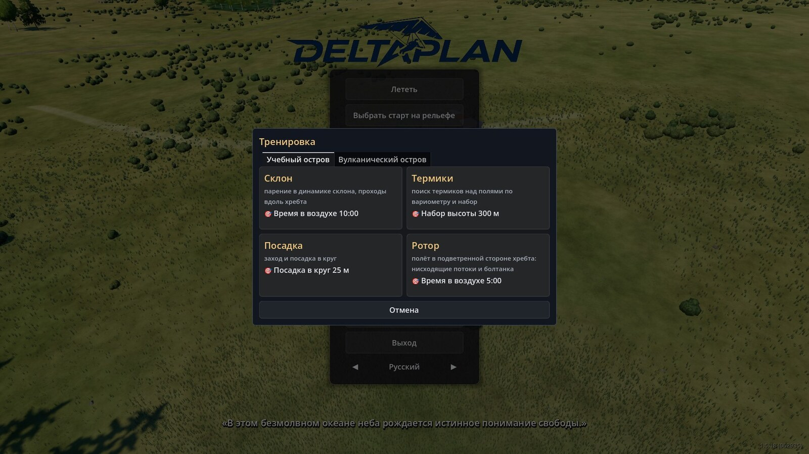
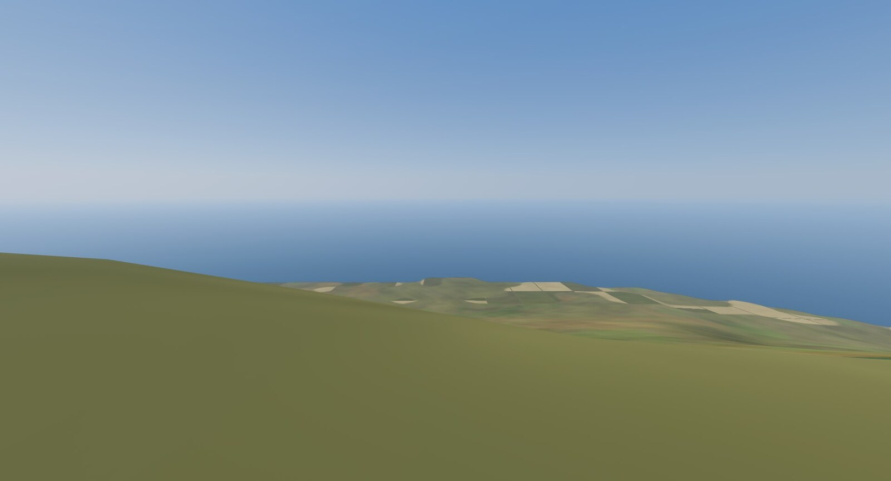
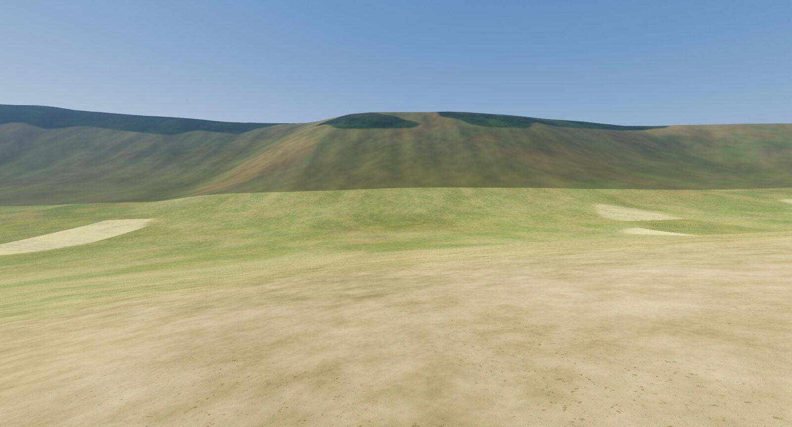
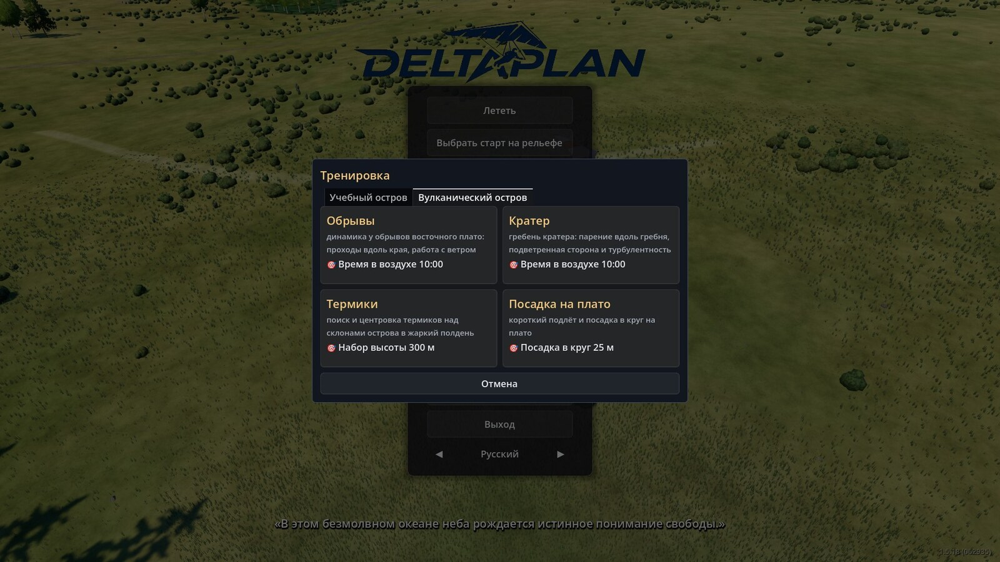
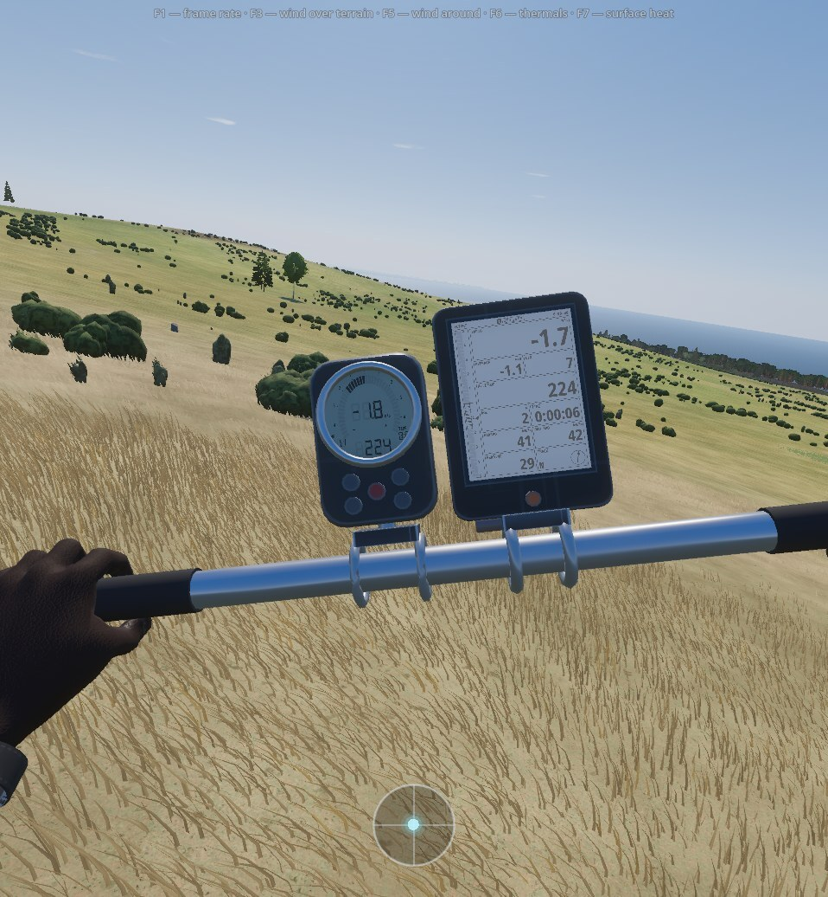

# Training islands

The Training window offers two places: **Training Island** and **Volcanic Island**. Each exists so that a single flight
shows one kind of air — ridge lift, a thermal, rotor, a landing — without hunting for the right day and place. For that,
every start has its weather set in advance. Every start has its own card with a flight goal; how the window works is on the page [The Training window](/docs/training/).

## Training Island {#training-island}

A fictional place, 15 × 10 km, generated from the game's own files: there is no real location behind it, and no network or terrain build is needed. The data ships inside the game. The four starts are in "Popular places" too (without a country). Each start has its own kind of air:

| Start | What it trains | Weather at the start |
|---|---|---|
| "Ridge" | ridge soaring: passes along the ridge in slope lift | wind 6 m/s from 270°, overcast, 20 °C, 12:00 |
| "Thermals" | finding thermals over the fields by the variometer and climbing | wind 2 m/s from 180°, partly cloudy, 25 °C, 12:00 |
| "Spot landing" | approach and landing in a circle | wind 1 m/s from 270°, clear, 22 °C, 09:00 |
| "Rotor" | flying on the lee side of the ridge: sink and turbulence | 8.5 m/s inflow from 270°, overcast, 20 °C, 12:00 |

The date is 15 July everywhere. The ridge is overcast and windy so that weak thermals do not get in the way of learning the ridge; "Thermals" is the opposite: light wind and a warm day.

## Volcanic Island {#volcano-island}

The island is real: about 24 × 18 km, land of about 165 km², highest point 507.6 m. Terrain and land cover come from open data,
unedited; the name and coordinates are not given in the game or on the site. The data ships inside the game, no network is needed. The place is reachable only from the
Training window — it is not in the Popular places list or on the map picker. Roads and buildings come from the place's own files.

All four starts have the date 15 January and wind from 110° (the trade wind). The four starts:

| Start | Where | Heading | Weather and card goal |
|---|---|---|---|
| "Cliffs" | edge of the sea cliff of the eastern plateau | 110° | 6 m/s, partly cloudy, 27 °C, 12:00; 10 min airborne |
| "Crater" | edge of the south-west cliff above the crater | 110° | 6 m/s inflow, partly cloudy, 27 °C, 12:00; 10 min airborne |
| "Thermals" | island summit, meadow | 110° | 3 m/s, clear, 28 °C, 15:00; climb 300 m |
| "Plateau landing" | short approach to a target | 90° | 2 m/s, clear, 27 °C, 09:00; landing in a 25 m circle |

## Start weather {#start-weather}

A start can have fixed weather: wind, hour, date, sky and temperature come from the start's set, the weather and time fields in the "Flight settings" window are unavailable, and the line under them says what weather is set ("Start weather is fixed: …"). Time still runs as usual. The set's wind is given either at the start itself or as the inflow at the edge of the area (at "Rotor" and "Crater"): then the wind at the start behind the ridge is weaker than the set, as in real life. The wind over the island's terrain is computed by the game's general wind calculation, as at any other place.

## How the islands differ from real places {#limits}

- **Training Island is fictional.** The terrain is generated, the height range tuned to the task. The general layout — a ridge above the sea, fields, a hill, a bowl — is instructional, not taken from life.
- **Card names promise more than the goal checks.** The goal is an ordinary flight goal (time aloft, height gain, landing in a circle); the game does not look at where exactly you flew.
- **No lift figures are promised on this page.** What a ridge, rotor or thermal gives at a particular start is shown by the flight itself.
- **Volcanic Island has no trade-wind inversion.** The model has none, so thermals lift higher than on a real island.
- **The lift comes from the sea cliffs**, not from a gentle slope. There are no level landing fields, only meadow ledges.
- **One season and one wind direction are set:** January, trade wind 110° (the start sets contain no others).

## More {#more}

- [docs/guide/volcano-island.md](/docs/guide/volcano-island.md) — Volcanic Island: data, starts, weather, limits.
- [docs/research/training_island_air.md](/docs/research/training_island_air.md) — the weather of the Training Island starts.
- [docs/guide/location-data.md](/docs/guide/location-data.md) — place data.
