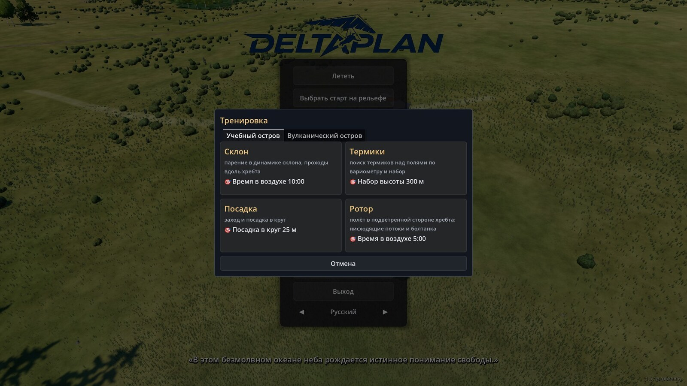
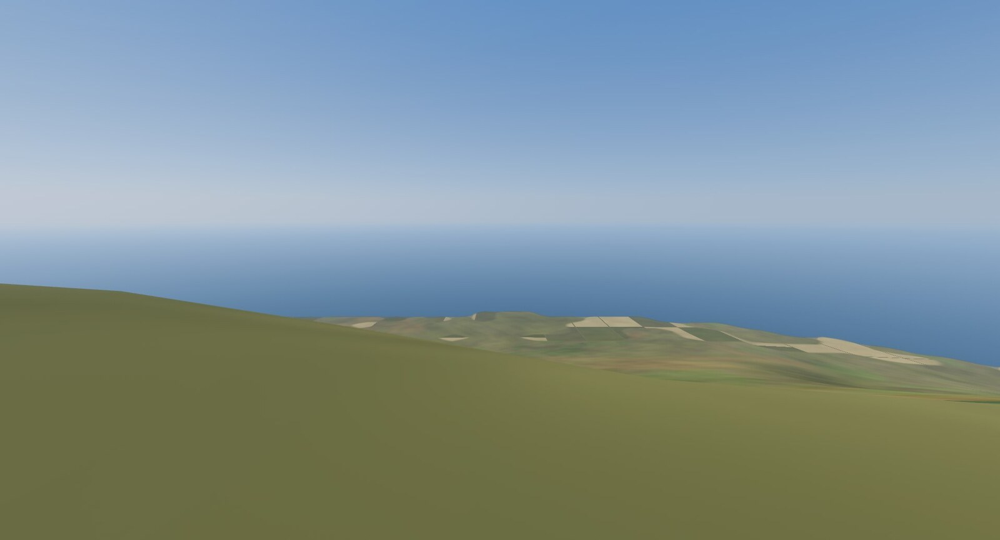
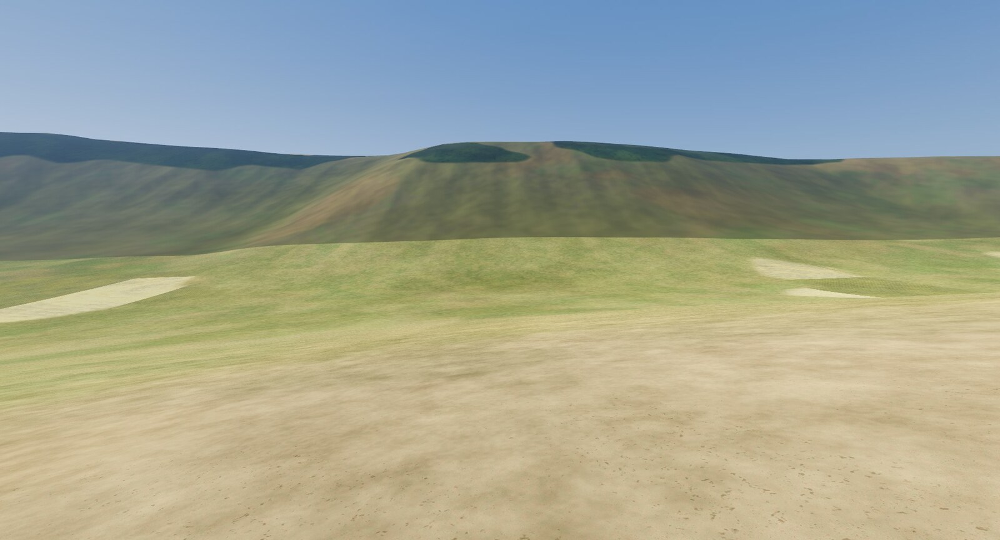
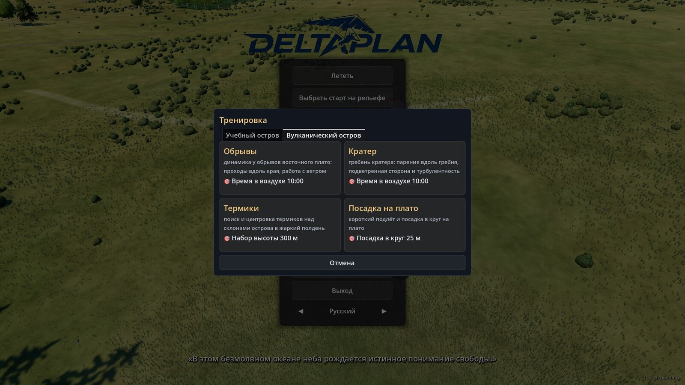
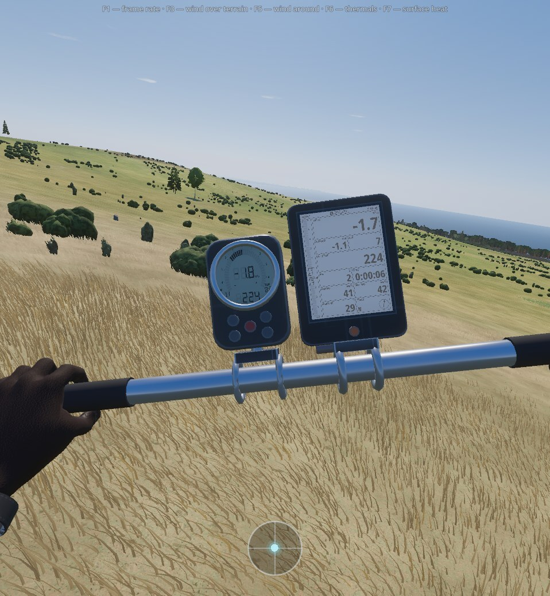

# Учебные острова

В окне «Тренировка» два места: **Учебный остров** и **Вулканический остров**. Оба нужны, чтобы за один вылет почувствовать один вид воздуха — склон, термик, ротор, посадку — без подбора дня и места. Для этого у каждого старта заранее задана погода. У каждого старта своя карточка с целью полёта; как устроено окно — на странице [«Окно „Тренировка“»](/docs/training/).

## Учебный остров {#training-island}

Вымышленное место 15 × 10 км, сгенерированное из файлов игры: реального места за ним нет, сеть и сборка рельефа не нужны. Данные лежат в сборке. Четыре старта есть и в «Популярных местах» (без страны). У каждого старта свой тип воздуха:

| Старт | Что отрабатываем | Погода у старта |
|---|---|---|
| «Склон» | парение в динамике склона, проходы вдоль хребта | ветер 6 м/с с 270°, пасмурно, 20 °C, 12 ч |
| «Термики» | поиск термиков над полями по вариометру и набор | ветер 2 м/с с 180°, переменная облачность, 25 °C, 12 ч |
| «Посадка» | заход и посадка в круг | ветер 1 м/с с 270°, ясно, 22 °C, 9 ч |
| «Ротор» | полёт в подветренной стороне хребта: нисходящие потоки и болтанка | набегающий поток 8,5 м/с с 270°, пасмурно, 20 °C, 12 ч |

Дата везде 15 июля. Склон сделан пасмурным и ветреным, чтобы слабые термики не мешали учиться склону; «Термики» — наоборот, слабый ветер и тёплый день.

## Вулканический остров {#volcano-island}

Остров реальный: примерно 24 × 18 км, суша около 165 км², высшая точка 507,6 м. Рельеф и покров взяты из открытых данных без правок; название и координаты в игре и на сайте не указываются. Данные лежат в сборке игры, сеть не нужна. Место доступно только из окна «Тренировка» — в «Популярных местах» и при выборе на карте его нет. Дороги и здания — из файлов места.

У всех четырёх стартов дата 15 января, ветер с 110° (пассат). Четыре старта:

| Старт | Где | Курс | Погода и цель карточки |
|---|---|---|---|
| «Обрывы» | кромка морского обрыва восточного плато | 110° | 6 м/с, переменная облачность, 27 °C, 12 ч; 10 мин в воздухе |
| «Кратер» | кромка юго-западного обрыва над кратером | 110° | набегающий поток 6 м/с, переменная облачность, 27 °C, 12 ч; 10 мин в воздухе |
| «Термики» | вершина острова, луг | 110° | 3 м/с, ясно, 28 °C, 15 ч; набор 300 м |
| «Посадка на плато» | короткий подлёт к мишени | 90° | 2 м/с, ясно, 27 °C, 9 ч; посадка в круг 25 м |

## Погода старта {#start-weather}

У старта может быть фиксированная погода: ветер, час, дата, небо и температура берутся из набора старта, поля погоды и времени в окне «Настройки полёта» недоступны, а строка под ними пишет, какая погода задана («Погода старта фиксирована: …»). Время при этом идёт как обычно. Ветер набора задан либо у самого старта, либо как набегающий поток на краю области (у «Ротора» и «Кратера»): тогда ветер у старта за хребтом слабее набора, как и в жизни. Ветер над рельефом острова считает общий расчёт ветра игры, как на любом другом месте.

## Чем острова отличаются от настоящих мест {#limits}

- **Учебный остров вымышлен.** Рельеф сгенерирован, перепад высот подогнан под задачу. Общая схема — хребет над морем, поля, холм, чаша — учебная, а не с натуры.
- **Названия карточек обещают больше, чем проверяет цель.** Цель — обычная цель полёта (время в воздухе, набор высоты, посадка в круг); игра не смотрит, где именно вы летали.
- **Числа подъёма на странице не обещаны.** Что даёт склон, ротор или термик на конкретном старте, показывает сам полёт.
- **Вулканический остров без пассатной инверсии.** В модели её нет, поэтому термики поднимают выше, чем на настоящем острове.
- **Подъём дают обрывы к морю**, а не пологий склон. Ровных посадочных полей нет — только луговые уступы.
- **Задан один сезон и одно направление ветра:** январь, пассат 110° (в наборах стартов других нет).

## Подробнее {#more}

- [docs/guide/volcano-island.md](/docs/guide/volcano-island.md) — вулканический остров: данные, старты, погода, границы.
- [docs/research/training_island_air.md](/docs/research/training_island_air.md) — погода стартов Учебного острова.
- [docs/guide/location-data.md](/docs/guide/location-data.md) — данные мест.
