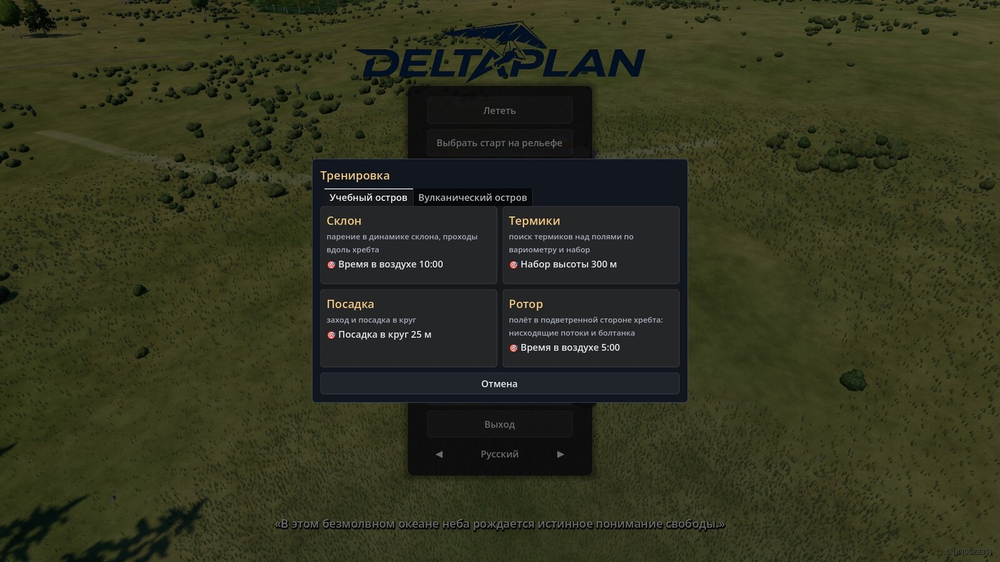
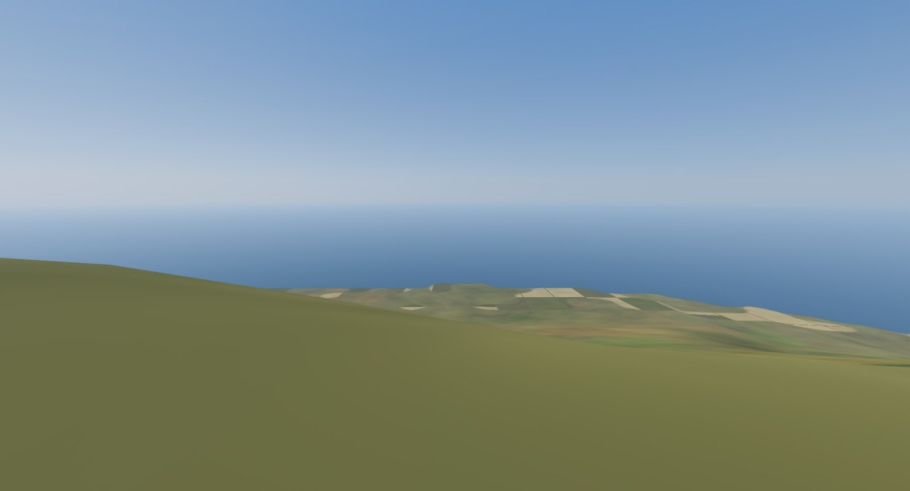
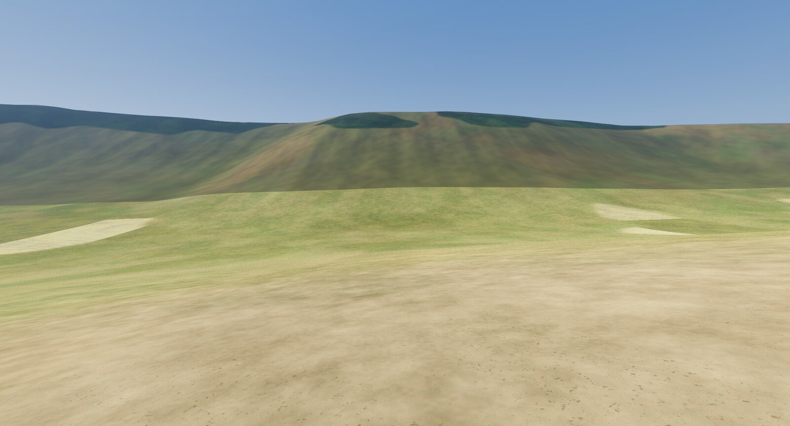
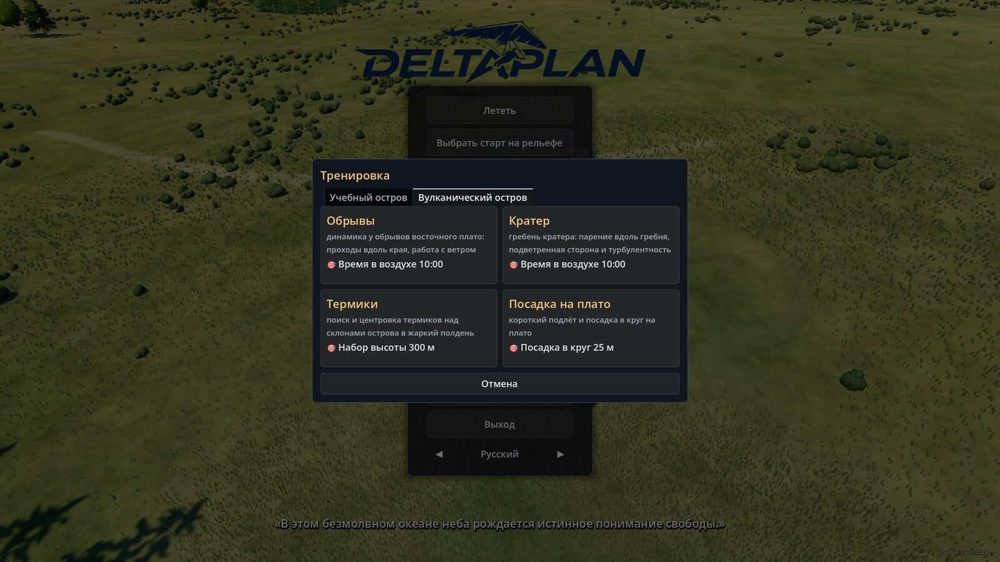
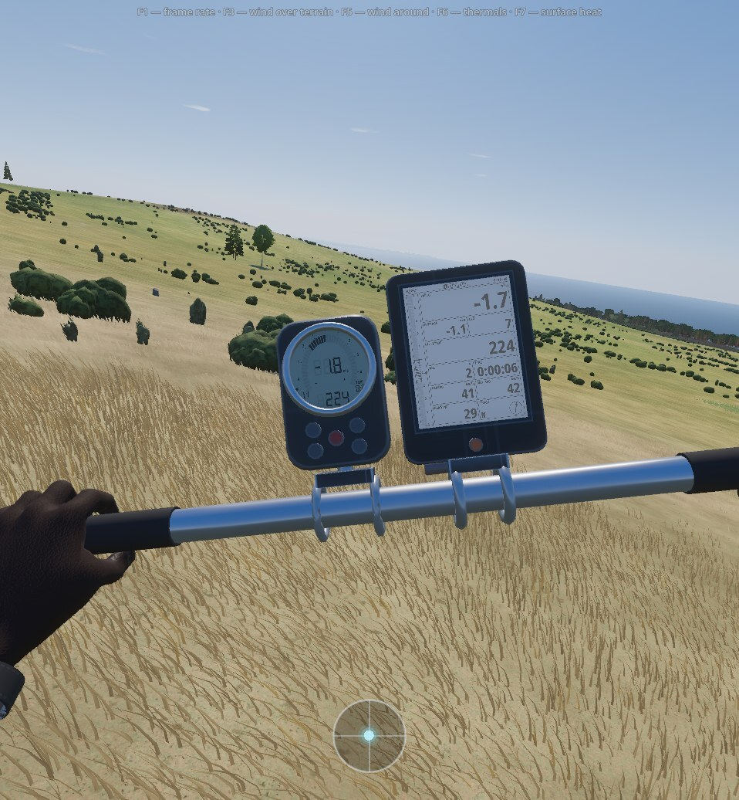

# Учебные острова

В окне «Тренировка» два места: **Учебный остров** и **Вулканический остров**. Оба нужны, чтобы за один вылет
почувствовать один вид воздуха — склон, термик, ротор, посадку — без подбора дня и места. Для этого у каждого
старта заранее задана погода, а поле ветра запечено в файл и грузится за секунду. У каждого старта своя карточка с целью полёта.

## Учебный остров {#training-island}

Вымышленное место 15 × 10 км, сгенерированное из файлов игры: реального места за ним нет, сеть и сборка рельефа не нужны.
Четыре старта, у каждого свой тип воздуха:

| Старт | Что учит | Ветер у старта | Что даёт воздух |
|---|---|---|---|
| «Склон» | парение вдоль хребта | 6 м/с с 270°, пасмурно, 12 ч | подъём над гребнем: в среднем +1,83 м/с (при 5 м/с — +1,41, при 8 м/с — +2,52), вверх во всех 153 проверенных точках |
| «Термики» | поиск и набор в термике | 2 м/с с 180°, 25 °C, переменная облачность, 12 ч | ядра термиков над полями: медиана 1,98, p90 2,66, максимум 4,1 м/с; кромка 1741 м над морем |
| «Посадка» | заход и посадка в круг | 1 м/с с 270°, утро (9 ч), ясно | почти штиль: у мишени 1,16 м/с |
| «Ротор» | полёт за хребтом | 8,5 м/с набегающего потока с 270°, пасмурно, 12 ч | за гребнем у земли ветер обратный в 56 % точек, вертикальная скорость до −1,67 м/с |

Дата везде 15 июля. Склон нарочно сделан пасмурным и ветреным: слабые термики не мешают учиться склону.
Термики — наоборот: слабый ветер, тёплый день, над морем термиков нет совсем.

## Вулканический остров {#volcano-island}

Остров реальный: примерно 24 × 18 км, суша около 165 км², высшая точка 507,6 м. Рельеф и покров взяты из открытых данных
без правок; название и координаты в игре и на сайте не указываются. Данные лежат в сборке игры, сеть не нужна. Место доступно только из окна
«Тренировка» — в «Популярных местах» и в меню полёта его нет. Дороги и здания — из файлов места.

Пассат дует с 110° почти постоянно, у склонов 6 м/с, 15 января, 12 ч, переменная облачность, 27 °C. Четыре старта:

| Старт | Где | Высота, курс, уклон | Цель карточки |
|---|---|---|---|
| «Обрывы» | кромка морского обрыва восточного плато | 141 м, 110°, 8,9° | 10 мин в воздухе |
| «Кратер» | кромка юго-западного обрыва над кратером | 226 м, 110°, 12,7° | 10 мин в воздухе |
| «Термики» | вершина острова, луг | 504 м, 110°, 10,3° | набор 300 м (3 м/с, 15 ч, 28 °C, ясно) |
| «Посадка на плато» | короткий подлёт к мишени | 219 м, 90°, 13,1° | посадка в круг 25 м (2 м/с, 9 ч, ясно) |

Что показала проверка воздуха (6 м/с, без болтанки): над бровкой «Обрывов» в среднем +1,43 м/с (p90 2,30), у «Кратера» +1,56 (p90 2,31),
во всех проверенных точках подъём. Ротор у кратера слабый: обратный ветер лишь в 3,3 % точек за бровкой, минимум w −1,20 м/с.
Термики над сушей: ядра p90 4,1–4,3 м/с; над морем термиков нет.

## Погода старта и запечённые поля ветра {#start-weather}

У старта может быть фиксированная погода: ветер, час, дата, небо и температура берутся из набора старта — одинаково из меню, при повторе,
в сети и из командной строки. Время при этом идёт как обычно. Ветер набора задан либо у самого старта, либо как набегающий поток на краю области
(у «Ротора» и «Кратера»): тогда ветер у старта за хребтом честно слабее набора, как и в жизни.

Поле ветра запечено заранее. Если условия совпали с файлом, игра читает его вместо расчёта: старт острова грузится около 0,7 с вместо 14–58 с,
этап «Рассчитываем ветер» не показывается. Поля четырёх стартов Учебного острова занимают 25,9 МБ. От расчёта «в лоб» запечённое поле
отличается не больше чем на 0,007 м/с (проверка на Онгудае; хранится в float16). Файла нет или условия не совпали — считается как обычно.

## Чем острова отличаются от настоящих мест {#limits}

- **Учебный остров вымышлен.** Рельеф сгенерирован, перепад высот подогнан под задачу. Общая схема — хребет над морем, поля, холм, чаша — учебная, а не с натуры.
- **Погоду набора не меняют.** Термики на Учебном острове получены только подбором погоды старта, без правки общих параметров модели. Кромка 1741 м
  посчитана по сухому воздуху модели (точка росы июля), без влажности моря: над настоящим морским островом база ниже, облаков больше.
- **Набор термиком 788 м за 15 мин** — оценка «идеального» пилота: кружение строго по оси, без разбега и болтанки. Живой пилот наберёт меньше.
- **Вулканический остров без пассатной инверсии.** В модели её нет, база кучёвки выходит 3,8–3,9 км вместо обычных 1,5–2,5 км: наборы в термиках до 3 км выше, чем на настоящем острове.
- **Подъём дают обрывы к морю**, а не пологий склон: на склонах 5–10° его почти нет. Ровных посадочных полей нет — только луговые уступы с уклоном 4–8°.
- **Проверен один день** (15 января, пассат 110°, 3 м/с и 5–8 м/с); другие направления ветра не проверялись. Морского бриза нет, термики по классам покрова.
- **Разброс набора** между вылетами (330–3120 м) — это попадание в ядро термика, а не случайность модели.

## Подробнее {#more}

- [docs/research/training_island_air.md](/docs/research/training_island_air.md) — погода стартов Учебного острова и проверка воздуха (склон, термики, ротор, посадка).
- [docs/guide/volcano-island.md](/docs/guide/volcano-island.md) — вулканический остров: данные, старты, погода, числа воздуха, границы.
- [docs/guide/location-data.md](/docs/guide/location-data.md) — запечённые поля ветра и данные мест.
- [CHANGELOG.md](/CHANGELOG.md) — сборка 1.5.19.
