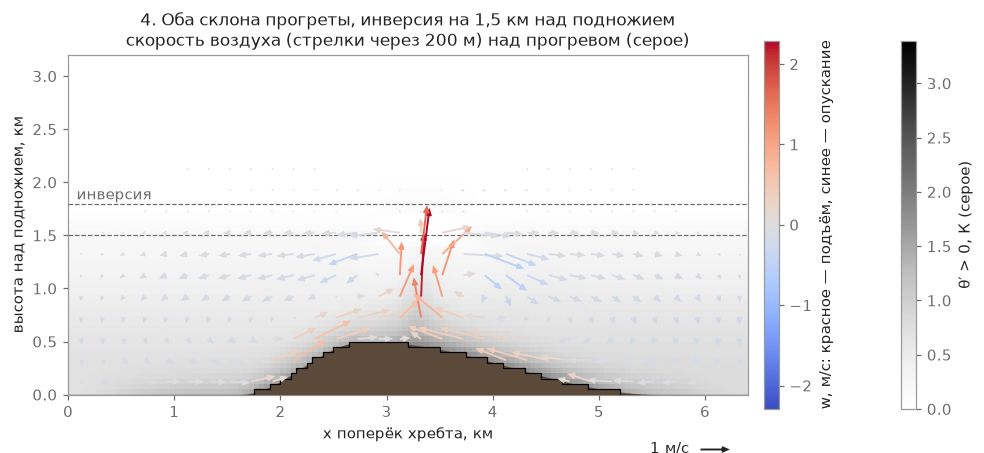

# Weather from temperature and the daily cycle

The pilot in the game does not pick a "weak / medium / strong day" from a list. They set what they see in
the forecast: the daytime maximum temperature, wind strength and direction, and cloud cover. Everything
else (thermal height, cloud base, strength and frequency of the lift, thunderstorm probability, the daily
cycle) is derived by the model from these numbers and from the climate of the chosen place and month. The
calculation runs in the Rust crate `dp-air`, on the CPU.

## How it works

The "Flight…" window sets four things: the **daytime temperature** (0…+40 °C, a slider; under it a hint
"Typical daytime high this month: … °C", the climatic maximum of the chosen place), the **wind** (from 0 m/s
in steps of 1; the top of the slider is the largest wind limit among the wing classes, currently 25 m/s), the
**wind direction** ("Headwind" for this launch or one of 8 compass points; unavailable in calm) and the
**cloud cover** ("Clear / Partly cloudy / Overcast"). On starts with fixed weather (the training island)
these fields are locked and the set weather is shown.

`derive` (`rust/dp-air/src/weather/derive.rs`, numbers in `configs/weather_model.json`) turns the forecast,
the place, the date and the hour into a dictionary of weather parameters: cloud base, thermal strength, radius,
spacing and share, clouds, cirrus, haze. The place for it is the date, latitude and longitude, the valley height
`h_v` (the lowest 10 % of the terrain within the base-reference radius) and the mean ground height `h_m`.

**Thermal height and cloud base.** A rising bubble cools along the dry adiabat; the ambient air above cools at
`Γ_env` = 4 K/km above a reference level near 700 hPa:

$$ z_{dry} = h_v + \frac{(T + \delta) - T_u - \Gamma_{env}(z_u - h_v)}{9.8 - \Gamma_{env}} $$

$$ z_{lcl} = h_v + 0.122 \cdot (T - T_d) $$

where `δ` = 1 K is the bubble's excess temperature, `T_u` and `z_u` are the temperature and height of the
700 hPa level from the climate of the place and month, and `T_d` is the dew point of the day (next section). The
top of the lift is the smaller of the two: `z_top = min(z_dry, z_lcl)`; above mean ground it is clamped to
300…3800 m. The margin `m = z_dry − z_lcl` decides whether the day is cumulus or "blue": at `m < −100 m` there
are no clouds and all thermals are dry.

An example for the reference place from `configs/weather_model.json → reference_context` (Altai, Sinyukha,
15 July, `h_v` = 304 m, mean ground 509 m; climate of the place: `T_u` = +3.3 °C at `z_u` = 3047 m, climatic
dew point +14.3 °C), sky "Clear"; computed by the model itself (`derive`), heights above sea level:

| Daytime temperature | Dew point of the day | z_dry | z_lcl | margin m | base above mean ground | day |
|---|---|---|---|---|---|---|
| +12 °C | 6.9 °C | 84 m | 930 m | −846 m | 300 m (lower limit) | blue |
| +16 °C | 8.1 °C | 774 m | 1269 m | −495 m | 300 m (lower limit) | blue |
| +20 °C | 9.3 °C | 1464 m | 1607 m | −144 m | 955 m | blue (`m < −100 m`) |
| +26 °C | 11.2 °C | 2498 m | 2115 m | 383 m | 1606 m | cumulus, clouds ~870 m deep |
| +31 °C | 12.7 °C | 3360 m | 2539 m | 822 m | 2030 m | strong, `cb_chance` 0.35 |
| +34 °C | 13.6 °C | 3877 m | 2793 m | 1085 m | 2284 m | the same, thunderstorm more likely |

This is one place and one date. The dew point of the day depends on the place, month, sky cover and day of the
month, so in another place or on another day the same temperatures give a different base. The climatic
maximum at this point is +25.7 °C: +26 °C is an ordinary July day.

The condensation level rises 122 m per degree of `T − Td`, in agreement with the pilots' rule "+1 °C is +120 m".

**Thermal strength, size and frequency** come from a piecewise-linear table of anchors by the top of the lift
above mean ground (`anchors_by_top_agl`: 300, 1000, 1700, 2300, 3200 m), with corrections for the season (noon
sun height: a strength factor `(sin h / sin 59.5°)^0.5` limited to 0.5…1.05) and for wind (strong wind tears
thermals apart: between 15 and 45 km/h the strength factor falls from 1.0 to 0.5 and the birth-rate factor to 0.6).

**Forecast cloud cover** (`configs/weather_model.json → sky`) reduces heating once. The heating share is
1.0 / 0.8 / 0.3 ("Clear / Partly cloudy / Overcast"): thermal strength is multiplied by share^⅓ (×1, ×0.93,
×0.67), the birth rate by 1 / 0.85 / 0.5, the "softness" of thermals (wider, weaker core) is 0 / 0.3 / 1; the
thunderstorm factors (`cb_k`) are 1 / 0.7 / 0, so under "Overcast" there are no thunderstorms. The forecast sky
cover does not dim the sun for thermal sources a second time: only cirrus beyond the chosen cloud cover weakens it.

**Clouds by the margin `m`**: the share of dry thermals, cloud depth (300…1600 m), the chance of overdevelopment
and the share of thermals that grow into a thunderstorm cell come from the `clouds_by_margin` table by the single
number `m`. The thunderstorm ceiling is the tropopause of the place:
`cb_top_above_base_m = max(tropopause − z_lcl, 1000 m)`. More about thunderstorms is on the
[Thermals](/mechanics/air-model/thermals/) page.

## Dew point and the air aloft by place

The dew point, the 700 hPa temperature, the climatic maximum and daily range, the tropopause and the high cloud
cover are taken from ERA5 climate grids of 1° × 12 months (`data/climate/*.bin`); a month refers to the 15th,
and between mid-months the value changes linearly by day. Corrections for the valley height are gradients by
latitude belt and season (`configs/weather_model.json → climate`): for the dew point −3.3…−4.5 K/km in the
30–60° belt (depending on the season), −4.6 in the tropics, −4.0 at other latitudes. With no grid file the
values come from the config tables, one for Altai and Bashkiria (50–56° N).

**The dew point of the day** differs from the climatic one:

$$ T_d = T_{d,\,clim} + \mu \cdot \sigma + \beta \cdot (T_{max} - T_{x,\,clim}) + r \cdot \rho \cdot \sigma $$

and then `Td ≤ T`. `σ` is the spread of the daily mean dew point around the monthly mean in this cell (at
Sinyukha in July 2.6 K); `μ`, `β`, `ρ` are tables by latitude belt, season and sky cover of the day from ERA5
2011–2013 (`td_day`); `T_x` is the climatic maximum of the place. What the terms mean: under "Overcast" the air
is on average more humid than under "Clear", a hot day (above the climatic maximum) is usually more humid, and
`r` is a random N(0, 1) number clipped to ±3 σ and deterministic from the month, day, latitude and longitude:
on a given day in a given place it is always the same. For example, for Sinyukha on 15 July at +26 °C: "Clear"
gives Td 11.2 °C (z_lcl 2115 m), "Overcast" gives 13.0 °C (z_lcl 1892 m).

**Haze** depends on the relative humidity of the hour `RH = e_s(Td)/e_s(T)` (the Magnus formula): the density
factor is `haze_k = ((1 − RH_c)/(1 − 0.40))^−0.6`, with `RH_c` clamped to 0.40…0.95; dry air (`RH ≤ 40 %`) gives
1.0, 85 % gives 2.3, 95 % and above gives 4.44. The dew point of the day is constant while `T` falls in the
evening, so in a humid place the haze is thicker in the morning and evening.

## Forecast wind is open-terrain wind {#forecast-wind}

The wind number in the "Flight…" window is understood by the model as the **open-terrain wind at a height of
10 m**: the wind that blows over a flat field, which neither mountains nor forest reach. Above the launch the
wind grows by `gain_per_km` per kilometre of height (a factor from 0.5 to 2; the growth is taken from the
climate of the place, from the ratio of the 700 hPa wind to the surface wind), and below it the wind is weaker.
The air field is computed from the terrain, so at a particular launch the wind may differ from the forecast.

- **A launch on a windward slope or ridge.** The flow accelerates and the wind over the launch comes out
  stronger than the forecast. In this case the model slightly weakens the inflow at the edge of the area so that
  the launch gets the set number.
- **A launch in the lee shadow (behind a mountain, behind a ridge).** Here the wind is honestly weaker than
  the forecast: the inflow at the edge of the area is not boosted (the inflow factor is at most 1).

What remains imprecise. At 100–200 m above the ground the wind at island launches stays 1.9–2.1 times above the
forecast: this is the growth of wind with height and the acceleration over the island, not a model correction. It
was measured at several launches in Rapa Nui, at Ongudai and at Askarovo (6 m/s, 12:00, 15 July), not at all
places of the game. About wind as such and about flow separation behind a ridge, see the pages
[Heuristic mode](/mechanics/air-model/heuristic/) and
[Wind field: phases and Picard](/mechanics/air-model/wind-phases/).

## The daily cycle

The pilot enters the daytime maximum rather than the temperature at the moment of launch: a forecast prints the
maximum in large type, and when game time is accelerated the number must not "drift". The start hours in the
window are 9, 12, 15 and 20; after that time runs by itself (within 6 to 21 h of the place). The temperature at
the moment `t` is computed by Parton and Logan: a sine from sunrise to the maximum (true noon + 2.5 h, but not
later than 0.5 h before sunset), then a smooth decline toward sunset and an exponential at night (time constant
2 h):

$$ T(t) = T_{max} - A \cdot (1 - f(t)) $$

where `A` is the daily range of the place and month from the grid (at Sinyukha in July ≈ 11 K), and `f(t)` goes
from 0 at sunrise to 1 at the maximum and declines to 0.65 toward sunset.

**Ground heating inertia** works over 9 surface classes (`configs/weather_model.json → heating.lag_h`): a thermal
source takes not the current sun but the sun delayed by its class (≈ 0.6·τ): meadow and field 0.3 h (τ ≈ 0.5 h),
shrub 0.4 h, forest 0.6 h, rocks and scree 0.9 h (τ ≈ 1.5 h), built-up area 1.2 h, water 0 (it barely heats; it
has its own flux from the water–air temperature difference). That is why "evening thermals from rocks" and warm
walls appear later than over open fields.

**After sunset** land heating is zero: there are no new thermals either in the analytic part or in the air field,
and live ones finish their cycle. The exceptions are water (a warm lake in autumn gives an upward heat flux in
the evening) and built-up areas, which cool with a time constant of 1.5 h down to a weak night flux of 25 W/m².
The air field is computed for the chosen flight date. The water temperature used for heating the air over lakes
comes from the same weather model: the daily mean air temperature for the 30 days before the date, at the lake
height (at or below 0 °C it is ice, treated as snow); see [Thermals](/mechanics/air-model/thermals/).

**The morning surface inversion** (500 m thick) keeps thermals low until heating breaks through it: the cloud
base rises all morning rather than standing at the maximum value right away. Thermal strength grows with the heat
flux as `(flux/peak)^(1/3)` (Deardorff scaling), and the share of births as `(flux/peak)^1`, so in the evening
there are noticeably fewer thermals, and they are wider and softer (the softness is set by the same flux-to-peak
ratio: the radius up to +30 %, the core up to 20 % weaker, the turbulence at the edge up to 40 % weaker). In the
2 h before sunset mechanical turbulence falls to 0.6 of its daytime value (the air near the ground calms down),
while the slope itself works as it does by day: "warm, very good soft air, good dynamics at the slope, few
thermals" (a pilot's words, which became the basis of this part of the model).

The weather is recomputed in steps of 60 game seconds and interpolated linearly between steps; live thermals
live out their life with the old parameters, while newly born ones already get the new ones.

## Physics: laws and approximations

The model rests on standard approximations of aviation meteorology: the dry adiabat of 9.8 K/km and the LCL
rule (condensation level) ≈ 122–125 m per degree of temperature–dew point spread. The theoretical value is
confirmed by measurements on paraglider tracks (France, 2017–2024): the "ceiling/spread" slope is 101–133 m/°C
depending on the terrain, and theory gives 125 m/°C. The climatic profile above the mixed layer and the daily
cycle after Parton and Logan are common simplifications: the real atmosphere is neither perfectly mixed nor
perfectly sinusoidal in time, but for a game this is enough for "hotter near the ground at the same air aloft"
to mean, physically, "higher and stronger thermals".

## Model limits

- **The dew point is constant through the day.** It is given by the climate of the place and corrections for the
  temperature and sky cover of the day; in real life it also drifts, though more slowly than temperature. The pilot
  does not set humidity as a separate parameter.
- **The climate is a 1° grid, not a point.** The dew point and the 700 hPa air come from ERA5 cells, corrected for
  the valley height with a zonal gradient; regional gradients (separately for the Alps, Zagros and so on) were not
  introduced. For the southern hemisphere there are no gradients: the values of the 30–60° N belt are used with
  the season shifted by half a year (an assumption).
- **The dew-point correction tables are built from three years (2011–2013)**; individual "belt × season" cells
  are reliable to ≈ ±0.1 σ; at two Iranian stations the grid is more humid than reality by 2.4–2.5 K, and the cause
  has not been established.
- **The spread of the air aloft is not modelled.** The 700 hPa temperature is climatic, with no random deviation
  for the day.
- **The anchor table by the top of the lift is piecewise linear**, not derived anew from the heat flux at every
  point: its rows are calibrated values of the former presets, not a direct calculation from the heating of a
  particular piece of slope.
- **Snow does not depend on the weather.** The temperature slider starts at 0 °C; lying snow is not drawn from
  the forecast and does not change the heating; fresh snow and glaciers on high mountains are determined by the
  date and latitude, not by the temperature of the day (see [Terrain and places](/mechanics/terrain/)). The snow
  class does heat, but only mountains above the snow line and ice on lakes get it.
- **No precipitation:** the weather model does not derive rain or snowfall; there are only clouds and
  thunderstorm cells.
- **The tropopause and high cloud are coarse.** The tropopause is from the mean profile of the month, with an
  error of ±300–500 m; the share of cirrus comes from the high-cloud climate of the place and the latitude belt.
- **The wave is hidden and off by default** (`wave.enabled = false`): the physics of the lee wave (strong wind
  across a ridge + stable air) exists in the code, but the pilot does not know the word "wave" and it is not
  switched on by default; see the page [Slope wind](/mechanics/air-model/heuristic/).

## What was considered and why this way

The pilot used to pick from five ready-made weather presets ("Weak / Medium / Strong day / Thunderstorm /
Wave"); in the feedback this looked strange: a real forecast has no such categories, only temperature and wind.
The presets were removed from the interface entirely, but their `weak/medium/strong` values remain in the
internal references `configs/weather/*` and in tests as calibration points: the rows of the anchor table at
1000/1700/2300 m are exactly those.

## Relation to the air model

The game has a single physical air field at three scales: the **mean field** (where it blows, where the slope
holds, the thermal ceiling: a steady solution of the Boussinesq equations, recomputed every 15 game minutes and
when the wind or weather changes), **thermals** (a bubble model, but the sources and strength come from the
field, not from the anchor table) and **perturbations** (turbulence and gusts, from the turbulence statistics of
the field). The daily cycle, heating inertia by surface class and temperature as an input parameter stayed the
same: the field takes them as input. More in the [air model](/mechanics/air-model/) and
[docs/guide/air-model.md](/docs/guide/air-model.md).

## More

- [docs/guide/atmosphere/weather.md](/docs/guide/atmosphere/weather.md), "Weather from the forecast": how this is
  wired into the game.
- [docs/research/calibration_data.md](/docs/research/calibration_data.md): tables for calibration
  (§1 "Thermals", §6 "Atmosphere profiles, clouds").
- [rust/dp-air/src/weather/derive.rs](/rust/dp-air/src/weather/derive.rs),
  [rust/dp-air/src/weather/noise.rs](/rust/dp-air/src/weather/noise.rs),
  [rust/dp-air/src/weather/climate.rs](/rust/dp-air/src/weather/climate.rs),
  [rust/dp-air/src/field/surface_heat.rs](/rust/dp-air/src/field/surface_heat.rs): the code.
- [configs/weather_model.json](/configs/weather_model.json): all the numbers of the weather model.
- [CHANGELOG.md](/CHANGELOG.md): what changed for the pilot, by date.
