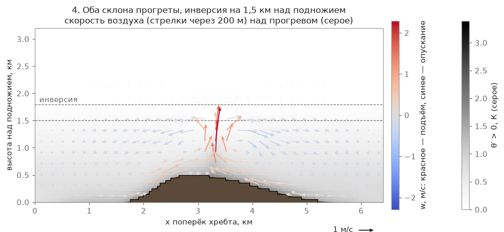

# Погода по температуре и суточный ход

Пилот в игре не выбирает «слабый / средний / сильный день» из списка — он задаёт то, что видит в
прогнозе: дневной максимум температуры, силу и направление ветра, облачность. Всё остальное — высота
термиков, кромка облаков, сила и частота подъёмов, вероятность грозы, дневной ход — модель выводит из
этих чисел и из климата выбранного места и месяца. Расчёт идёт в Rust-крейте `dp-air` на процессоре.

## Как это устроено

Окно «Полёт…» задаёт четыре вещи: **температуру днём** (0…+40 °C, ползунок; под ним подсказка «Обычно днём
в этом месяце: … °C» — климатический максимум выбранного места), **ветер** (от 0 м/с с шагом 1; верх
ползунка — наибольший предел ветра среди классов крыльев, сейчас 25 м/с), **откуда ветер** («Встречный» для
этого старта или один из 8 румбов; при штиле список недоступен) и **облачность** («Ясно / Переменная /
Облачно»). У стартов с фиксированной погодой (учебный остров) эти поля заблокированы, показан заданный набор.

`derive` (`rust/dp-air/src/weather/derive.rs`, числа — `configs/weather_model.json`) превращает прогноз,
место, дату и час в словарь параметров погоды: кромка, сила, радиус, шаг и доля термиков, облака, перистая
пелена, дымка. Место для него — дата, широта и долгота, высота долины `h_v` (нижние 10 % рельефа в радиусе
отсчёта кромки) и средняя высота земли `h_m`.

**Высота термиков и кромка.** Поднимающийся пузырь остывает по сухой адиабате, окружающий воздух наверху —
по градиенту `Γ_env` = 4 К/км выше опорного уровня около 700 гПа:

$$ z_{dry} = h_v + \frac{(T + \delta) - T_u - \Gamma_{env}(z_u - h_v)}{9{,}8 - \Gamma_{env}} $$

$$ z_{lcl} = h_v + 0{,}122 \cdot (T - T_d) $$

где `δ` = 1 К — перегрев пузыря, `T_u` и `z_u` — температура и высота уровня 700 гПа по климату места и
месяца, `T_d` — точка росы дня (следующий раздел). Верх подъёма — меньшее из двух: `z_top = min(z_dry, z_lcl)`;
над средней землёй он зажат пределами 300…3800 м. Запас `m = z_dry − z_lcl` решает, будет ли день кучевым или
«голубым»: при `m < −100 м` облаков нет, все термики сухие.

Пример для опорного места из `configs/weather_model.json → reference_context` (Алтай, Синюха, 15 июля,
`h_v` = 304 м, средняя земля 509 м; климат места: `T_u` = +3,3 °C на `z_u` = 3047 м, Td климата +14,3 °C),
небо «Ясно»; расчёт самой моделью (`derive`), высоты над уровнем моря:

| Температура днём | Td дня | z_dry | z_lcl | запас m | кромка над средней землёй | день |
|---|---|---|---|---|---|---|
| +12 °C | 6,9 °C | 84 м | 930 м | −846 м | 300 м (нижний предел) | голубой |
| +16 °C | 8,1 °C | 774 м | 1269 м | −495 м | 300 м (нижний предел) | голубой |
| +20 °C | 9,3 °C | 1464 м | 1607 м | −144 м | 955 м | голубой (`m < −100 м`) |
| +26 °C | 11,2 °C | 2498 м | 2115 м | 383 м | 1606 м | кучевой, облака ~870 м мощностью |
| +31 °C | 12,7 °C | 3360 м | 2539 м | 822 м | 2030 м | сильный, `cb_chance` 0,35 |
| +34 °C | 13,6 °C | 3877 м | 2793 м | 1085 м | 2284 м | то же, гроза вероятнее |

Это одно место и одна дата. Точка росы дня зависит от места, месяца, облачности и числа дня, поэтому в другом
месте или в другой день те же температуры дадут другую кромку. Климатический максимум в этой точке — +25,7 °C:
+26 °C — обычный июльский день.

Рост уровня конденсации — 122 м на градус разницы `T − Td`, в согласии с правилом пилотов «+1 °C — плюс 120 м».

**Сила, размер и частота термиков** берутся из кусочно-линейной таблицы опор по верху подъёма над средней
землёй (`anchors_by_top_agl`: 300, 1000, 1700, 2300, 3200 м), с поправками на сезон (высота солнца в полдень:
множитель к силе `(sin h / sin 59,5°)^0,5` в пределах 0,5…1,05) и на ветер (сильный ветер рвёт термики:
между 15 и 45 км/ч множитель к силе падает с 1,0 до 0,5, к доле рождений — до 0,6).

**Облачность из прогноза** (`configs/weather_model.json → sky`) уменьшает прогрев один раз. Доля прогрева
1,0 / 0,8 / 0,3 («Ясно / Переменная / Облачно»): сила термиков умножается на доля^⅓ (×1, ×0,93, ×0,67), доля
рождений — на 1 / 0,85 / 0,5, «мягкость» термиков (шире, слабее ядро) — 0 / 0,3 / 1; грозовые множители
(`cb_k`) — 1 / 0,7 / 0, то есть при «Облачно» гроз нет. Пелена неба из прогноза не гасит солнце источникам
второй раз: ослабление идёт только за счёт перистой пелены сверх выбранной облачности.

**Облачность по запасу `m`** — доля сухих термиков, толщина облака (300…1600 м), вероятность переразвития и
доля термиков, дорастающих до грозовой ячейки, — берётся из таблицы `clouds_by_margin` по одному числу `m`.
Потолок гроз — тропопауза места: `cb_top_above_base_m = max(тропопауза − z_lcl, 1000 м)`. Подробнее про
грозы — на странице [«Термики»](/mechanics/air-model/thermals/).

## Точка росы и воздух наверху по месту

Точка росы, температура на 700 гПа, климатический максимум и суточная амплитуда, тропопауза и высокая
облачность берутся из климатических сеток ERA5 1° × 12 месяцев (`data/climate/*.bin`); месяц относится к 15-му
числу, между серединами месяцев значение меняется линейно по дню. Поправки на высоту долины — градиенты по
поясу широты и сезону (`configs/weather_model.json → climate`): для точки росы −3,3…−4,5 К/км в поясе 30–60°
(зависит от сезона), −4,6 в тропиках, −4,0 в остальных широтах. Нет файла сетки — значения из таблиц
конфига, одной на Алтай и Башкирию (50–56° с. ш.).

**Точка росы дня** отличается от климатической:

$$ T_d = T_{d,\,клим} + \mu \cdot \sigma + \beta \cdot (T_{max} - T_{x,\,клим}) + r \cdot \rho \cdot \sigma $$

затем `Td ≤ T`. `σ` — разброс среднесуточной точки росы вокруг среднего месяца в этой ячейке (на Синюхе в
июле 2,6 К), `μ`, `β`, `ρ` — таблицы по поясу широты, сезону и облачности дня из ERA5 2011–2013 (`td_day`),
`T_x` — климатический максимум места. Смысл слагаемых: при «Облачно» воздух в среднем влажнее, чем при «Ясно»,
жаркий день (выше климатического максимума) обычно влажнее, а `r` — случайное число N(0, 1), обрезанное по ±3 σ и
детерминированное от месяца, дня, широты и долготы: в один день в одном месте всегда одно и то же. Например,
для Синюхи 15 июля при +26 °C: «Ясно» — Td 11,2 °C (z_lcl 2115 м), «Облачно» — 13,0 °C (z_lcl 1892 м).

**Дымка** зависит от относительной влажности часа `RH = e_s(Td)/e_s(T)` (формула Магнуса): множитель густоты
`haze_k = ((1 − RH_c)/(1 − 0,40))^−0,6`, где `RH_c` зажата в пределах 0,40…0,95; сухой воздух (`RH ≤ 40 %`) —
1,0, 85 % — 2,3, 95 % и выше — 4,44. Точка росы дня постоянна, а `T` вечером падает — поэтому утром и вечером
во влажном месте дымка гуще.

## Ветер прогноза — ветер открытой местности {#forecast-wind}

Число ветра в окне «Полёт…» модель понимает как **ветер открытой местности на высоте 10 м**: такой
ветер дует над ровным полем, куда не достают ни горы, ни лес. Выше отметки долины места (10-й перцентиль высот в радиусе 10 км) ветер растёт на `gain_per_km` на
километр высоты (множитель от 0,5 до 2; рост берётся из климата места по отношению ветра на 700 гПа к
приземному). Поле воздуха считается по рельефу из этого ветра на краю области (множитель притока всегда 1, один проход);
к числу прогноза поле у старта не подгоняется, поэтому у конкретного старта ветер отличается от прогноза. В подсказке
старта игра пишет, сколько получилось: «На старте X м/с» (число из готового поля).

- **Старт на наветренном склоне или гребне.** Поток разгоняется, и ветер над стартом выходит сильнее
  прогноза: у острова-учебника ridge_west при прогнозе 6 м/с у старта 7,4 м/с, на Онгудае (151°) — 7,7 м/с.
- **Старт в подветренной тени (за горой, за гребнем).** Здесь ветер честно слабее прогноза: в чаше lee_bowl при прогнозе 8,5 м/с у старта 1,2 м/с.

Что остаётся неточным. На высоте 100–200 м над землёй ветер на островных стартах остаётся в 1,9–2,1 раза выше
прогноза: это рост ветра с высотой и разгон над островом, а не поправка модели. Мерили на нескольких стартах в
Рапа-Нуи, на Онгудае и в Аскарово (6 м/с, 12:00, 15 июля), а не на всех местах игры. Про ветер как таковой и
про срыв потока за хребтом — страница
[«Поле ветра: фазы и Пикар»](/mechanics/air-model/wind-phases/).

## Суточный ход

Пилот вводит дневной максимум, а не температуру на момент старта: в прогнозе крупно пишут именно максимум, а при
ускорении игрового времени число не должно «плыть». Часы старта в окне — 9, 12, 15 и 20 ч; дальше время идёт само
(в пределах от 6 до 21 ч места). Температура на момент `t` считается по Партону — Логану: синусоида от восхода к
максимуму (истинный полдень + 2,5 ч, но не позже чем за 0,5 ч до заката), затем плавный спад к закату и
экспонента ночью (постоянная 2 ч):

$$ T(t) = T_{max} - A \cdot (1 - f(t)) $$

где `A` — суточная амплитуда места и месяца из сетки (на Синюхе в июле ≈ 11 К), `f(t)` — от 0 на восходе до
1 в максимуме, к закату спадает до 0,65.

**Инерция прогрева земли** — по 9 классам поверхности (`configs/weather_model.json → heating.lag_h`): источник
термиков берёт не текущее солнце, а солнце с запаздыванием класса (≈ 0,6·τ): луг и поле 0,3 ч (τ ≈ 0,5 ч),
кустарник 0,4 ч, лес 0,6 ч, скалы и осыпи 0,9 ч (τ ≈ 1,5 ч), застройка 1,2 ч, вода 0 (почти не греется, у неё
свой поток — по разности температур воды и воздуха). Поэтому «вечерние термики с камней» и тёплых стен
появляются позже, чем над открытым полем.

**После заката** прогрев суши — ноль: новых термиков нет ни в аналитике, ни в поле воздуха, живые доживают
цикл. Исключения — вода (тёплое озеро осенью вечером даёт поток тепла вверх) и застройка: она остывает с
постоянной 1,5 ч до слабого ночного потока 25 Вт/м². Поле воздуха считается на выбранную дату полёта.
Температура воды для нагрева воздуха над озёрами берётся из этой же погодной модели — среднесуточная воздуха за
30 суток до даты на высоте озера (при 0 °C и ниже — лёд, он считается как снег); подробнее —
[Термики](/mechanics/air-model/thermals/).

**Утренняя приземная инверсия** (толщина 500 м) держит термики низко, пока прогрев её не пробьёт: кромка
поднимается всё утро, а не сразу стоит на месте максимума. Сила термиков растёт с потоком тепла как
`(поток/пик)^(1/3)` (масштаб Дирдорфа), доля рождений — как `(поток/пик)^1`, поэтому вечером термиков заметно
меньше, они шире и мягче (мягкость определяется тем же отношением потока к пику: радиус до +30 %, ядро слабее
до 20 %, болтанка на краю слабее до 40 %). За 2 ч до заката механическая болтанка снижается до 0,6 от дневной —
воздух у земли успокаивается, а сам склон работает как днём: «тёплый, очень хороший мягкий воздух, хорошая
динамика у склона, термиков мало» (слова пилота, легли в основу этого раздела модели).

Погода пересчитывается шагом 60 игровых секунд и между шагами интерполируется линейно; живые термики доживают
со старыми параметрами, а рождаются уже новые.

## Физика: законы и приближения

Модель опирается на стандартные приближения авиационной метеорологии: сухая адиабата 9,8 К/км, правило
LCL (уровень конденсации) ≈ 122–125 м на градус разницы температуры и точки росы — теоретическое значение
подтверждается замерами по параплановым трекам (Франция, 2017–2024): наклон «потолок/спред» 101–133 м/°C в
зависимости от рельефа, теория даёт 125 м/°C. Климатический профиль выше перемешанного слоя и суточный ход по
Партону — Логану — общепринятые упрощения: реальная атмосфера не идеально перемешана и не идеально синусоидальна
по времени, но для игры этого достаточно, чтобы «жарче у земли при том же воздухе наверху» физически осмысленно
означало «термики выше и злее».

## Границы модели

- **Точка росы дня постоянна в течение дня.** Её даёт климат места и поправки на температуру и облачность дня;
  в жизни она тоже плывёт, хотя медленнее температуры. Влажность как отдельный параметр пилот не задаёт.
- **Климат — сетка 1°, а не точка.** Точка росы и воздух на 700 гПа берутся из ячеек ERA5 с поправкой на высоту
  долины по зональному градиенту; региональные градиенты (отдельно для Альп, Загроса и т. п.) не вводились.
  Для южного полушария градиентов нет: взяты значения пояса 30–60° с. ш. со сдвигом сезона на полгода
  (допущение).
- **Таблицы поправок точки росы построены по трём годам (2011–2013)**, отдельные клетки «пояс × сезон»
  надёжны до ≈ ±0,1 σ; по двум иранским станциям сетка влажнее реальности на 2,4–2,5 К, причина не установлена.
- **Разброс воздуха наверху не моделируется.** Температура на 700 гПа — климатическая, без случайного
  отклонения дня.
- **Таблица опор по верху подъёма кусочно-линейна**, а не выведена заново из потока тепла в каждой точке:
  строки таблицы — калиброванные значения прежних пресетов, не прямой расчёт по нагреву конкретного участка склона.
- **Снег от погоды не зависит.** Слайдер температуры начинается с 0 °C, лежащий снег по прогнозу не
  рисуется и не меняет нагрев; свежий снег и ледники на высоких горах определяются датой и широтой, а не
  температурой дня (см. [«Рельеф и места»](/mechanics/terrain/)). Нагрев снежного класса есть, но
  его получают только горы выше снеговой линии и лёд на озёрах.
- **Осадков нет:** дождя и снегопада модель погоды не выводит, есть только облака и грозовые ячейки.
- **Тропопауза и высокая облачность грубые.** Тропопауза — по среднему профилю месяца, ошибка ±300–500 м;
  доля перистых — по климату высокой облачности места и поясу широты.
- **Волна скрыта и выключена по умолчанию** (`wave.enabled = false`): физика подветренной волны
  (сильный ветер поперёк хребта + устойчивый воздух) существует в коде, но слова «волна» пилот не
  знает, и по умолчанию она не включается — подробнее на странице [«Поле ветра: фазы и Пикар»](/mechanics/air-model/wind-phases/).

## Что рассматривали и почему так

Пилот выбирал из пяти готовых пресетов погоды («Слабый / Средний / Сильный день / Гроза / Волна») — по отзыву это
выглядело странно: в реальном прогнозе таких категорий нет, есть температура и ветер. Пресеты убраны из
интерфейса совсем, но их значения `weak/medium/strong` остались во внутренних эталонах `configs/weather/*` и
тестах как калибровочные точки: строки таблицы опор 1000/1700/2300 м — ровно они.

## Связь с моделью воздуха

В игре единое физическое поле воздуха на три масштаба: **среднее поле** (где дует, где держит
склон, потолок термиков — установившееся решение уравнений Буссинеска, пересчитывается каждые 15 игровых
минут и при смене ветра или погоды), **термики** (модель пузырей, но источники и сила — из поля, а не из
таблицы опор) и **возмущения** (болтанка и порывы — из статистики турбулентности поля). Суточный ход,
инерция прогрева по классам поверхности и температура как входной параметр остались теми же — поле берёт
их как вход. Подробнее — [модель воздуха](/mechanics/air-model/).

## Подробнее

- [docs/guide/atmosphere/weather.md](/docs/guide/atmosphere/weather.md) → «Погода из прогноза» — как это подключено в игре.
- [docs/research/calibration_data.md](/docs/research/calibration_data.md) — таблицы для калибровки
  (§1 «Термики», §6 «Профили атмосферы, облака»).
- [rust/dp-air/src/weather/derive.rs](/rust/dp-air/src/weather/derive.rs),
  [rust/dp-air/src/weather/noise.rs](/rust/dp-air/src/weather/noise.rs),
  [rust/dp-air/src/weather/climate.rs](/rust/dp-air/src/weather/climate.rs),
  [rust/dp-air/src/field/surface_heat.rs](/rust/dp-air/src/field/surface_heat.rs) — код.
- [configs/weather_model.json](/configs/weather_model.json) — все числа модели погоды.
- [CHANGELOG.md](/CHANGELOG.md) — что для пилота изменилось по датам.
