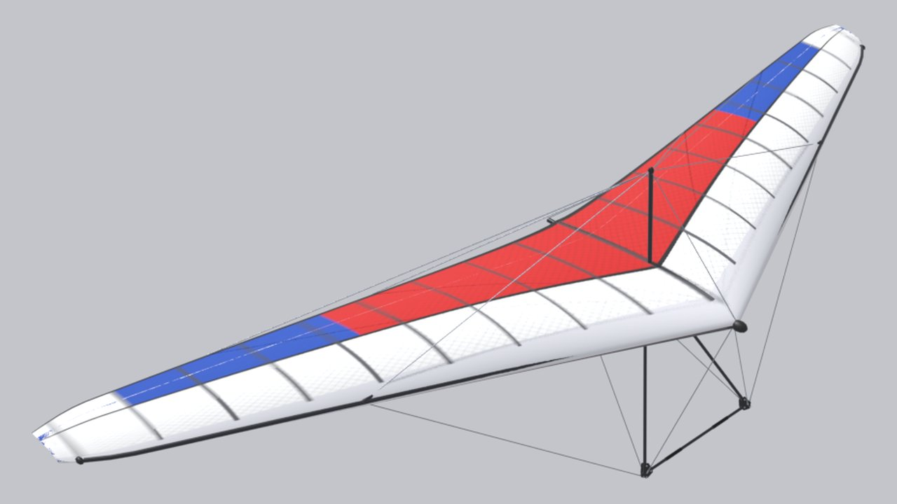

<!-- Страница сгенерирована tools/site/gen_wings.py из configs/wings и паспортов — руками не править -->

# Icaro Laminar Easy 14

**Прототип:** Icaro Laminar Easy 14 (мачтовый) · **годы:** ≈ 2003 · **группа:** [Мачтовые](/wings/kingpost/) · **мачтовое**

## Данные

Числа — как в игре (`configs/wings/laminar.json`). Отметки: **паспорт**, **аналог**, **оценка** — [что значат](/wings/#provenance-marks).

| Параметр | Значение | Откуда |
|---|---|---|
| Размах | 10,3 м | **оценка**: не паспорт: en.wikipedia Icaro_Laminar, руководство icaro2000.com (прямого паспорта Laminar Easy 14 нет); паспорт Icaro Easy 2 M: 10,35 м ([карточка DHV 01-0424-07](https://service.dhv.de/db1/technicsearchpage.php?lang=DE)) |
| Площадь | 14,5 м² | **оценка**: не паспорт: en.wikipedia Icaro_Laminar, руководство icaro2000.com (прямого паспорта Laminar Easy 14 нет); паспорт Icaro Easy 2 M: 14,45 м² ([карточка DHV 01-0424-07](https://service.dhv.de/db1/technicsearchpage.php?lang=DE)) |
| Масса крыла | 30,5 кг | **аналог**: аналог Icaro Easy 2 M: [карточка DHV 01-0424-07](https://service.dhv.de/db1/technicsearchpage.php?lang=DE) «30.5 Kg *)» |
| Масса пилота с подвеской | 65–95 кг | **оценка**: не паспорт: en.wikipedia Icaro_Laminar, руководство icaro2000.com (прямого паспорта Laminar Easy 14 нет) |
| Двойная обшивка | 85 % размаха | **аналог**: аналог Icaro Easy 2 M: [карточка DHV 01-0424-07](https://service.dhv.de/db1/technicsearchpage.php?lang=DE) «85.0 %» |
| Мачта | есть (мачтовое) | **оценка**: ТЗ, раздел E5 |
| Класс / сертификат | DHV 2 (DHV 01-0424-07) | **аналог**: аналог Icaro Easy 2 M: [карточка DHV 01-0424-07](https://service.dhv.de/db1/technicsearchpage.php?lang=DE) |
| Годы выпуска | ≈ 2003 | **оценка**: docs/archive/plan/wings-lineup.md |
| DHV Vmin (VG 0) | 31 км/ч (стартовая масса 80–121 кг) | **аналог**: аналог Icaro Orbiter 14: [карточка DHV 01-0412-05](https://service.dhv.de/db1/technicsearchpage.php?lang=DE) |
| DHV Vmax (VG 0) | 90 км/ч | **аналог**: аналог Icaro Orbiter 14: [карточка DHV 01-0412-05](https://service.dhv.de/db1/technicsearchpage.php?lang=DE) |
| Скорость трима | 35 км/ч | **оценка**: модель игры: поляра — оценка по классу и источникам (docs/archive/plan/wings-lineup.md) |
| Скорость, трапеция полностью на себя — эталон конфига | 85 км/ч | **оценка**: модель игры: поляра — оценка по классу и источникам (docs/archive/plan/wings-lineup.md); паспортная цель (Vmax при VG 0), по ней настроены боты, а не результат модели «Маятник» |
| в игре: полностью на себя, с добором | 83,5 км/ч | **оценка**: замер модели «Маятник» в игре (tools/research/site-docs/pullin_vmax.json): полный «на себя» с добором, установившаяся скорость; добор — Shift у мыши или кнопка модификатора у геймпада, ход рук до «штанги у бёдер» 0,7 м вместо 0,45 м, усилие рук не более 300 Н (docs/research/pendulum/pitch-nonlinear.md); границы модели — docs/research/pendulum/pullin-speed.md |
| в игре: полностью на себя, без добора | 65,7 км/ч | **оценка**: замер модели «Маятник» в игре (tools/research/site-docs/pullin_vmax.json): полный «на себя» без добора, установившаяся скорость; добор — Shift у мыши или кнопка модификатора у геймпада, ход рук до «штанги у бёдер» 0,7 м вместо 0,45 м, усилие рук не более 300 Н (docs/research/pendulum/pitch-nonlinear.md); границы модели — docs/research/pendulum/pullin-speed.md |
| Сваливание (прямой полёт) | 26,3 км/ч | **оценка**: модель игры: поляра — оценка по классу и источникам (docs/archive/plan/wings-lineup.md) |
| Минимальное снижение | 0,9 м/с на 38 км/ч | **оценка**: модель игры: поляра — оценка по классу и источникам (docs/archive/plan/wings-lineup.md) |
| Качество | 13,2 на 46 км/ч | **оценка**: модель игры: поляра — оценка по классу и источникам (docs/archive/plan/wings-lineup.md) |
| Ветер на старте | плавающая поперечина, 12–15 м/с | **оценка**: класс — по поперечине, предел класса — со слов пилота (configs/wing_classes.json); подсказка меню игры, в физике не участвует |
| Эталонная масса пилота (для поляры) | 82 кг | **оценка**: модель игры |

## Ссылки

- Конфиг крыла в игре: [configs/wings/laminar.json](/configs/wings/laminar.json)
- ТЗ на 3D-модель и сверка с паспортом: [раздел E5](/docs/research/glider_3d_tz.md#раздел-e5-icaro-laminar-easy-14-мачтовый-laminar--существующая-модель)
- Что в конфиге из паспорта, что оценка, противоречия: [wings_config_sources.md](/docs/research/wings_config_sources.md)
- Данные карточек DHV — спасибо DHV: <a href="../../../#acknowledgements">благодарность на главной</a>
