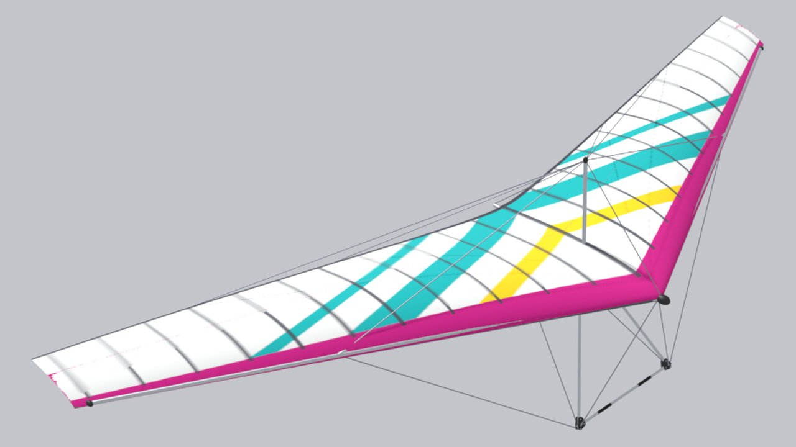

<!-- Страница сгенерирована tools/site/gen_wings.py из configs/wings и паспортов — руками не править -->

# Airwave Magic IV 166

**Прототип:** Airwave Magic IV 166 · **годы:** 1983–1988 · **группа:** [Мачтовые](/wings/kingpost/) · **мачтовое**

## Данные

Числа — как в игре (`configs/wings/magic.json`). Отметки: **паспорт**, **аналог**, **оценка** — [что значат](/wings/#provenance-marks).

| Параметр | Значение | Откуда |
|---|---|---|
| Размах | 10,26 м | **оценка**: не паспорт: thisdayinaviation.com (экземпляр в Смитсоновском музее), topaflyers.com |
| Площадь | 15,4 м² | **оценка**: не паспорт: thisdayinaviation.com (экземпляр в Смитсоновском музее), topaflyers.com |
| Масса крыла | 28 кг | **оценка**: не паспорт: thisdayinaviation.com (экземпляр в Смитсоновском музее), topaflyers.com |
| Масса пилота с подвеской | 65–100 кг | **оценка**: не паспорт: thisdayinaviation.com (экземпляр в Смитсоновском музее), topaflyers.com |
| Двойная обшивка | 60 % размаха | **оценка**: не паспорт: thisdayinaviation.com (экземпляр в Смитсоновском музее), topaflyers.com |
| Мачта | есть (мачтовое) | **оценка**: ТЗ, раздел E6 |
| Класс / сертификат | нет данных | — |
| Годы выпуска | 1983–1988 | **оценка**: docs/archive/plan/wings-lineup.md |
| Скорость трима | 34 км/ч | **оценка**: модель игры: поляра — оценка по классу и источникам (docs/archive/plan/wings-lineup.md) |
| Скорость, трапеция полностью на себя — эталон конфига | 75 км/ч | **оценка**: модель игры: поляра — оценка по классу и источникам (docs/archive/plan/wings-lineup.md); паспортная цель (Vmax при VG 0), по ней настроены боты, а не результат модели «Маятник» |
| в игре: полностью на себя, с добором | 71,6 км/ч | **оценка**: замер модели «Маятник» в игре (tools/research/site-docs/pullin_vmax.json): полный «на себя» с добором, установившаяся скорость; добор — Shift у мыши или кнопка модификатора у геймпада, ход рук до «штанги у бёдер» 0,7 м вместо 0,45 м, усилие рук не более 300 Н (docs/research/pendulum/pitch-nonlinear.md); границы модели — docs/research/pendulum/pullin-speed.md |
| в игре: полностью на себя, без добора | 58,1 км/ч | **оценка**: замер модели «Маятник» в игре (tools/research/site-docs/pullin_vmax.json): полный «на себя» без добора, установившаяся скорость; добор — Shift у мыши или кнопка модификатора у геймпада, ход рук до «штанги у бёдер» 0,7 м вместо 0,45 м, усилие рук не более 300 Н (docs/research/pendulum/pitch-nonlinear.md); границы модели — docs/research/pendulum/pullin-speed.md |
| Сваливание (прямой полёт) | 26,3 км/ч | **оценка**: модель игры: поляра — оценка по классу и источникам (docs/archive/plan/wings-lineup.md) |
| Минимальное снижение | 1 м/с на 34 км/ч | **оценка**: модель игры: поляра — оценка по классу и источникам (docs/archive/plan/wings-lineup.md) |
| Качество | 10,6 на 44 км/ч | **оценка**: модель игры: поляра — оценка по классу и источникам (docs/archive/plan/wings-lineup.md) |
| Ветер на старте | жёсткая поперечина, 10–12 м/с | **оценка**: класс — по поперечине, предел класса — со слов пилота (configs/wing_classes.json); подсказка меню игры, в физике не участвует |
| Эталонная масса пилота (для поляры) | 85 кг | **оценка**: модель игры |

## Ссылки

- Конфиг крыла в игре: [configs/wings/magic.json](/configs/wings/magic.json)
- ТЗ на 3D-модель и сверка с паспортом: [раздел E6](/docs/research/glider_3d_tz.md#раздел-e6-airwave-magic-iv-166-magic--существующая-модель)
- Что в конфиге из паспорта, что оценка, противоречия: [wings_config_sources.md](/docs/research/wings_config_sources.md)
- Данные карточек DHV — спасибо DHV: <a href="../../../#acknowledgements">благодарность на главной</a>
