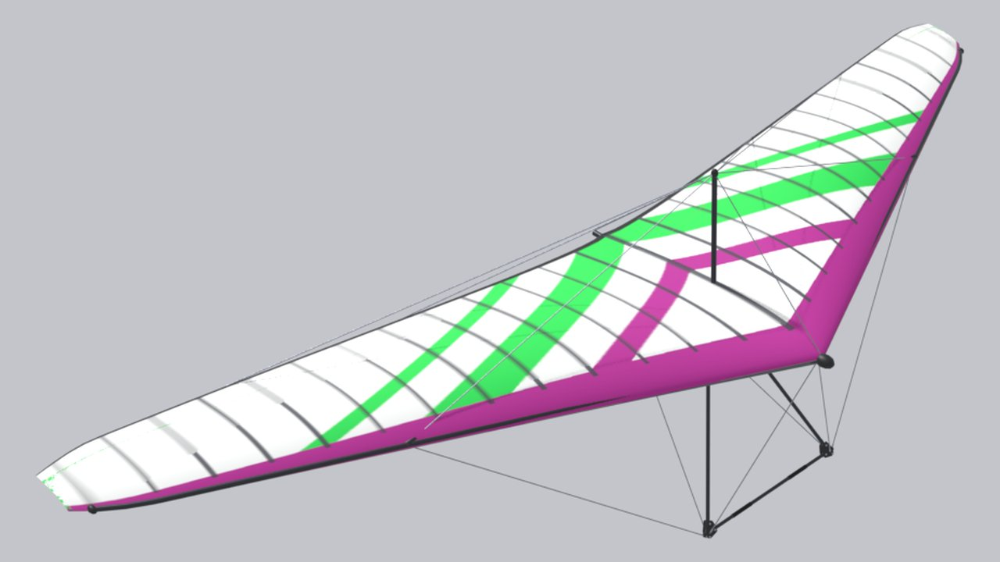

<!-- Generated by tools/site/gen_wings.py from configs/wings and the passports — do not edit by hand -->

# Moyes Litesport 4

**Prototype:** Moyes Litesport · **years:** years unknown · **group:** [Kingpost](/wings/kingpost/) · **kingposted**

## Data

Numbers are as in the game (`configs/wings/moyes_litesport.json`). Marks: **passport**, **analog**, **estimate** — [what they mean](/wings/#provenance-marks).

| Parameter | Value | Source |
|---|---|---|
| Span | 9.6 m | **passport**: [moyes.com.au: Litesport](https://www.moyes.com.au/products/hang-gliders/litesport/specifications) “Span 9.6 m” |
| Area | 13.8 m² | **passport**: [moyes.com.au: Litesport](https://www.moyes.com.au/products/hang-gliders/litesport/specifications) “Area 13.8 sq.m” |
| Wing mass | 31.8 kg | **passport**: [moyes.com.au: Litesport](https://www.moyes.com.au/products/hang-gliders/litesport/specifications) “Glider Weight * 31.8 kgs” |
| Pilot mass with hang point | 68–109 kg | **passport**: [moyes.com.au: Litesport](https://www.moyes.com.au/products/hang-gliders/litesport/specifications) “Hook-In-Weight 68-109 kgs” |
| Double surface | 85 % of span | **estimate**: same as the base Icaro Laminar Easy 14 (not in the passport) |
| Kingpost | yes (kingposted) | **passport**: quote from the manufacturer's page: [moyesusa.com](http://moyesusa.com/products/litesportspecs.html) |
| Class / certification | no data | — |
| Years of production | unknown | **estimate**: not in the passports or the sample |
| Trim speed | 34.4 km/h | **estimate**: game model: polar of the base Icaro Laminar Easy 14 scaled by wing loading (f = 1.0709) |
| Speed, control frame fully pulled in — config reference | 85.9 km/h | **estimate**: game model: polar of the base Icaro Laminar Easy 14 scaled by wing loading (f = 1.0709); the passport target (Vmax at VG 0) the bots are tuned to, not a result of the Pendulum model |
| in game: fully pulled in, with the extra pull | 86 km/h | **estimate**: measured on the Pendulum model in the game (tools/research/site-docs/pullin_vmax.json): fully pulled in with the extra pull, steady speed; the extra pull is Shift on the mouse or the modifier button on the gamepad, hand travel to the bar at the hips 0.7 m instead of 0.45 m, hand force at most 300 N (docs/research/pendulum/pitch-nonlinear.md); model limits — docs/research/pendulum/pullin-speed.md |
| in game: fully pulled in, without the extra pull | 65.9 km/h | **estimate**: measured on the Pendulum model in the game (tools/research/site-docs/pullin_vmax.json): fully pulled in without the extra pull, steady speed; the extra pull is Shift on the mouse or the modifier button on the gamepad, hand travel to the bar at the hips 0.7 m instead of 0.45 m, hand force at most 300 N (docs/research/pendulum/pitch-nonlinear.md); model limits — docs/research/pendulum/pullin-speed.md |
| Stall (straight flight) | 26.5 km/h | **estimate**: game model: polar of the base Icaro Laminar Easy 14 scaled by wing loading (f = 1.0709) |
| Minimum sink | 0.91 m/s at 38.4 km/h | **estimate**: game model: polar of the base Icaro Laminar Easy 14 scaled by wing loading (f = 1.0709) |
| Glide ratio | 13.2 at 46.5 km/h | **estimate**: game model: polar of the base Icaro Laminar Easy 14 scaled by wing loading (f = 1.0709); scaling does not change the glide ratio — same as the base |
| Wind at launch | floating crossbar, 12–15 m/s | **estimate**: class by crossbar, class limit per the pilot (configs/wing_classes.json); a game menu hint, not used in the physics |
| Reference pilot mass (for the polar) | 91 kg | **estimate**: game model: same place in the range as the base Icaro Laminar Easy 14 |

## Links

- Wing config in the game: [configs/wings/moyes_litesport.json](/configs/wings/moyes_litesport.json)
- 3D model spec and check against the passport: [section N28](/docs/research/glider_3d_tz.md#раздел-n28-moyes-litesport-moyes_litesport--новая-модель-приоритет-p1)
- Passports (each number has a quote and a parsing file): [wings_merged.json](/tools/research/data/wing_passports/wings_merged.json), how the config was built: [make_new_wings.py](/tools/research/data/wing_passports/make_new_wings.py)
- DHV card data — thanks to DHV: <a href="../../../#acknowledgements">acknowledgment on the home page</a>
