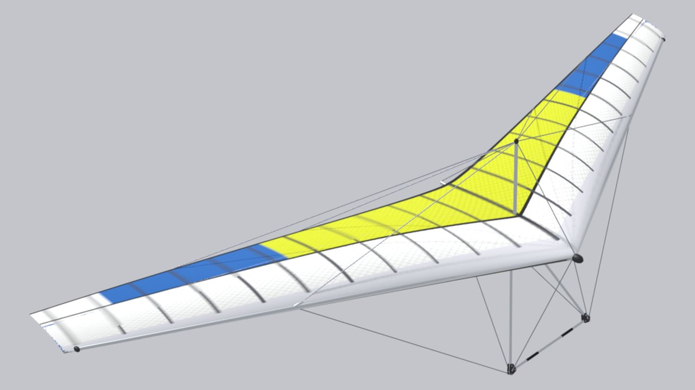

<!-- Generated by tools/site/gen_wings.py from configs/wings and the passports — do not edit by hand -->

# Wills Wing Cross Country 155

**Prototype:** Wills Wing Cross Country · **years:** 1995–2000 · **group:** [Kingpost](/wings/kingpost/) · **kingposted**

## Data

Numbers are as in the game (`configs/wings/ww_cross_country.json`). Marks: **passport**, **analog**, **estimate** — [what they mean](/wings/#provenance-marks).

| Parameter | Value | Source |
|---|---|---|
| Span | 10.36 m | **passport**: [willswing.com (archive): cross-country](https://www.willswing.com/hang-gliders/archive/cross-country/) “Span (ft) 34” |
| Area | 14.4 m² | **passport**: [willswing.com (archive): cross-country](https://www.willswing.com/hang-gliders/archive/cross-country/) “Area (ft²) 155” |
| Wing mass | 31.8 kg | **passport**: [willswing.com (archive): cross-country](https://www.willswing.com/hang-gliders/archive/cross-country/) “Glider Weight (lbs) 70” |
| Pilot mass with hang point | 77–127 kg | **passport**: [willswing.com (archive): cross-country](https://www.willswing.com/hang-gliders/archive/cross-country/) “Hook-In Weight (lbs) 170-280” |
| Double surface | 60 % of span | **estimate**: same as the base Airwave Magic IV 166 (not in the passport) |
| Kingpost | yes (kingposted) | **estimate**: by year of production and class, no confirming quote (3D model spec, section N39) |
| Class / certification | HGMA/USHPA IV Advanced | **passport**: [willswing.com (archive): cross-country](https://www.willswing.com/hang-gliders/archive/cross-country/), [willswing.com: placards](https://www.willswing.com/hang-glider-placard-specifications/) |
| Years of production | 1995–2000 | **estimate**: sample of manufacturer pages / certification year (3D model spec, section N39) |
| Trim speed | 38.8 km/h | **estimate**: game model: polar of the base Airwave Magic IV 166 scaled by wing loading (f = 1.142) |
| Speed, control frame fully pulled in — config reference | 85.6 km/h | **estimate**: game model: polar of the base Airwave Magic IV 166 scaled by wing loading (f = 1.142); the passport target (Vmax at VG 0) the bots are tuned to, not a result of the Pendulum model |
| in game: fully pulled in, with the extra pull | 78.2 km/h | **estimate**: measured on the Pendulum model in the game (tools/research/site-docs/pullin_vmax.json): fully pulled in with the extra pull, steady speed; the extra pull is Shift on the mouse or the modifier button on the gamepad, hand travel to the bar at the hips 0.7 m instead of 0.45 m, hand force at most 300 N (docs/research/pendulum/pitch-nonlinear.md); model limits — docs/research/pendulum/pullin-speed.md |
| in game: fully pulled in, without the extra pull | 67.8 km/h | **estimate**: measured on the Pendulum model in the game (tools/research/site-docs/pullin_vmax.json): fully pulled in without the extra pull, steady speed; the extra pull is Shift on the mouse or the modifier button on the gamepad, hand travel to the bar at the hips 0.7 m instead of 0.45 m, hand force at most 300 N (docs/research/pendulum/pitch-nonlinear.md); model limits — docs/research/pendulum/pullin-speed.md |
| Stall (straight flight) | 30 km/h | **estimate**: game model: polar of the base Airwave Magic IV 166 scaled by wing loading (f = 1.142) |
| Minimum sink | 1.142 m/s at 38.8 km/h | **estimate**: game model: polar of the base Airwave Magic IV 166 scaled by wing loading (f = 1.142) |
| Glide ratio | 10.6 at 50.2 km/h | **estimate**: game model: polar of the base Airwave Magic IV 166 scaled by wing loading (f = 1.142); scaling does not change the glide ratio — same as the base |
| Wind at launch | rigid crossbar, 10–12 m/s | **estimate**: class by crossbar, class limit per the pilot (configs/wing_classes.json); a game menu hint, not used in the physics |
| Reference pilot mass (for the polar) | 106 kg | **estimate**: game model: same place in the range as the base Airwave Magic IV 166 |

## Links

- Wing config in the game: [configs/wings/ww_cross_country.json](/configs/wings/ww_cross_country.json)
- 3D model spec and check against the passport: [section N39](/docs/research/glider_3d_tz.md#раздел-n39-wills-wing-cross-country-ww_cross_country--новая-модель-приоритет-p2)
- Passports (each number has a quote and a parsing file): [wings_merged.json](/tools/research/data/wing_passports/wings_merged.json), how the config was built: [make_new_wings.py](/tools/research/data/wing_passports/make_new_wings.py)
- DHV card data — thanks to DHV: <a href="../../../#acknowledgements">acknowledgment on the home page</a>
