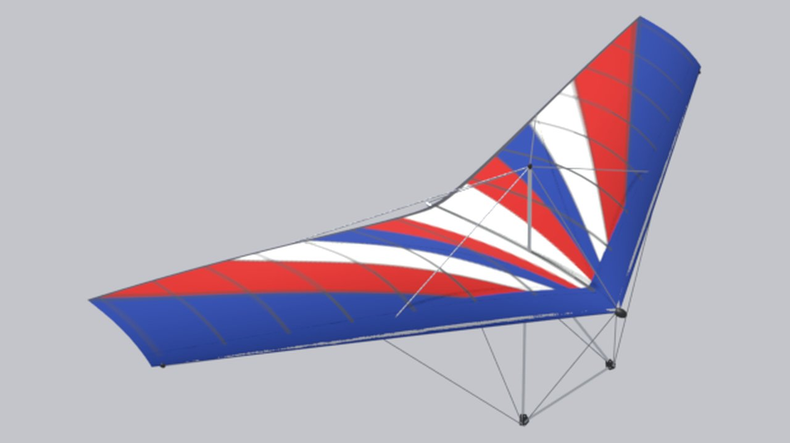

<!-- Generated by tools/site/gen_wings.py from configs/wings and the passports — do not edit by hand -->

# Slavutich-UT

**Prototype:** Slavutich-UT · **years:** 1979–1980-е · **group:** [Soviet 1980s](/wings/soviet/) · **kingposted**

## Data

Numbers are as in the game (`configs/wings/slavutich_ut.json`). Marks: **passport**, **analog**, **estimate** — [what they mean](/wings/#provenance-marks).

| Parameter | Value | Source |
|---|---|---|
| Span | 8.81 m | **estimate**: not a passport: delta-nsk.ucoz.ru (specifications), ru.wikipedia “Slavutich (hang gliders)” |
| Area | 17.46 m² | **estimate**: not a passport: delta-nsk.ucoz.ru (specifications), ru.wikipedia “Slavutich (hang gliders)” |
| Wing mass | 25 kg | **estimate**: not a passport: delta-nsk.ucoz.ru (specifications), ru.wikipedia “Slavutich (hang gliders)” |
| Pilot mass with hang point | 60–90 kg | **estimate**: not a passport: delta-nsk.ucoz.ru (specifications), ru.wikipedia “Slavutich (hang gliders)” |
| Double surface | 0 % of span | **estimate**: not a passport: delta-nsk.ucoz.ru (specifications), ru.wikipedia “Slavutich (hang gliders)” |
| Kingpost | yes (kingposted) | **estimate**: 3D model spec, section E8 |
| Class / certification | no data | — |
| Years of production | 1979–1980-е | **estimate**: docs/archive/plan/wings-lineup.md |
| Trim speed | 29 km/h | **estimate**: game model: the polar is an estimate from the class and the sources (docs/archive/plan/wings-lineup.md) |
| Speed, control frame fully pulled in — config reference | 55 km/h | **estimate**: game model: the polar is an estimate from the class and the sources (docs/archive/plan/wings-lineup.md); the passport target (Vmax at VG 0) the bots are tuned to, not a result of the Pendulum model |
| in game: fully pulled in, with the extra pull | 53 km/h | **estimate**: measured on the Pendulum model in the game (tools/research/site-docs/pullin_vmax.json): fully pulled in with the extra pull, steady speed; the extra pull is Shift on the mouse or the modifier button on the gamepad, hand travel to the bar at the hips 0.7 m instead of 0.45 m, hand force at most 300 N (docs/research/pendulum/pitch-nonlinear.md); model limits — docs/research/pendulum/pullin-speed.md |
| in game: fully pulled in, without the extra pull | 44.3 km/h | **estimate**: measured on the Pendulum model in the game (tools/research/site-docs/pullin_vmax.json): fully pulled in without the extra pull, steady speed; the extra pull is Shift on the mouse or the modifier button on the gamepad, hand travel to the bar at the hips 0.7 m instead of 0.45 m, hand force at most 300 N (docs/research/pendulum/pitch-nonlinear.md); model limits — docs/research/pendulum/pullin-speed.md |
| Stall (straight flight) | 23.5 km/h | **estimate**: game model: the polar is an estimate from the class and the sources (docs/archive/plan/wings-lineup.md) |
| Minimum sink | 1.35 m/s at 29 km/h | **estimate**: game model: the polar is an estimate from the class and the sources (docs/archive/plan/wings-lineup.md) |
| Glide ratio | 6.2 at 31 km/h | **estimate**: game model: the polar is an estimate from the class and the sources (docs/archive/plan/wings-lineup.md) |
| Wind at launch | trainer, 7–10 m/s | **estimate**: class by crossbar, class limit per the pilot (configs/wing_classes.json); a game menu hint, not used in the physics |
| Reference pilot mass (for the polar) | 75 kg | **estimate**: game model |

## Links

- Wing config in the game: [configs/wings/slavutich_ut.json](/configs/wings/slavutich_ut.json)
- 3D model spec and check against the passport: [section E8](/docs/research/glider_3d_tz.md#раздел-e8-славутич-ут-slavutich_ut--существующая-модель)
- What in the config is from the passport, what is an estimate, contradictions: [wings_config_sources.md](/docs/research/wings_config_sources.md)
- DHV card data — thanks to DHV: <a href="../../../#acknowledgements">acknowledgment on the home page</a>
