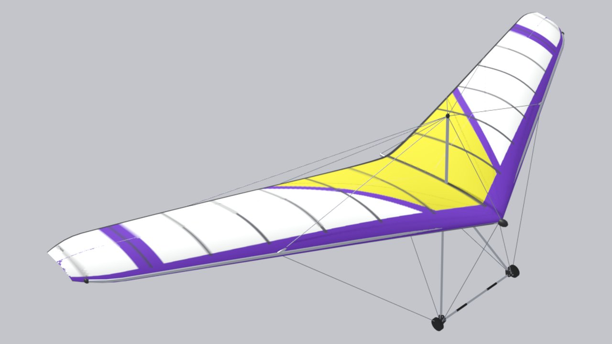

<!-- Generated by tools/site/gen_wings.py from configs/wings and the passports — do not edit by hand -->

# Delta Flugschule Condor Crex 3

**Prototype:** Delta Flugschule Condor Crex 3 · **years:** 2015– · **group:** [Trainers](/wings/trainer/) · **kingposted**

## Data

Numbers are as in the game (`configs/wings/condor_crex3.json`). Marks: **passport**, **analog**, **estimate** — [what they mean](/wings/#provenance-marks).

| Parameter | Value | Source |
|---|---|---|
| Span | 9.6 m | **passport**: [card DHV 01-0505-24](https://service.dhv.de/db1/technicsearchpage.php?lang=DE) “Spannweite  9.6 m” |
| Area | 14.5 m² | **passport**: [card DHV 01-0505-24](https://service.dhv.de/db1/technicsearchpage.php?lang=DE) “Fläche  14.5 m2” |
| Wing mass | 23 kg | **passport**: [card DHV 01-0505-24](https://service.dhv.de/db1/technicsearchpage.php?lang=DE) “Gewicht (ohne Packsack)  23.0 Kg” |
| Pilot mass with hang point | 49–98 kg | **estimate**: DHV “Startgewicht” 72–121 kg minus wing mass 23 kg ([card DHV 01-0505-24](https://service.dhv.de/db1/technicsearchpage.php?lang=DE); no hook-in figure in the passport) |
| Double surface | 60 % of span | **passport**: [card DHV 01-0505-24](https://service.dhv.de/db1/technicsearchpage.php?lang=DE) “Doppelsegel  60.0 %” |
| Kingpost | yes (kingposted) | **estimate**: by year of production and class, no confirming quote (3D model spec, section N5) |
| Class / certification | DHV 1 (DHV 01-0505-24) | **passport**: [card DHV 01-0505-24](https://service.dhv.de/db1/technicsearchpage.php?lang=DE) |
| Years of production | 2015– | **estimate**: sample of manufacturer pages / certification year (3D model spec, section N5) |
| DHV Vmin (VG 0) | 35 km/h (takeoff mass 72–121 kg) | **passport**: [card DHV 01-0505-24](https://service.dhv.de/db1/technicsearchpage.php?lang=DE) |
| DHV Vmax (VG 0) | 80 km/h | **passport**: [card DHV 01-0505-24](https://service.dhv.de/db1/technicsearchpage.php?lang=DE) |
| Trim speed | 38.7 km/h | **estimate**: game model: polar of the base Wills Wing Falcon 170 scaled by wing loading (f = 1.0011) |
| Speed, control frame fully pulled in — config reference | 79 km/h | **estimate**: game model: polar of the base Wills Wing Falcon 170 scaled by wing loading (f = 1.0011); the passport target (Vmax at VG 0) the bots are tuned to, not a result of the Pendulum model |
| in game: fully pulled in, with the extra pull | 79.8 km/h | **estimate**: measured on the Pendulum model in the game (tools/research/site-docs/pullin_vmax.json): fully pulled in with the extra pull, steady speed; the extra pull is Shift on the mouse or the modifier button on the gamepad, hand travel to the bar at the hips 0.7 m instead of 0.45 m, hand force at most 300 N (docs/research/pendulum/pitch-nonlinear.md); model limits — docs/research/pendulum/pullin-speed.md |
| in game: fully pulled in, without the extra pull | 65.8 km/h | **estimate**: measured on the Pendulum model in the game (tools/research/site-docs/pullin_vmax.json): fully pulled in without the extra pull, steady speed; the extra pull is Shift on the mouse or the modifier button on the gamepad, hand travel to the bar at the hips 0.7 m instead of 0.45 m, hand force at most 300 N (docs/research/pendulum/pitch-nonlinear.md); model limits — docs/research/pendulum/pullin-speed.md |
| Stall (straight flight) | 34.7 km/h | **estimate**: game model: polar of the base Wills Wing Falcon 170 scaled by wing loading (f = 1.0011) |
| Minimum sink | 1.212 m/s at 36.3 km/h | **estimate**: game model: polar of the base Wills Wing Falcon 170 scaled by wing loading (f = 1.0011) |
| Glide ratio | 9 at 46 km/h | **estimate**: game model: polar of the base Wills Wing Falcon 170 scaled by wing loading (f = 1.0011); scaling does not change the glide ratio — same as the base |
| Wind at launch | trainer, 7–10 m/s | **estimate**: class by crossbar, class limit per the pilot (configs/wing_classes.json); a game menu hint, not used in the physics |
| Reference pilot mass (for the polar) | 71 kg | **estimate**: game model: same place in the range as the base Wills Wing Falcon 170 |

## Links

- Wing config in the game: [configs/wings/condor_crex3.json](/configs/wings/condor_crex3.json)
- 3D model spec and check against the passport: [section N5](/docs/research/glider_3d_tz.md#раздел-n5-delta-flugschule-condor-crex-3-condor_crex3--новая-модель-приоритет-p2)
- Passports (each number has a quote and a parsing file): [wings_merged.json](/tools/research/data/wing_passports/wings_merged.json), how the config was built: [make_new_wings.py](/tools/research/data/wing_passports/make_new_wings.py)
- DHV card data — thanks to DHV: <a href="../../../#acknowledgements">acknowledgment on the home page</a>
