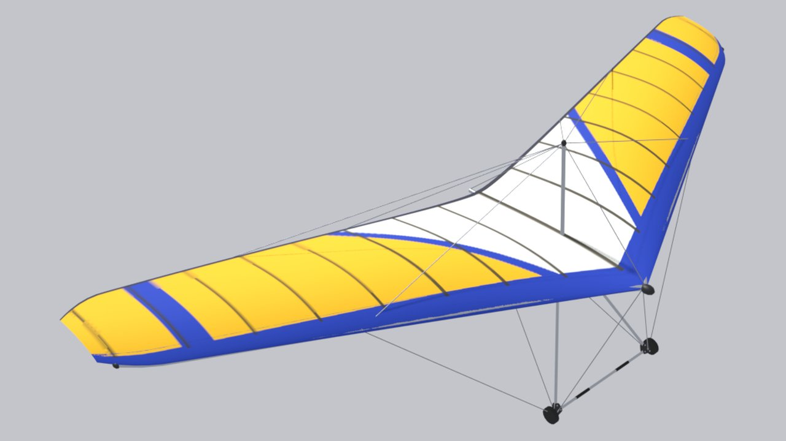

<!-- Страница сгенерирована tools/site/gen_wings.py из configs/wings и паспортов — руками не править -->

# Wills Wing Falcon 170

**Прототип:** Wills Wing Falcon 4 170 · **годы:** 2009– · **группа:** [Учебные](/wings/trainer/) · **мачтовое**

## Данные

Числа — как в игре (`configs/wings/training.json`). Отметки: **паспорт**, **аналог**, **оценка** — [что значат](/wings/#provenance-marks).

| Параметр | Значение | Откуда |
|---|---|---|
| Размах | 9,3 м | **паспорт**: [willswing.com: Falcon 4](https://www.willswing.com/hang-gliders/falcon-4/) «Span (ft): 30.6» |
| Площадь | 15,8 м² | **паспорт**: [willswing.com: Falcon 4](https://www.willswing.com/hang-gliders/falcon-4/) «Area (ft^2): 170» |
| Масса крыла | 22,2 кг | **паспорт**: [willswing.com: Falcon 4](https://www.willswing.com/hang-gliders/falcon-4/) «Glider Weight (lbs): 49» |
| Масса пилота с подвеской | 64–100 кг | **паспорт**: [willswing.com: Falcon 4](https://www.willswing.com/hang-gliders/falcon-4/) «Hook-In Weight (lbs): 140-220» |
| Двойная обшивка | 30 % размаха | **оценка**: числа в паспорте нет; учебное, ≈ 30 % по отзыву пилота (docs/archive/plan/wings-lineup.md) |
| Мачта | есть (мачтовое) | **оценка**: ТЗ, раздел E1 |
| Класс / сертификат | класс 2 (страница производителя); HGMA/USHPA II Novice | **паспорт**: [willswing.com: Falcon 4](https://www.willswing.com/hang-gliders/falcon-4/), [willswing.com: плакарды](https://www.willswing.com/hang-glider-placard-specifications/) |
| Годы выпуска | 2009– | **оценка**: docs/archive/plan/wings-lineup.md |
| Скорость трима | 32,3 км/ч | **оценка**: модель игры: поляра — оценка по классу и источникам (docs/archive/plan/wings-lineup.md) |
| Скорость, трапеция полностью на себя — эталон конфига | 62,6 км/ч | **оценка**: модель игры: поляра — оценка по классу и источникам (docs/archive/plan/wings-lineup.md); паспортная цель (Vmax при VG 0), по ней настроены боты, а не результат модели «Маятник» |
| в игре: полностью на себя, с добором | 62,4 км/ч | **оценка**: замер модели «Маятник» в игре (tools/research/site-docs/pullin_vmax.json): полный «на себя» с добором, установившаяся скорость; добор — Shift у мыши или кнопка модификатора у геймпада, ход рук до «штанги у бёдер» 0,7 м вместо 0,45 м, усилие рук не более 300 Н (docs/research/pendulum/pitch-nonlinear.md); границы модели — docs/research/pendulum/pullin-speed.md |
| в игре: полностью на себя, без добора | 51 км/ч | **оценка**: замер модели «Маятник» в игре (tools/research/site-docs/pullin_vmax.json): полный «на себя» без добора, установившаяся скорость; добор — Shift у мыши или кнопка модификатора у геймпада, ход рук до «штанги у бёдер» 0,7 м вместо 0,45 м, усилие рук не более 300 Н (docs/research/pendulum/pitch-nonlinear.md); границы модели — docs/research/pendulum/pullin-speed.md |
| Сваливание (прямой полёт) | 25,3 км/ч | **оценка**: модель игры: поляра — оценка по классу и источникам (docs/archive/plan/wings-lineup.md) |
| Минимальное снижение | 1,044 м/с на 31,2 км/ч | **оценка**: модель игры: поляра — оценка по классу и источникам (docs/archive/plan/wings-lineup.md) |
| Качество | 9 на 39,7 км/ч | **оценка**: модель игры: поляра — оценка по классу и источникам (docs/archive/plan/wings-lineup.md) |
| Ветер на старте | учебный, 7–10 м/с | **оценка**: класс — по поперечине, предел класса — со слов пилота (configs/wing_classes.json); подсказка меню игры, в физике не участвует |
| Эталонная масса пилота (для поляры) | 80 кг | **оценка**: модель игры |

## Ссылки

- Конфиг крыла в игре: [configs/wings/training.json](/configs/wings/training.json)
- ТЗ на 3D-модель и сверка с паспортом: [раздел E1](/docs/research/glider_3d_tz.md#раздел-e1-wills-wing-falcon-4-170-training--существующая-модель)
- Что в конфиге из паспорта, что оценка, противоречия: [wings_config_sources.md](/docs/research/wings_config_sources.md)
- Данные карточек DHV — спасибо DHV: <a href="../../../#acknowledgements">благодарность на главной</a>
