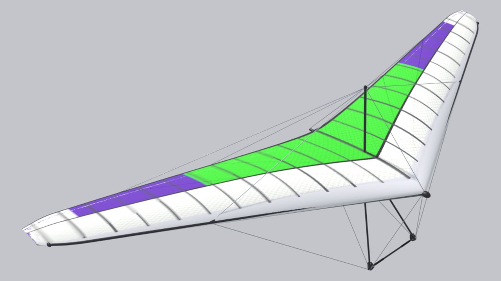

<!-- Generated by tools/site/gen_wings.py from configs/wings and the passports — do not edit by hand -->

# Air Creation iXess 15 (tug)

**Prototype:** Air Creation iXess 15 (tug) · **years:** 2000-е– · **group:** [Tugs](/wings/tug/) · **kingposted**

## Data

Numbers are as in the game (`configs/wings/trike_ixess15.json`). Marks: **passport**, **analog**, **estimate** — [what they mean](/wings/#provenance-marks).

| Parameter | Value | Source |
|---|---|---|
| Span | 10 m | **estimate**: not a passport: Wikipedia “Air Creation iXess”, BMAA HADS HM16, the TT-1 calculation (tools/research/tow-trike/wing_trike_ixess15.json, docs/research/tow/trike-tug.md); no manufacturer passport in the set |
| Area | 15 m² | **estimate**: not a passport: Wikipedia “Air Creation iXess”, BMAA HADS HM16, the TT-1 calculation (tools/research/tow-trike/wing_trike_ixess15.json, docs/research/tow/trike-tug.md); no manufacturer passport in the set |
| Wing mass | 53 kg | **estimate**: not a passport: Wikipedia “Air Creation iXess”, BMAA HADS HM16, the TT-1 calculation (tools/research/tow-trike/wing_trike_ixess15.json, docs/research/tow/trike-tug.md); no manufacturer passport in the set |
| Pilot mass with hang point | 220–397 kg | **estimate**: min — mass of the trike cart with crew: cart 150 kg + a pilot from 55 kg (HADS §7(B)) + 15 kg of fuel; max — mass of the trike cart with crew: MTOW 450 kg (HADS §7(A)) minus the 53 kg wing |
| Double surface | 90 % of span | **estimate**: not a passport: Wikipedia “Air Creation iXess”, BMAA HADS HM16, the TT-1 calculation (tools/research/tow-trike/wing_trike_ixess15.json, docs/research/tow/trike-tug.md); no manufacturer passport in the set |
| Kingpost | yes (kingposted) | **estimate**: 3D model spec, section E10 |
| Class / certification | no data | — |
| Years of production | 2000-е– | **estimate**: docs/archive/plan/wings-lineup.md |
| Trim speed | 69.7 km/h | **estimate**: game model: the polar is an estimate from the class and the sources (docs/archive/plan/wings-lineup.md) |
| Speed, control frame fully pulled in — config reference | 82 km/h | **estimate**: game model: the polar is an estimate from the class and the sources (docs/archive/plan/wings-lineup.md); the passport target (Vmax at VG 0) the bots are tuned to, not a result of the Pendulum model |
| in game: fully pulled in, with and without the extra pull | no measurement | **estimate**: no measurement: the trike has no pull-in control frame or extra pull, the Pendulum model is not applied to it |
| Stall (straight flight) | 49.65 km/h | **estimate**: game model: the polar is an estimate from the class and the sources (docs/archive/plan/wings-lineup.md) |
| Minimum sink | 1.77 m/s at 57.1 km/h | **estimate**: game model: the polar is an estimate from the class and the sources (docs/archive/plan/wings-lineup.md) |
| Glide ratio | 10.53 at 79.45 km/h | **estimate**: game model: the polar is an estimate from the class and the sources (docs/archive/plan/wings-lineup.md) |
| Wind at launch | rigid crossbar, 10–12 m/s | **estimate**: class by crossbar, class limit per the pilot (configs/wing_classes.json); a game menu hint, not used in the physics |
| Reference pilot mass (for the polar) | 262.5 kg | **estimate**: game model |

## Links

- Wing config in the game: [configs/wings/trike_ixess15.json](/configs/wings/trike_ixess15.json)
- 3D model spec and check against the passport: [section E10](/docs/research/glider_3d_tz.md#раздел-e10-air-creation-ixess-15-буксировщик-trike_ixess15--существующая-модель)
- What in the config is from the passport, what is an estimate, contradictions: [wings_config_sources.md](/docs/research/wings_config_sources.md)
- DHV card data — thanks to DHV: <a href="../../../#acknowledgements">acknowledgment on the home page</a>
