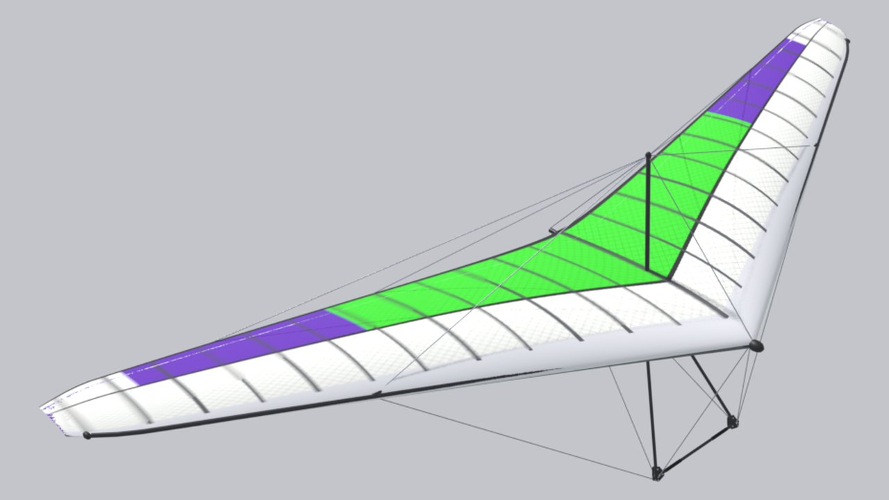

<!-- Страница сгенерирована tools/site/gen_wings.py из configs/wings и паспортов — руками не править -->

# Air Creation iXess 15 (буксировщик)

**Прототип:** Air Creation iXess 15 (буксировщик) · **годы:** 2000-е– · **группа:** [Буксировщики](/wings/tug/) · **мачтовое**

## Данные

Числа — как в игре (`configs/wings/trike_ixess15.json`). Отметки: **паспорт**, **аналог**, **оценка** — [что значат](/wings/#provenance-marks).

| Параметр | Значение | Откуда |
|---|---|---|
| Размах | 10 м | **оценка**: не паспорт: Wikipedia «Air Creation iXess», BMAA HADS HM16, расчёт TT-1 (tools/research/tow-trike/wing_trike_ixess15.json, docs/research/tow/trike-tug.md); паспорта производителя в наборе нет |
| Площадь | 15 м² | **оценка**: не паспорт: Wikipedia «Air Creation iXess», BMAA HADS HM16, расчёт TT-1 (tools/research/tow-trike/wing_trike_ixess15.json, docs/research/tow/trike-tug.md); паспорта производителя в наборе нет |
| Масса крыла | 53 кг | **оценка**: не паспорт: Wikipedia «Air Creation iXess», BMAA HADS HM16, расчёт TT-1 (tools/research/tow-trike/wing_trike_ixess15.json, docs/research/tow/trike-tug.md); паспорта производителя в наборе нет |
| Масса пилота с подвеской | 220–397 кг | **оценка**: мин. — масса тележки с экипажем: тележка 150 кг + пилот от 55 кг (HADS §7(B)) + 15 кг топлива; макс. — масса тележки с экипажем: MTOW 450 кг (HADS §7(A)) минус крыло 53 кг |
| Двойная обшивка | 90 % размаха | **оценка**: не паспорт: Wikipedia «Air Creation iXess», BMAA HADS HM16, расчёт TT-1 (tools/research/tow-trike/wing_trike_ixess15.json, docs/research/tow/trike-tug.md); паспорта производителя в наборе нет |
| Мачта | есть (мачтовое) | **оценка**: ТЗ, раздел E10 |
| Класс / сертификат | нет данных | — |
| Годы выпуска | 2000-е– | **оценка**: docs/archive/plan/wings-lineup.md |
| Скорость трима | 69,7 км/ч | **оценка**: модель игры: поляра — оценка по классу и источникам (docs/archive/plan/wings-lineup.md) |
| Скорость, трапеция полностью на себя — эталон конфига | 82 км/ч | **оценка**: модель игры: поляра — оценка по классу и источникам (docs/archive/plan/wings-lineup.md); паспортная цель (Vmax при VG 0), по ней настроены боты, а не результат модели «Маятник» |
| в игре: полностью на себя, с добором и без добора | нет замера | **оценка**: нет замера: у дельталёта нет трапеции «на себя» и добора, модель «Маятник» к нему не применяется |
| Сваливание (прямой полёт) | 49,65 км/ч | **оценка**: модель игры: поляра — оценка по классу и источникам (docs/archive/plan/wings-lineup.md) |
| Минимальное снижение | 1,77 м/с на 57,1 км/ч | **оценка**: модель игры: поляра — оценка по классу и источникам (docs/archive/plan/wings-lineup.md) |
| Качество | 10,53 на 79,45 км/ч | **оценка**: модель игры: поляра — оценка по классу и источникам (docs/archive/plan/wings-lineup.md) |
| Ветер на старте | жёсткая поперечина, 10–12 м/с | **оценка**: класс — по поперечине, предел класса — со слов пилота (configs/wing_classes.json); подсказка меню игры, в физике не участвует |
| Эталонная масса пилота (для поляры) | 262,5 кг | **оценка**: модель игры |

## Ссылки

- Конфиг крыла в игре: [configs/wings/trike_ixess15.json](/configs/wings/trike_ixess15.json)
- ТЗ на 3D-модель и сверка с паспортом: [раздел E10](/docs/research/glider_3d_tz.md#раздел-e10-air-creation-ixess-15-буксировщик-trike_ixess15--существующая-модель)
- Что в конфиге из паспорта, что оценка, противоречия: [wings_config_sources.md](/docs/research/wings_config_sources.md)
- Данные карточек DHV — спасибо DHV: <a href="../../../#acknowledgements">благодарность на главной</a>
