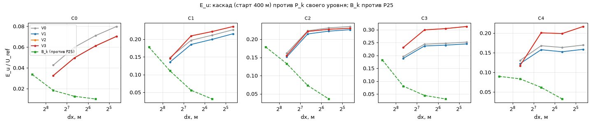
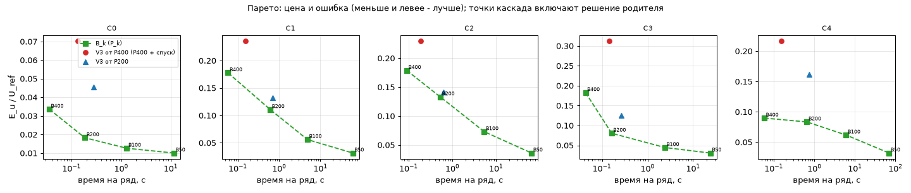
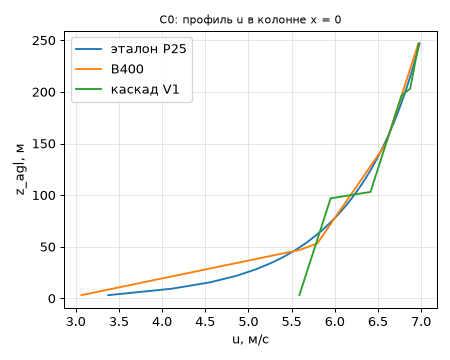
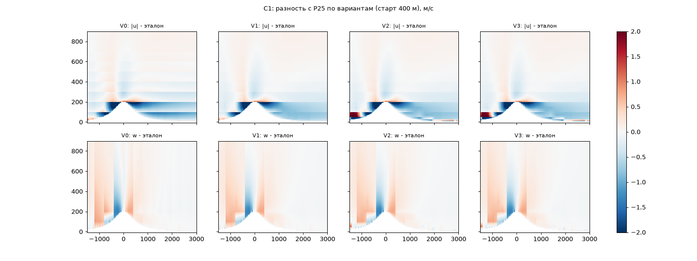
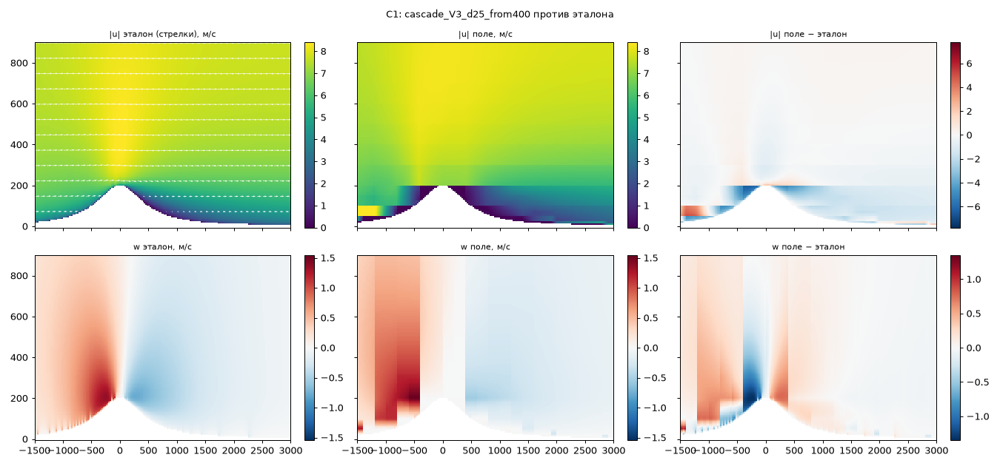
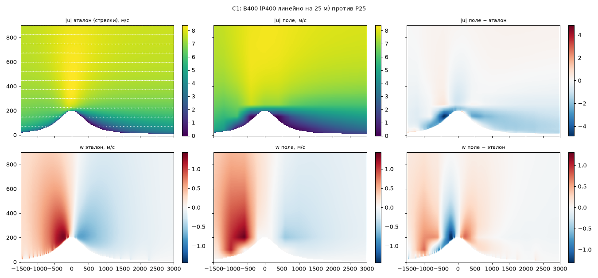
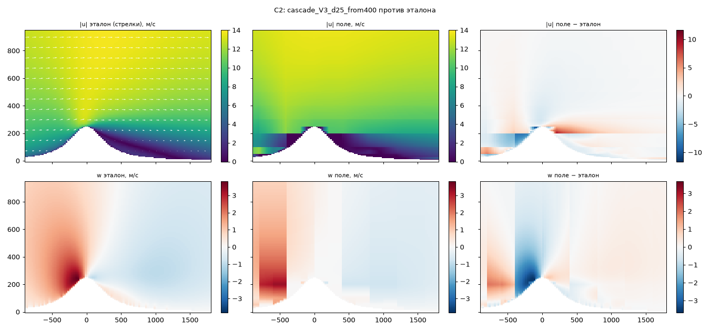
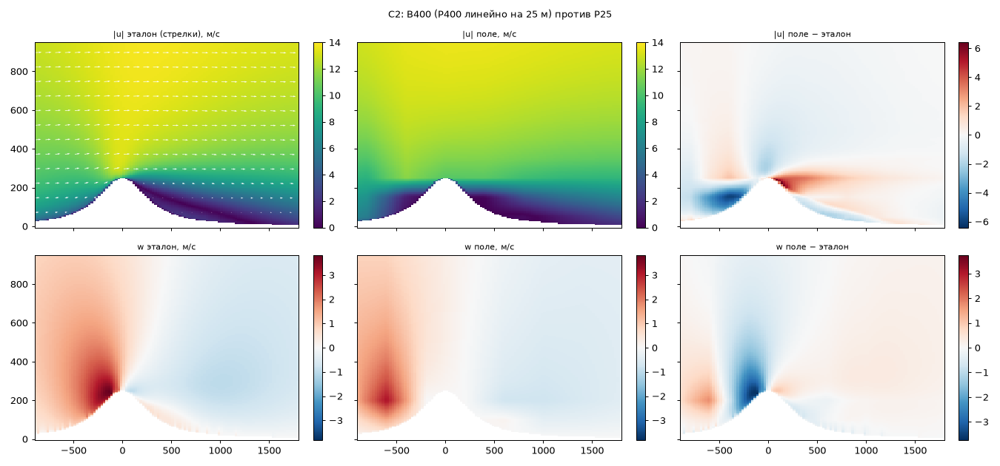
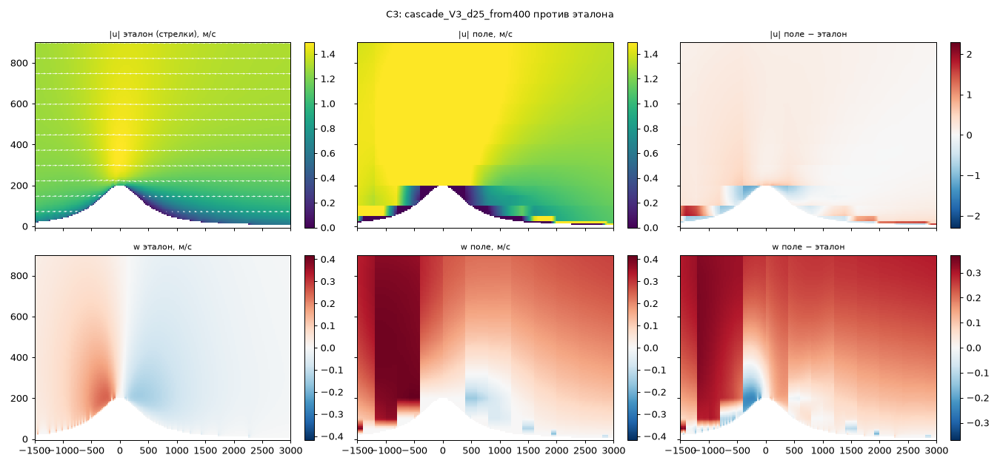
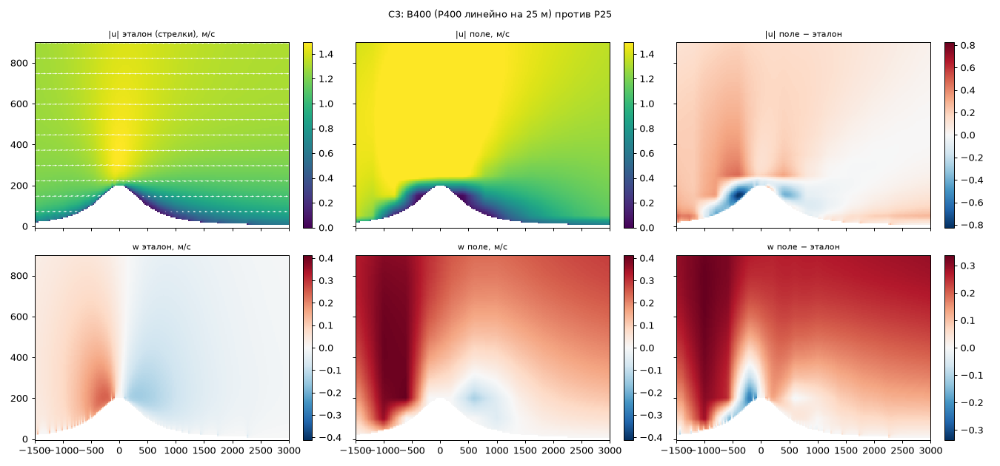

# cascade-2d

## Цель
Проверить, имеет ли смысл каскад по уровням (400→25 м) на квази-2D разрезе по сравнению с
эталоном Пикара 25 м. План и критерии — `docs/plan/cascade-2d.md`, форматы — `docs/contracts/cascade-2d.md`.

## Каталоги
- `contract/` — `cascade2d_io.py` (чтение/запись F1, F2, `div2d`, `rel_div`), `check_contract.py` (проверка F1/F2/M1), `test_contract.py`.
- `py` — обёртка Python с venv; `requirements.txt` — зависимости.
- `out/runs/<C>/` — копии записей прогонов F2 (в git); `out/metrics/<C>.{json,csv}` — метрики M1.
- `cases/`, `cascade_rs/`, `metrics/` — эталоны (CSD-1), каскад (CSD-3), метрики (CSD-2); `experiments/` — прогоны и разбор (CSD-4); `out/verdict.json`, `out/tables.md`, `out/levels.json`, `out/diag_*.json`, `out/fig/<C>/*.png`, `out/timing/` — итоги CSD-4.

## Данные
`$CASCADE2D_DATA` (по умолчанию `~/data/cascade_2d`): `cases/` (случаи R1), `fields/<C>/` (F1 и F2).

## Воспроизведение
```
tools/research/cascade_2d/py tools/research/cascade_2d/contract/test_contract.py
tools/research/cascade_2d/py tools/research/cascade_2d/contract/check_contract.py --selftest
tools/research/cascade_2d/py tools/research/cascade_2d/contract/check_contract.py $CASCADE2D_DATA/fields
```
venv создаётся при первом запуске (`CASCADE2D_VENV` переопределяет путь).

## Итог

**Вердикт: не имеет смысла** (`out/verdict.json`; критерии K0–K5 — `docs/plan/cascade-2d.md`, «Критерии», зафиксированы 2026-11-04 до опытов и не менялись; вариант V3, старт от P400; эталон P25).
Опыты прогнаны дважды: **«до исправления»** (наклон линейной реконструкции у стенки = 0; числа в `out/before/`) и **«после»** (односторонний наклон у стенки, см. «Исправление наклона»; числа в `out/`, во всех таблицах ниже, вердикт — по серии «после»). Вердикт в обеих сериях один.
Каскад дёшев (спуск 400 → 25 м ≈ 0,1 с, в 10⁻³…10⁻⁴ от времени P25), но на всех информативных случаях ошибка скорости больше, чем у простой линейной интерполяции грубого поля Пикара 400 м (B400),
а баланс массы держится только там, где родитель двумерен и нет «потерянных» граней.




| критерий | итог («после») | главные числа; в скобках «до» |
|---|---|---|
| K0 контроль (C0) | не выполнен | E_u 0,070 против B400 0,034 (+0,01 допуск) (0,078); ложный \|w\| 0,0014·U_ref — в норме (≤ 0,02) |
| K1 баланс | не выполнен | max rel_div при пороге 1e-5: C0 4,1e-6, C1 2,2e-5 (наследие родителя), C2 1,0 (потерянная грань V2+), C4 9,5e-6; C3 — по добавке к родителю (решение координатора): 0,078 (родитель не 2D) |
| K2 точность (C1, C2, C3) | не выполнен нигде | E_u V3 / B400: C1 0,236 / 0,178 (0,239); C2 0,230 / 0,179 (0,232); C3 0,312 / 0,183 (0,314); нужно ≤ 0,7·B400; C4 (справочно) 0,217 / 0,090 |
| K3 цена | время — выполнен; опрос — нет; память — условно | T_desc 0,093–0,101 с против 0,1·T(P25)/ny = 11…57 с; опрос 10 000 точек: 22,5–30,1 мкс холодный (порог 20), 5–6 мкс тёплый; RSS 201 МБ (V1 — 20 МБ) против 61 МБ |
| K4 Парето (по плану: B_k с T(P_k)/ny ≤ T_desc) | не выполнен | B400 (0,04–0,09 с на ряд ≤ T_desc 0,1 с) точнее на всех случаях; с учётом цены P400 (0,13–0,19 с) тоже |
| K5 сходимость | не выполнен | NaN нет; побитно 1 и 8 потоков (20 F1) и опрос точки — да; рост E_u за уровень до ×1,52 (C0), ×1,71 (C4); max\|u\|/P25 до ×2,0 (C3), ×3,35 (C4); старт P200 лучше P400 на всех случаях |

Правило вердикта: «не имеет» — если K1 не держится, или K2 не выполнен ни на одном случае, или K3 не выполнен ни в одном режиме. Сработали первые два условия.
K2 и K4 не выполнены независимо от толкования K1, так что вывод не зависит от спорных мест K1.

**Оговорки к K1.** (1) Порог 1e-5 строже, чем держит сам эталон: P25 на C1 даёт 1,2e-5 (T3), P50 — 2,4e-5; родитель P400 на C1 — 4,3e-5. Каскад передаёт дивергенцию родителя детям без изменений
(rel_div ∝ dx), поэтому на 200 м получает 2,2e-5 — наследие; добавка каскада на C1 6e-7. Сумма подграней равна грани родителя (тест `subfaces_sum_to_parent_face`, `cargo test` 11 из 11).
(2) C3: родитель P400 не двумерен (`y_uniform` 0,5, `cases/README.md`); по решению координатора оценивается добавка каскада к родителю — `max(0, rel_div_n − rel_div_родителя·dx_n/400)`: 0,078, не мала (V2 на C3 даёт дополнительную расходимость). (3) **Собственный отказ каскада — C2 при V2/V3/V3h**: одна «потерянная» грань
(родитель открыт, обе подграни на мелком уровне — земля), масса пропадает, дивергенция на 100 м доходит до 1,0·U_ref/dx (V0/V1 на C2 — 6e-7…1,2e-5, всё в порядке).

## Что делает каскад (простыми словами)

Берём грубое поле ветра P400 (клетки 400 × 100 м) и «режем» каждую клетку на четыре (200 × 50 м), потом ещё и ещё до 25 м. Ничего не решаем — только делим потоки.
Через каждую грань родителя идёт поток; делим его между двумя подгранями (по линейной реконструкции от соседей, V1). Внутренние грани четвёрки детей находим из баланса массы:
сколько втекло в ребёнка, столько вытекло. Остаётся одна свободная величина (циркуляция по кругу) — выбираем так, чтобы поле было как можно более гладким.
V2 добавляет рельеф мелкого уровня (подгрань в земле закрыта, весь поток уходит в открытую), V3 — Фруда и тепло, V3h — случайную болтанку. Так в любой точке 25 м
значение получается по цепочке клеток-предков (режим опроса), без поля целиком.

Что это даёт и чего не даёт: масса сохраняется точно, форма ступеней и рельефа появляется, но **нового физического содержания мельче родителя нет**. Давления и инерции нет, поэтому отрыв, ротор и волны
за гребнем — только то, что уже было в P400. А в сам поток каскад вносит ошибки.

## Исправление наклона у стенки (серия «после»)

Постановка координатора: у нижней клетки родителя (стенка снизу) наклон линейной реконструкции считался нулевым; заменить односторонним наклоном по двум внутренним граням с тем же ограничителем (minmod), без подстановки нуля.
Реализация — `cascade_rs/src/rules.rs: limited_slope` (для `slope_u` по z и `slope_w` по x; окружающие правила не менялись), тест `slope_at_a_wall_is_one_sided_not_zero` в `cargo test`;
прежнее правило включается `CASCADE_WALL_ZERO=1` (серия «до»). Остальные тесты, баланс (selftest 3,2e-7) и побитное совпадение режимов целы.

Эффект (V3, старт 400, E_u до → после): C0 0,078 → 0,070; C1 0,239 → 0,236; C2 0,232 → 0,230; C3 0,314 → 0,312; C4 0,223 → 0,217. Вердикт и все K прежние; изменился знак лишь у частностей (K5 на C0: рост за уровень ×1,43 → ×1,52 — порог 1,5 теперь превышен).
Исправление верное по замыслу, но почти ничего не даёт — ниже, почему.

## Механизм: откуда проигрыш и почему дело не в наклоне




1. **Приземный слой.** Ошибка сосредоточена в нижних 100 м (`out/diag_bands.json`, E_u в слое 0–100 м / 100–300 м, B400 → V3): C0 0,058 / 0,004 → 0,121 / 0,008; C1 0,27 / 0,10 → 0,37 / 0,12; C3 0,20 / 0,17 → 0,47 / 0,19; C4 0,13 / 0,06 → 0,35 / 0,09.
   Профиль C0 в колонне x = 0 (`out/diag_C0_profile.json`): P25 растёт от 3,4 м/с у земли до 5,4 на 40 м; B400 — почти так же (3,1 → 5,2: он тянет линию к нулевой скорости стенки); каскад до исправления держал 5,77 м/с на всех нижних 100 м, после — 5,59 → 5,93 (наклон ограничен
   минимумом из двух разностей 0,82 и 0,39 м/с на ячейку: профиль log-подобный, выпуклый, ограничитель срезает наклон) и скачок на 0,5 м/с на границе родительской клетки (100 м). Контроль (`out/diag_wall.json`, диагностика `CASCADE_WALL_NOLIMIT=1`: наклон = u − 0 без ограничителя):
   E_u хуже — C0 0,095, C1 0,255, C3 0,342 (V3) — перекос в обратную сторону. Значит, нужного профиля внутри приземной клетки 100 м из одного значения и соседей не восстановить, а сглаживание B400 — это сплошная линейная интерполяция между центрами клеток, а не кусочно-линейное деление.
2. **Нет информации мельче родителя.** r_w над склоном у V3 0,50 (C1) и 0,30 (C2) против 0,99 и 0,96 у B50 (шум эталона) и 0,53 / 0,30 у B400: вертикальную скорость над склоном каскад получает только из рельефа на балансе — не лучше интерполяции. L_rec в C2: 125 м против 1200 м у эталона (B400: 375 м).
3. **Потерянные грани и «карманы» (V2+).** Подграни в земле закрыты, поток уходит в оставшуюся: скорость растёт (C4: max\|u\| 3,35·P25; C1 1,36), E_u на C3/C4 растёт с 0,25/0,16 (V1) до 0,31/0,22 (V2). Воздух, который мелкая сетка считает воздухом, а P400 — землёй (стенка родителя при открытых подгранях, 116–324 грани на случай), остаётся
   неподвижным: на C4 в колонне входа x = −4800 м четыре нижние клетки (до 25 м) имеют u ≈ 0 при эталонных 2–4,6 м/с (проверено). V3 к V2 на E_u почти ничего не добавляет (Фруд срабатывает на C3 141 раз, тепло — 1).
4. **Стартовая ошибка не гасится.** E_u против P_k своего уровня уже на 200 м 0,03…0,23 и растёт ×1,0…1,7 за уровень (T6). Старт от P200 лучше старта от P400 на всех случаях (0,045 / 0,132 / 0,141 / 0,126 / 0,161), но хуже B200 на каждом (0,018 / 0,111 / 0,133 / 0,081 / 0,083).
5. **Термик (C3).** F_up = 854 против 83 у P25 (×10) и 852 у B400: поток наследуется от P400 (не двумерен и завышен), каскад копирует. w_max 0,418 против 0,244 (+70 %).
6. **ΔS на C4 (1,8 у каскада против 0,3 у B400): объяснено.** ΔS(25 м) = |S − S_эталон| считает S = U(25)/U_вх(25) − 1; в каскаде в колонне входа u(25 м) = 1,07 против 4,67 у P25 (карман из п. 3), поэтому S(25) = 5,7 против 0,59 и ΔS(25) ≈ 5,1 тянет среднее; ΔS(50) = 0,23, ΔS(100) = 0,08. Это проявление кармана, а не отдельный дефект метрики.
7. **Хеш V3h (справочно).** Среднее не сохраняется точно: СКО (среднее по 8 сидам − V3) ≈ 0,014–0,016·U_ref (C1–C4; 0,002 на C0); σ_u по 8 сидам на 25 / 100 / 300 м: C1 0,20 / 0,28 / 0,04 м/с, C2 0,19 / 0,39 / 0,02, C3 0,05 / 0,06 / 0,005, C4 0,22 / 0,24 / 0,05 (`out/diag_hash.json`).
   Сравнение с σ закрытия игры не делалось (нужен профиль замыкания по высоте; в вердикт не входит). E_u от хеша почти не меняется (0,229 против 0,236 на C1).

**Что ещё ограничивает, если наклон исправлен.** Каскад использует только значения родителя и мелкий рельеф: нет ни подсеточной физики (профиль пограничного слоя внутри клетки 100 м, подветренный отрыв, ротор), ни давления. Кусочно-линейное деление даёт разрывы на границах родителя, а мелкий рельеф при грубой стенке создаёт либо карман без потока, либо потерянную грань. Эти ограничения заложены в метод,
поэтому исправление наклона их не снимает; чтобы получить K2 (≤ 0,7·B400), нужна новая информация мельче родителя, а не лучшая реконструкция.

## Результаты («после»)

Картинки полей «V3 против P25» (6 панелей: |u| эталон / поле / разность, w эталон / поле / разность) и «B400 против P25»:








### T1. Точность на 25 м (СКО / U_ref в ROI), V3 против B400

| случай | E_ref (B50) | E_u B400 | E_u V3(400) | E_u V3(200) | E_w B400 | E_w V3(400) | E_u_lee B400→V3 | ΔS B400→V3 | r_w V3 |
|---|---|---|---|---|---|---|---|---|---|
| C0 | 0.010 | 0.034 | 0.070 | 0.045 | 2.6e-04 | 2.6e-04 | 0.033→0.070 | 0.022→0.022 | 0.83 |
| C1 | 0.031 | 0.178 | 0.236 | 0.132 | 0.057 | 0.065 | 0.173→0.188 | 0.140→0.131 | 0.50 |
| C2 | 0.036 | 0.179 | 0.230 | 0.141 | 0.098 | 0.113 | 0.117→0.143 | 0.140→0.207 | 0.30 |
| C3 | 0.031 | 0.183 | 0.312 | 0.126 | 0.123 | 0.132 | 0.097→0.220 | 0.058→0.045 | 0.86 |
| C4 | 0.032 | 0.090 | 0.217 | 0.161 | 0.050 | 0.046 | 0.076→0.159 | 0.305→1.806 | 0.74 |

### T2. Варианты на 25 м (E_u / E_w; старт 400 | старт 200)

| случай | V0 | V1 | V2 | V3 | V3h (сид 1) |
|---|---|---|---|---|---|
| C0 | 0.080/0.000 \| 0.053/0.000 | 0.070/0.000 \| 0.045/0.000 | 0.070/0.000 \| 0.045/0.000 | 0.070/0.000 \| 0.045/0.000 | 0.071/0.001 \| 0.046/0.001 |
| C1 | 0.227/0.066 \| 0.140/0.035 | 0.215/0.065 \| 0.134/0.035 | 0.236/0.065 \| 0.132/0.035 | 0.236/0.065 \| 0.132/0.035 | 0.229/0.067 \| 0.134/0.035 |
| C2 | 0.235/0.114 \| 0.154/0.063 | 0.226/0.113 \| 0.148/0.061 | 0.230/0.113 \| 0.141/0.061 | 0.230/0.113 \| 0.141/0.061 | 0.223/0.114 \| 0.142/0.062 |
| C3 | 0.252/0.132 \| 0.130/0.044 | 0.245/0.132 \| 0.126/0.043 | 0.312/0.132 \| 0.126/0.043 | 0.312/0.132 \| 0.126/0.043 | 0.308/0.133 \| 0.128/0.043 |
| C4 | 0.169/0.049 \| 0.106/0.044 | 0.159/0.047 \| 0.096/0.042 | 0.217/0.046 \| 0.161/0.041 | 0.217/0.046 \| 0.161/0.041 | 0.213/0.047 \| 0.161/0.042 |

### T3. Баланс (K1), V3 от 400

| случай | max rel_div по уровням | 200 | 100 | 50 | 25 | P400 (родитель) | P25 (эталон) | lost_flux | стенка родителя / подграни открыты |
|---|---|---|---|---|---|---|---|---|---|
| C0 | 4.1e-06 | 4.1e-06 | 2.1e-06 | 1.1e-06 | 5.7e-07 | 8.0e-06 | 1.6e-05 | 0 | 0 |
| C1 | 2.2e-05 | 2.2e-05 | 1.1e-05 | 5.5e-06 | 3.3e-06 | 4.3e-05 | 1.2e-05 | 0 | 132 |
| C2 | 1.0e+00 | 6.8e-07 | 1.0e+00 | 6.7e-01 | 4.5e-01 | 1.2e-06 | 8.1e-06 | 1 | 116 |
| C3 | 1.9e-01 | 1.9e-01 | 1.4e-01 | 7.6e-02 | 3.8e-02 | 2.6e-01 | 9.6e-05 | 0 | 132 |
| C4 | 9.5e-06 | 9.5e-06 | 5.9e-06 | 3.4e-06 | 2.7e-06 | 1.9e-05 | 1.4e-05 | 0 | 324 |

### T4. Цена (K3), V3, один поток

| случай | T_desc, с (медиана 10) | T(P25)/ny, с | отношение | RSS V3, МБ | RSS V1, МБ | поля, МБ | P25 RSS/ряд, МБ | опрос холодный, мкс | тёплый, мкс |
|---|---|---|---|---|---|---|---|---|---|
| C0 | 0.096 | 108 | 8.9e-04 | 201 | 19 | 4.9 | 123 | 24.5 | 5.3 |
| C1 | 0.097 | 524 | 1.8e-04 | 201 | 21 | 4.9 | 123 | 22.7 | 5.5 |
| C2 | 0.101 | 556 | 1.8e-04 | 201 | 20 | 4.9 | 123 | 30.1 | 5.9 |
| C3 | 0.099 | 254 | 3.9e-04 | 201 | 19 | 4.9 | 123 | 22.5 | 5.6 |
| C4 | 0.093 | 569 | 1.6e-04 | 201 | 21 | 4.9 | 123 | 23.7 | 5.2 |

### T5. Парето (K4): B_k и стоимость, c на ряд

| случай | T(P400)+T_desc | B400: T, E_u | B200: T, E_u | B100: T, E_u | B50: T, E_u | E_u V3 |
|---|---|---|---|---|---|---|
| C0 | 0.13 | 0.04, 0.034 | 0.19, 0.018 | 1.30, 0.013 | 11.76, 0.010 | 0.070 |
| C1 | 0.15 | 0.06, 0.178 | 0.61, 0.111 | 4.88, 0.056 | 61.49, 0.031 | 0.236 |
| C2 | 0.19 | 0.09, 0.179 | 0.53, 0.133 | 5.40, 0.073 | 65.67, 0.036 | 0.230 |
| C3 | 0.14 | 0.04, 0.183 | 0.16, 0.081 | 2.41, 0.045 | 24.08, 0.031 | 0.312 |
| C4 | 0.15 | 0.06, 0.090 | 0.66, 0.083 | 6.09, 0.062 | 70.34, 0.032 | 0.217 |

### T6. Сходимость (K5), V3 от 400: E_u против P_k своего уровня

| случай | 200 | 100 | 50 | 25 | рост за уровень | max\|u\|/max\|u\|(P25) | 1 и 8 потоков | старт 200 / 400 (E_u) |
|---|---|---|---|---|---|---|---|---|
| C0 | 0.033 | 0.050 | 0.061 | 0.070 | 1.52, 1.23, 1.15 | 1.00 | побитно (20 файлов) | 0.045 / 0.070 |
| C1 | 0.146 | 0.209 | 0.221 | 0.236 | 1.44, 1.06, 1.06 | 1.36 | побитно (20 файлов) | 0.132 / 0.236 |
| C2 | 0.155 | 0.221 | 0.227 | 0.230 | 1.42, 1.03, 1.01 | 1.23 | побитно (20 файлов) | 0.141 / 0.230 |
| C3 | 0.231 | 0.299 | 0.304 | 0.312 | 1.29, 1.02, 1.03 | 2.00 | побитно (20 файлов) | 0.126 / 0.312 |
| C4 | 0.117 | 0.201 | 0.199 | 0.217 | 1.71, 0.99, 1.09 | 3.35 | побитно (20 файлов) | 0.161 / 0.217 |

### T7. Термик C3: V3 против эталона и B400

| | w_max, м/с | F_up, м²/с |
|---|---|---|
| P25 | 0.244 | 83.2 |
| B400 | 0.413 | 851.6 |
| V3 (400) | 0.418 | 853.9 |

Числа серии «до исправления» — `out/before/` (metrics, runs, verdict.json, tables.md, levels.json, diag_*, fig, timing); воспроизводятся прогоном с `CASCADE_WALL_ZERO=1` на коммите до правки.

## Допущения и границы применимости
- Квази-2D срез (ny = 4, зеркальные края); три случая синтетические, C4 — разрез Аскарово без 3D-рельефа и леса. Эталон — Пикар 25 м; сам он отличается от P50 на E_u 0,01–0,036 (E_ref), различия меньше ~0,03 не значимы.
- **P200 как старт:** сетки CSD-1 (nz = 26, 52, 102, …) не удовлетворяют требованию каскада «ребёнок = 2·nz_родителя − 1 строк»; для старта от 200 м верхняя строка P200 срезается (`experiments/trim_p200.py`, z ≈ 2,5 км, губка, дивергенция остальных клеток не меняется; решение координатора 2026-11-04). Старт от P400 без изменений.
- Сравнение на сетке P25: поле каскада nz = 401 против 402 у эталона приводится билинейно (`to_ref_grid`); верхняя строка вне ROI.
- C3: родители P400, P200, P100 не двумерны (`y_uniform` 0,50 / 0,15 / 0,035) — оценка термика искажена; K1 по добавке; вывод «не имеет» не зависит (K2 не выполнен и на C1, C2).
- Время и память: один поток, под замком cpu (cgroup 100 %); T_desc — медиана 10 повторов (`out/timing/`), включает чтение геометрии случая R1 с диска; RSS V3 = 201 МБ — по-видимому, в основном 98 МБ 3D-файла случая 25 м (читается целиком ради среднего ряда); в игре геометрию давал бы рельеф, а поля занимают 4,9 МБ (V1, где геометрия не читается, — 20 МБ). K3 по памяти условен. Опрос точки холодный — цепочка предков с нуля (10 000 точек, один поток), разница с полем 0.
- Спуск от P200 — по тому же коду; V3h — 8 сидов (сид 1 в основном каталоге, 2–8 в `fields_seeds/`); опрос 10 000 точек.
- Параметры правил V3 (`Fr_c = 1`, `c_h`, `θ_s`, `δ₀`, λ) не подбирались; чувствительность не исследована: вариант отстаёт не из-за них (V1 без них такой же).
- Диагностический режим `CASCADE_WALL_NOLIMIT` — только для объяснения механизма, в вердикт не входит.

## Неизвестное
- Сравнение σ V3h с замыканием игры (нужен профиль замыкания).
- Точность на трёхмерном рельефе, других U10 и N, ширина по y не варьировалась.
- Даст ли каскаду выигрыш, если родитель — не Пикар 400 м, а поле другого типа (например, с подсеточным профилем у земли), не проверялось.

## Воспроизведение (CSD-4)
Предпосылки: данные `$CASCADE2D_DATA` (`cases/README.md`), крейт каскада собран (`cargo build --release --manifest-path tools/research/cascade_2d/cascade_rs/Cargo.toml` под `.dpcli/dpcli lock cpu`).
```
.dpcli/dpcli lock cpu csd4-run -- tools/research/cascade_2d/py tools/research/cascade_2d/experiments/run_all.py   # вся пачка (~3 мин): P200 без верхней строки, спуски, опрос, сиды, потоки, метрики, вердикт, таблицы, разбор, картинки
tools/research/cascade_2d/py tools/research/cascade_2d/experiments/run_all.py --skip-run                            # только пересчёт после спусков
tools/research/cascade_2d/py tools/research/cascade_2d/experiments/diag_wall.py                                     # диагностика наклона у земли
CASCADE_WALL_ZERO=1 ...  # серия «до исправления» (прежнее правило наклона)
```
Поля каскада (~12 МБ на случай и вариант) — только в `$CASCADE2D_DATA`, в git — F2, M1, таблицы, json, картинки. Лицензии: код MIT; данных нет (синтетика), C4 — Copernicus GLO-30 через `detail.webp` игры (см. `cases/README.md`, `ASSETS.md`).

## Источники
Balsara 2001 (J. Comput. Phys. 174), Tóth & Roe 2002 (J. Comput. Phys. 180) — правило деления; `docs/research/air_phase_results.md`, `docs/guide/air-model/turbulence.md`, `docs/guide/air-model/limits.md` — пороги и замыкание.
